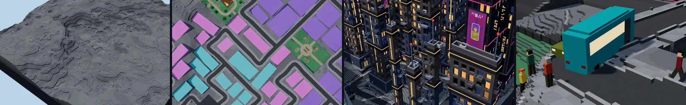
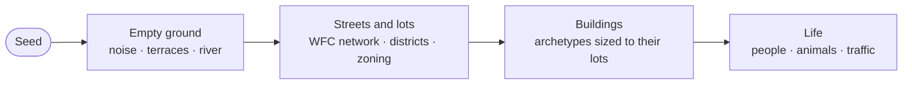
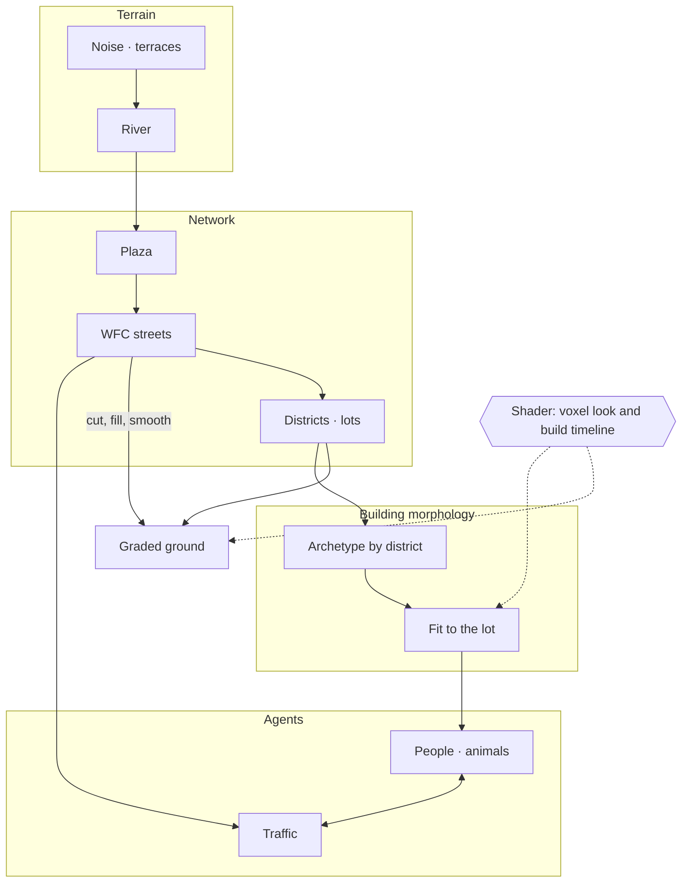

# Blueprint City

> **From empty ground to a working city: built layer by layer, then brought to life by people and traffic.**

A procedural voxel city for **Procedural World Building** at Cornell Tech (Fall 2026). Every
island is grown from a seed by rules, not by hand: the ground is printed, the streets are paved
outward from a plaza, the buildings rise storey by storey, and then people, pigeons, cats and
traffic move in.

- **Live site:** [procedural-worlds-d79be.web.app/world](https://procedural-worlds-d79be.web.app/world)
(try `/world?seed=blueprint`) 

- **Development log:** [site/src/world/README.md](site/src/world/README.md)

## Outline

1. [Concept](#1-concept)
2. [Technique](#2-technique): [Terrain](docs/techniques/terrain.md) · [Shader](docs/techniques/shader.md) · [Agents](docs/techniques/agents.md) · [Building morphology](docs/techniques/building-morphology.md) · [Network](docs/techniques/network.md)
3. [Process log](#3-process-log)
4. [Class notes and studios](#4-class-notes-and-studios)

Also: [Repository structure](#repository-structure) · [Firebase](#firebase-accounts-and-saved-configurations) · [Getting started](#getting-started)

---

## 1. Concept

Blueprint City takes the miniature voxel-diorama look of *Town to City* and turns it toward a
neon cyberpunk night. It is a compact, terraced island city of dark concrete, lit windows and
signs, where the interest is in **watching the rules work**: the timeline replays the whole city
being made, and once it is finished, it is lived in.



Full concept, references and the growth idea: **[docs/concept.md](docs/concept.md)**.

### Related analysis

| Document                                                                                                               | What it covers                                                                             |
| ---------------------------------------------------------------------------------------------------------------------- | ------------------------------------------------------------------------------------------ |
| [Town to City: building & terrain mechanics](<docs/analysis/Town to City — Building & Terrain Mechanics Breakdown.md>) | How the reference game handles terraforming, roads, placement and props                    |
| [Cozy "off-grid" builders](docs/analysis/cozy-builders-research.md)                                                    | Townscaper, Town to City and Tiny Glade compared                                           |
| [Week 9 feedback](docs/analysis/week09-feedback.md)                                                                    | Inspecting agents and buildings (state, trajectory), camera presets, and this README's structure |


---

## 2. Technique

Five kinds of technique make the city. Each has its own page with a diagram, screenshots, the
code it lives in and the log entries behind it.

| | Technique | What it does |
|---|---|---|
|  | **[Terrain](docs/techniques/terrain.md)** | Noise, slope-scaled terraces and a river on 0.25 m voxels (928 × 928 columns); streets cut and fill, blocks are smoothed between them, lots are graded flat |
|  | **[Shader](docs/techniques/shader.md)** | The voxel look on merged faces, data-texture overlays, and the build timeline: terrain printed, streets paved, buildings raised storey by storey, with nothing rebuilt per frame |
|  | **[Agents](docs/techniques/agents.md)** | People driven by needs on flow fields, boid pigeons, cats with a cone of vision, and traffic that yields to people, stops at bus shelters and picks up fares |
|  | **[Building morphology](docs/techniques/building-morphology.md)** | Eleven cyberpunk archetypes built from reusable parts, picked by district and sized to their lots |
|  | **[Network](docs/techniques/network.md)** | A street network by wave function collapse, districts and lots zoned along it, and the walking and lane graphs the agents move on |

How they fit together, in the order the city is made:



---

## 3. Process log

The full dated log with every screenshot is in
**[site/src/world/README.md](site/src/world/README.md)**. The milestones:

| Date          | Milestone                                                                                                                            |
| ------------- | ------------------------------------------------------------------------------------------------------------------------------------ |
| 2026-10-07    | **Version 1, then a restart.** A complete 14-stage pipeline (`bd582ca`), taken back to an empty diorama and rebuilt on 0.25 m voxels |
| 2026-10-08    | **River and claims.** A river valley from Week 5's splines, and a claim map so each stage keeps off land earlier stages use          |
| 2026-10-09    | **Streets by wave function collapse**, districts and lots                                                                            |
| 2026-10-12    | **Districts like Cities: Skylines**, parks on their own layer                                                                        |
| 2026-10-12/13 | **The building library**: eleven archetypes, four redesigned from real references                                                    |
| 2026-10-14    | **The build timeline** replays the city in the order it is made; buildings placed on the lots                                        |
| 2026-10-26    | **Buildings are built storey by storey**, under scaffolding                                                                          |
| 2026-10-27    | **Landscaped parks**; **inhabitants** (people, pigeons, cats); one concrete city                                                     |
| 2026-10-28    | **Traffic** (cars, vans, taxis, buses); **smoothed blocks** and graded lots; small lots merged and gaps filled                       |

| Version 1, rainy night (Oct 7) | Districts and parks (Oct 12) |
|---|---|
|  |  |

| The city with its buildings (Oct 28) | People and traffic (Oct 28) |
|---|---|
|  |  |

Plans: [terrain plan](docs/plans/terrain-plan.md) · [town plan](docs/plans/town-plan.md) · [shader studio plan](docs/plans/shader-studio-plan.md)

---

## 4. Class notes and studios

### Studios

Each week's in-class workshop is its own tab on the site, with a README study notebook and
screenshots in its folder. (Week 2 was built first, on 2026-09-10; folder numbers follow the
syllabus.)

| Week | Studio | |
|---|---|---|
| 1 | **[Three.js Basics](site/src/weeks/week01-threejs-basics/README.md)**: primitive geometries, materials and light types with shadows |  |
| 2 | **[Noise Grid & Hydraulic Erosion](site/src/weeks/week02-noise-grid/README.md)**: a noise stack and shaping curves on a 2D/3D terrain, with seeded droplet erosion on a timeline |  |
| 3 | **[Voxels & Volumes](site/src/weeks/week03-voxels-volumes/README.md)**: voxel resolution, implicit surfaces, CSG with SDF booleans, and five mesh-generation methods compared |  |
| 4 | **[Shader Studio](site/src/weeks/week04-shaders/README.md)**: one technique at a time (ripple with contact foam, matcap, cel, fresnel, fog and more) on a calm scene |  |
| 5 | **[Scatter & Paths](site/src/weeks/week05-scatter-paths/README.md)**: scatter layers with rules, spline roads and rivers, rain and wind on a curl-noise field |  |

### Class notes

- [Noise & Maps](docs/notes/noise-and-maps-notes.md)
- [Shaders](docs/notes/shaders-notes.md): the graphics pipeline, shader languages and techniques
- [Distributions, Paths & Vector Fields](docs/notes/distribution-and-paths-notes.md)

### Tutorials

- [Installing React (with terminal basics)](docs/tutorial/react-install-tutorial.md)
- [Installing Three.js](docs/tutorial/threejs-install-tutorial.md)
- [Git & GitHub](docs/tutorial/git-github-tutorial.md)
- [Firebase: Hosting and Firestore](docs/tutorial/firebase-tutorial.md)

The course's shared studio and reference materials live in the instructor's repository:
[jomasan/Procedural-World-Building](https://github.com/jomasan/Procedural-World-Building).

---

## Repository structure

```text
Procedure-World-Building/
├── README.md                ← you are here
├── docs/
│   ├── concept.md           ← the project concept
│   ├── techniques/          ← one page per technique (terrain, shader, agents, buildings, network)
│   ├── analysis/            ← feedback and research notes
│   ├── plans/               ← build plans
│   ├── notes/               ← class notes
│   ├── tutorial/            ← setup guides
│   └── images/              ← banner and reference images
└── site/                    ← the React + TypeScript + Three.js site
    ├── STYLE_GUIDE.md       ← shared visual style
    └── src/
        ├── components/      ← UI shared by all pages
        ├── world/           ← Blueprint City (route /world) and its development log
        │   ├── terrain/     ← one file per pipeline stage
        │   ├── buildings/   ← the building library (route /buildings)
        │   ├── city/        ← parks and building placement
        │   ├── life/        ← people, animals and traffic
        │   ├── render/      ← three.js view and shaders
        │   └── screenshots/
        └── weeks/           ← one folder per weekly studio
```

## Firebase: accounts and saved configurations

The live site uses Firebase for sign-in and per-user saved settings
([walkthrough](docs/tutorial/firebase-tutorial.md)):

- **Authentication:** "Sign in with Google" in the top bar.
- **Firestore:** **Configurations** saves the current page's settings to your account
  (`users/{uid}/configs`) and loads them back on any device; security rules
  ([`site/firestore.rules`](site/firestore.rules)) let each user reach only their own data.
- **Hosting:** deployed to [procedural-worlds-d79be.web.app](https://procedural-worlds-d79be.web.app).
- **Storage:** not used (the free Spark plan can't create a bucket), so each save's thumbnail is a
  small JPEG in its Firestore document.

Code: [`site/src/firebase/`](site/src/firebase) and [`site/src/components/AccountMenu.tsx`](site/src/components/AccountMenu.tsx).

## Getting started

```bash
cd site
npm install
npm run dev
```

Then open the printed `localhost` URL and go to `/world`. New weekly studios are added as a folder
under `site/src/weeks/` registered in [`site/src/weeks/registry.ts`](site/src/weeks/registry.ts).
