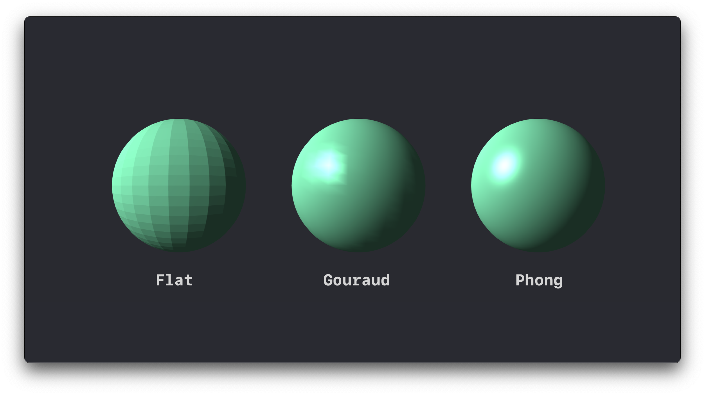
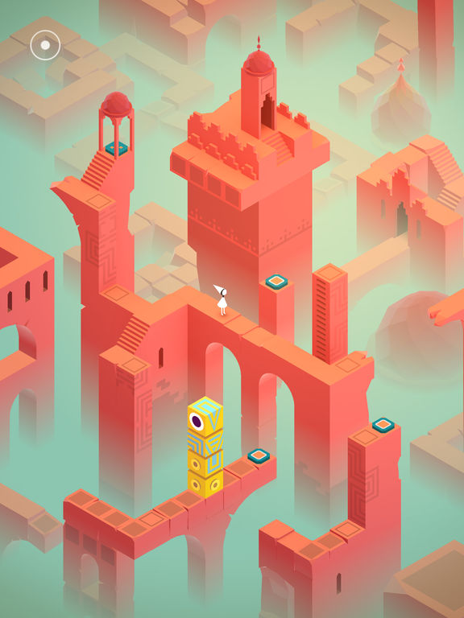
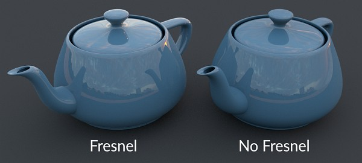
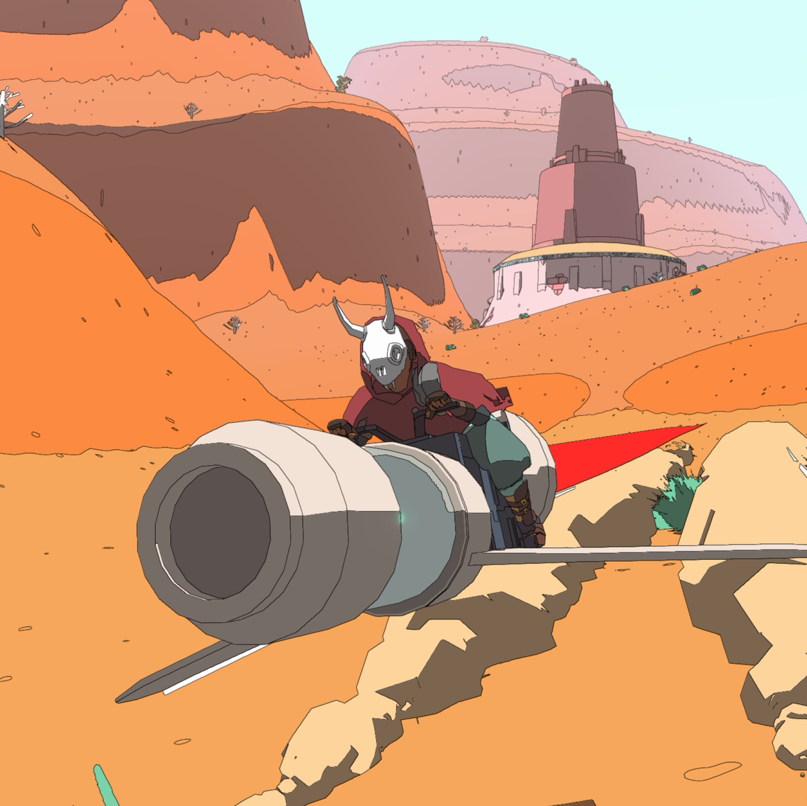
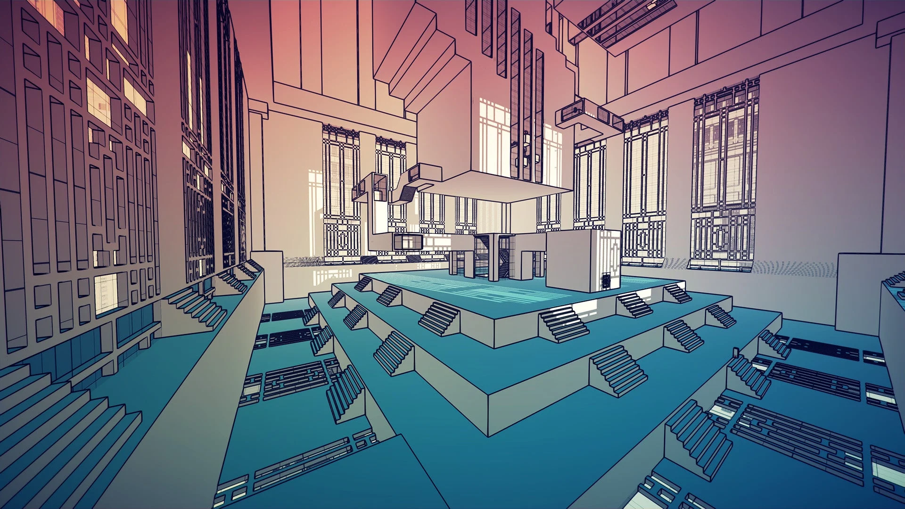
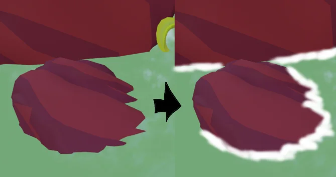

# Shaders — Class Notes

[← Back to the main README](../../README.md)

Notes from Week 4 (Class 05). The lecture introduced what a shader is, then walked through a
gallery of shader techniques used in games, then pointed at tools for designing shaders. It
ended with Assignment 2. Code below is written for **Three.js `ShaderMaterial`** (GLSL), since
that is what this project's site uses.

## 1. What Is a Shader?

A shader is a **small program that runs on the GPU**. It runs once per vertex or once per
pixel, all of them in parallel, and each run has no memory of the others. You write the rule
for *one* element and the GPU applies it millions of times at once.

```
you write:   color = f(this pixel's inputs)
GPU does:    for every pixel on screen, at the same time → f(...)
```

**Key idea:** a shader cannot ask "what color is my neighbour?" or "what did I output last
frame?". Everything it needs has to arrive as an input. That constraint is what makes it
fast, and it shapes how every technique below is built: each effect is a formula of position,
normal, view direction, distance or time.

## 2. The Graphics Pipeline

```
{ vertices } → vertex shader → shape assembly → geometry shader
                                                      ↓
     tests & blending ← fragment shader ← rasterization
```

| Stage | What happens                                                                      | Programmable? |
|---|---|---|
| **Vertex shader** | Runs once per vertex. Decides where the vertex lands on screen.                   | Yes |
| Shape assembly | Connects vertices into triangles.                                                 | No |
| Geometry shader | Can add or remove primitives. Not available in WebGL.                             | (Yes, outside WebGL) |
| Rasterization | Finds which pixels each triangle covers. Each covered pixel becomes a *fragment*. | No |
| **Fragment shader** | Runs once per fragment. Outputs its color.                                        | Yes |
| Tests & blending | Depth test (is something in front?), transparency blending.                       | No (configured, not coded) |

The two stages you write are the **vertex shader** and the **fragment shader**:

- **Vertex shader:** its required job is to output `gl_Position`, the vertex's position on
  screen. It can also *move* vertices (displacement, wobble, pop-in) and pass values on to
  the fragment stage.
- **Fragment shader:** its job is to output a color (`gl_FragColor`).

### How data gets in

| Kind | Changes per… | Example | Declared as |
|---|---|---|---|
| **Attribute** | vertex | `position`, `normal`, `uv` | `attribute` (Three.js declares the built-ins for you) |
| **Uniform** | draw call (same for every vertex/pixel) | `uTime`, `uColor`, `uFogDensity` | `uniform` |
| **Varying** | vertex → fragment | `vWorldPos`, `vNormal` | `varying` in both shaders |

A varying is written once per vertex and **interpolated across the triangle** before the
fragment shader reads it. That is why a color set per vertex blends smoothly across a face.

### Minimal Three.js shader

```ts
const material = new THREE.ShaderMaterial({
  uniforms: { uColor: { value: new THREE.Color('#22d3ee') } },
  vertexShader: /* glsl */ `
    varying vec3 vWorldPos;
    varying vec3 vWorldNormal;
    void main() {
      vec4 world = modelMatrix * vec4(position, 1.0);
      vWorldPos = world.xyz;
      vWorldNormal = normalize(mat3(modelMatrix) * normal); // fine for uniform scale
      gl_Position = projectionMatrix * viewMatrix * world;
    }
  `,
  fragmentShader: /* glsl */ `
    uniform vec3 uColor;
    void main() {
      gl_FragColor = vec4(uColor, 1.0);
    }
  `,
});
```

Three.js injects these for free in a `ShaderMaterial`: the matrices `modelMatrix`,
`viewMatrix`, `projectionMatrix`, `modelViewMatrix` and `normalMatrix`, the uniform
`cameraPosition`, and the attributes `position`, `normal` and `uv`. `RawShaderMaterial`
injects nothing. To tweak one of Three's *built-in* materials instead of writing from scratch,
use `material.onBeforeCompile` and string-replace parts of its shader.

## 3. Shader Languages

| Language | Used by |
|---|---|
| **GLSL** | OpenGL, WebGL, Vulkan. The common language of tutorials and Shadertoy. **Three.js uses this.** |
| **HLSL** | DirectX, Unity, Unreal. |
| **MSL** | Metal, on Apple platforms. |
| **WGSL** | WebGPU, the web's newer standard. (Three.js's WebGPU renderer uses it through TSL.) |
| **SPIR-V** | Not written by hand: the compiled binary format the others can target. |
| **Slang** | A newer open language that compiles to all of the above. |

## 4. Shader Techniques

| Technique           | Driven by                 | Core formula (GLSL)                                       | Seen in                |
| ------------------- | ------------------------- | --------------------------------------------------------- | ---------------------- |
| Flat / uniform      | a uniform                 | `color = uColor`                                          | LearnOpenGL cubes      |
| Position gradient   | world or local position   | `mix(a, b, remap(pos.y))`                                 | Monument Valley        |
| Slope gradient      | surface normal            | `mix(grass, rock, 1.0 - n.y)`                             | terrain slope maps     |
| Fake AO by height   | position                  | `mix(dark, light, smoothstep(0.0, h, pos.y))`             | Blender node setup     |
| Distance fog        | distance to camera        | `mix(color, fog, 1.0 - exp(-d * density))`                | Islands: Non-Places    |
| Fresnel rim         | normal · view direction   | `pow(1.0 - dot(N, V), p)`                                 | Unity Shader Graph     |
| Matcap              | view-space normal         | `texture2D(matcap, vN.xy * 0.5 + 0.5)`                    | ZBrush / Blender       |
| Cel / toon          | light · normal, quantized | `floor(ndl * bands) / bands`                              | Sable, Manifold Garden |
| Contact shader      | depth difference          | `foam = 1.0 - smoothstep(0.0, w, sceneDepth - surfDepth)` | stylised water         |
| Vertex displacement | position, time            | `pos += normal * amp * sin(...)`                          | ripples, object pop-in |

### 4.1 Flat shading (uniform color)

**The simplest shader:** every fragment of the object gets the same color from a uniform. There
is no lighting, so a cube reads as a flat silhouette. Useful as the baseline to compare the
others against, and as a debug view.



### 4.2 Gradients by position: world vs. local

Remap a position coordinate to `0..1` and use it to blend colors.

```glsl
float t = clamp((vWorldPos.y - uMinY) / (uMaxY - uMinY), 0.0, 1.0);
vec3 color = mix(uBottomColor, uTopColor, t);
```

- **Local (object) position** (`position` before `modelMatrix`): the gradient is glued to the
  object. Move or rotate it and the gradient travels with it.
- **World position** (`modelMatrix * position`): the gradient is glued to the *world*. Move
  the object and it slides through the colors. **Monument Valley** uses this for the soft
  height fog that fades the bottoms of its towers into the background color.

> the same color ramp applied in two spaces can sometime gives two different reads of the same shapes.



### 4.3 Gradients by slope

Color by how steep the surface is, from its normal. For a world-space normal `n`, `n.y` is
`1` on flat ground and `0` on a vertical wall.

```glsl
float steep = 1.0 - clamp(vWorldNormal.y, 0.0, 1.0);  // 0 flat, 1 vertical
float rock  = smoothstep(0.35, 0.55, steep);           // soft transition band
vec3 color  = mix(uGrass, uRock, rock);
```

This is how terrain gets grass on plateaus and bare rock on cliffs without anyone painting it.
The lecture showed both the debug view (flat-colored bands) and the textured result.

> Note: the map with the **0 to 360 deg** color legend is most likely showing **aspect** (which
> compass direction a slope faces), not steepness, since steepness only goes from 0 to 90 deg.
> Aspect is `atan(n.z, n.x)`. It is another useful input, e.g. for snow on north-facing slopes.

### 4.4 Interpolation: shaping the gradient

A gradient does not have to be linear. Passing `t` through a curve before `mix` changes where
the color changes and how sharply. These are the same shaping functions as the Noise & Maps
notes, applied to color instead of height.

| Curve | GLSL | Shape |
|---|---|---|
| Linear | `t` | Even blend |
| Smoothstep | `smoothstep(0.1, 0.9, t)` | Eases in and out; flat at both ends |
| Expo | `pow(t, 5.0)` | Stays low, then shoots up |
| Impulse | `k*t * exp(1.0 - k*t)` | Fast rise, slow decay (a "hit") |
| Cubic pulse | `1 - x*x*(3-2x)` with `x = abs(t-c)/w` (0 outside) | A soft bump centred at `c`, width `w` |
| Exp step | `exp(-k * pow(t, n))` | Smooth fall-off from 1 to 0 |
| Parabola | `pow(4.0*t*(1.0-t), k)` | 0 at both ends, 1 in the middle |
| Power curve | `K * pow(t,a) * pow(1-t,b)` | Asymmetric bump, peak moved by `a`/`b` |
| Bezier | quadratic / cubic Bezier through control points | Hand-drawn curve, like an easing editor |

`smoothstep(e0, e1, x)` is worth memorizing:
`t = clamp((x - e0) / (e1 - e0), 0, 1); return t * t * (3 - 2 * t);`

The lecture's `plot()` helper is a good debugging trick: draw the curve itself as a thin
green line on top of the gradient it produces (from *[The Book of Shaders](https://thebookofshaders.com/)*, Shaping Functions
chapter).

### 4.5 Distance-driven fog

Fade to a fog color based on how far the fragment is from the camera.

```glsl
float d   = length(vWorldPos - cameraPosition);
float fog = 1.0 - exp(-d * uFogDensity);        // exponential fog
vec3 col  = mix(baseColor, uFogColor, fog);
```

*Islands: Non-Places* uses this almost as its whole art style: flat colors, strong fog in
one hue, and only a few emissive objects (lamps, signs) that stay bright through it. Emissive
parts can skip or reduce fog so they glow. Three.js also has built-in `scene.fog`
(`Fog` linear, `FogExp2` exponential) that its standard materials respect; a custom
`ShaderMaterial` must set `fog: true` and include Three's fog chunks, or do it by hand as above.

### 4.6 Fresnel (rim glow)

Surfaces seen edge-on reflect more. In shader terms: the more the normal points *away* from
the camera, the brighter the rim.

```glsl
vec3 V = normalize(cameraPosition - vWorldPos);
vec3 N = normalize(vWorldNormal);
float fresnel = pow(1.0 - clamp(dot(N, V), 0.0, 1.0), uPower);
vec3 col = mix(baseColor, uRimColor, fresnel);
```

`uPower` controls rim thickness: higher power means a thinner, sharper rim. Good for glass, force fields, holograms and neon outlines.



### 4.7 Matcap

A **material capture** is a picture of a lit sphere. The shader looks up each fragment's
color in that picture using its view-space normal:

```glsl
vec2 uv = normalize(vViewNormal).xy * 0.5 + 0.5;
vec3 col = texture2D(uMatcap, uv).rgb;
```

All lighting and reflection are baked into the image, so one texture lookup gives clay, wax,
metal or glass looks with no lights in the scene. **The trade-off:** the lighting follows the
camera, not the world. Three.js has it built in as `MeshMatcapMaterial`.

### 4.8 Cel / toon shading

Take normal diffuse lighting and **quantize** it into a few flat bands.

```glsl
float ndl  = max(dot(N, normalize(uLightDir)), 0.0);
float band = floor(ndl * uBands) / uBands;       // 4 bands, 7 bands, …
vec3 col   = baseColor * mix(0.35, 1.0, band);   // keep shadows from going black
```

Normal shading vs. 4-band vs. 7-band spheres show the idea: fewer bands mean a more graphic
look. Games like *Sable* and *Manifold Garden* pair banded or flat shading with **outlines**.
Outlines are a separate pass, commonly an inverted hull (render the mesh again, slightly
inflated along its normals, back faces only, in black) or an edge-detection post-process on
depth and normals. Three.js has `MeshToonMaterial` (bands from a gradient texture).



### 4.9 Contact shaders (foam lines)

A white line where an object meets water. The water's fragment shader asks: *how far behind
me is the next solid surface?* If the gap is small, draw foam.



```glsl
// sceneDepth: linear depth of opaque geometry at this pixel (from a depth texture)
// surfDepth:  linear depth of the water surface fragment itself
float gap  = sceneDepth - surfDepth;
float foam = 1.0 - smoothstep(0.0, uFoamWidth, gap);
col = mix(col, vec3(1.0), foam);
```

In Three.js this needs the opaque scene rendered first into a `WebGLRenderTarget` with a
`DepthTexture`, then linearized in the water shader.

**Shortcut for heightmap terrain:** if the ground is a heightmap (as in this project), the
water shader can sample the terrain height at its own XZ position instead of a depth texture:
`gap = waterY - terrainHeight(xz)`. It is cheaper and does not depend on the camera.

Lecture layered it up in steps:

1. **Contact only:** a clean, even white ring around each object.
2. **+ vertex deformation:** the water surface moves, so the ring moves with it.
3. **+ noise:** break the foam threshold with noise (`foam > noise(xz * f + time)`) so the ring
   becomes broken, bubbly foam instead of a clean line.

### 4.10 Vertex displacement

Move vertices in the vertex shader before projecting them.

**Surface ripple:**

```glsl
vec3 p = position;
float wave = sin(p.x * uFreq + uTime * uSpeed) * cos(p.z * uFreq + uTime * uSpeed);
p.y += wave * uAmp;
gl_Position = projectionMatrix * modelViewMatrix * vec4(p, 1.0);
```

**Object pop-in:** scale an object from its base when it appears, with an overshoot easing so
it "bounces" into place:

```glsl
float t = clamp((uTime - uSpawnTime) / uDuration, 0.0, 1.0);
float c = 1.70158;                                  // easeOutBack
float s = 1.0 + (c + 1.0) * pow(t - 1.0, 3.0) + c * pow(t - 1.0, 2.0);
vec3 p = position * s;
```

Displacement only changes positions. If lighting should respond to the new shape, the
normals must be recomputed too (analytically, or by displacing two nearby points and taking
a cross product).

## 5. Tools for Designing Shaders

| Tool | What it is | Good for                                                    |
|---|---|---|
| **Shadertoy** (shadertoy.com) | Browser editor for full-screen fragment shaders, with a huge public gallery | Learning fragment tricks, reading other people's code       |
| **Shader Graph** (Unity; also Blender and Unreal node editors) | Node-based: wire inputs (Normal, View Dir, Position) into math nodes | Seeing the data flow of an effect; prototyping without code |
| ***The Book of Shaders*** (Patricio Gonzalez Vivo, thebookofshaders.com) | A step-by-step book with live, editable examples | The shaping functions, color, patterns, noise chapters      |

Shadertoy and The Book of Shaders use their own uniform names (`iTime`, `iResolution`,
`u_time`, `u_resolution`) and draw on a full-screen quad using `gl_FragCoord`. Porting to a
Three.js mesh means renaming uniforms and using `vUv` or world position instead of
`gl_FragCoord`.

### Candidate studies for Blueprint City

Mapping the lecture's techniques onto [the project concept](../concept.md) (a night-time
voxel diorama, cold muted terrain, the city as the light source):

| Study                   | Why it fits the concept                                                                    |
| ----------------------- | ------------------------------------------------------------------------------------------ |
| Slope + height gradient | Terrain color from the same data that decides where buildings go: flat terraces vs. cliffs |
| Distance fog            | The dense, "a little lonely" night atmosphere; makes neon read by contrast                 |
| Fresnel rim             | Neon edges and glass on towers without extra geometry                                      |
| Emissive bands / cel    | Graphic, readable voxels; banded lighting fits the diorama look                            |
| Contact foam            | Dark water meeting cliff bases; can use the heightmap shortcut                             |
| Vertex pop-in           | Buildings appearing as the city grows, stage by stage                                      |
| Matcap                  | A cheap lookdev comparison: clay model vs. final look                                      |
| Flat                    | Baseline and debug view                                                                    |