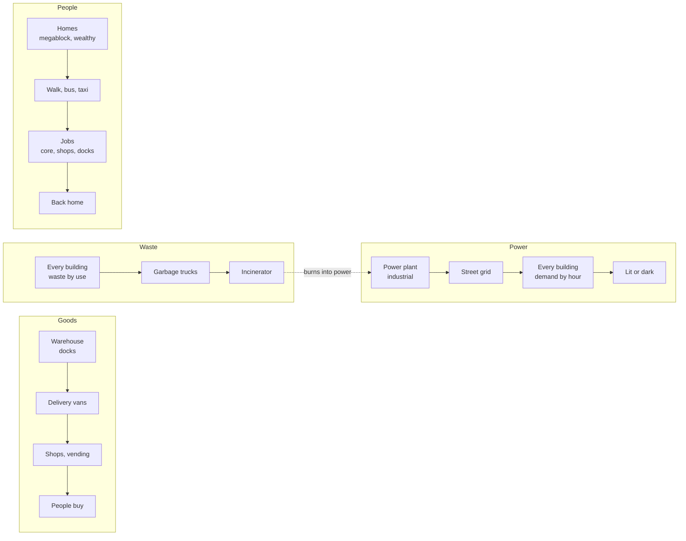

# Plan: Blueprint City as a simulation, with a day clock and resource flows

## Context

Class 09 (PWB), "PCG 07: City Simulation", ends with Assignment 2:
- consider whether your city runs as a simulation;
- what the simulation considers: inhabitants, energy, waste;
- resource flows as the way a city transfers data and simulates urban dynamics;
- agents that perform tasks and schedules across the roads and buildings of the city.

Slides 25–30 show Stone Librande's design diagrams for SimCity: every resource is a flow from
where it is made, through something that carries it, to where it is used, and each flow can fail
in a way you can see.

Blueprint City (`/world`) already has the inhabitants, but no schedule and no resources:
- **People** (`life/agents.ts`) are driven by needs (thirst, rest, company, home). "Home" sends
  them into **any** door, and someone else comes out of a random door. No one lives anywhere or
  works anywhere.
- **Traffic** (`life/traffic.ts`): cars and vans turn at random, taxis are dispatched to fares,
  buses go round their loops.
- **Buildings** (`city/placement.ts`): every lot has a grammar building with its district (core,
  commercial, megablock, industrial, wealthy), but a building is only a shape. Each one gets a
  door on its street (`doors` in `agents.ts`).
- **The sky** (`palette.ts` `SKY`) is fixed: one sun, one height, always day.

The state machines in `docs/techniques/agents.md` already sketch the two new machines: a
person's day, and a garbage truck.

**Goal:** the city runs on a clock. People live in one building and work in another, and four
resources flow through the streets, each carried by an agent you can see:

Decisions:
- **Fixed rules, no new sliders.** As with the hubs and the districts, every rate is a constant in
  the code. The only new controls are a Flows layer (M5) and the clock's own readout.
- **No building clicks.** The inspector stays on agents; buildings show their state through
  their lights and the Flows layer.
- **Pure simulation.** Like `life/agents.ts`, the new code has no three.js. The renderer reads
  its arrays.

---

## 1. The model

### 1.1 The clock

- One day lasts **10 minutes** of real time (`DAY_SECONDS = 600`), so an hour is 25 s.
- The city opens at **6:00**, so the first thing you see is the morning commute.
- The clock runs with the simulation: it stops when Life is off or the timeline is paused.
- **The sky follows it:**
  - the sun's height and color come from the hour;
  - the hemisphere light dims at night;
  - the background goes from the day blue to a dark blue.
- **Windows** light at dusk: the glow material's strength follows the hour. Each building's own
  share of lit windows (M2) then scales it.
- **A readout** shows the time (for example "07:25") next to the camera toolbar.

### 1.2 Homes and jobs

Every grammar building gets a **role** from its district:

| District | Role | Places per building |
|---|---|---|
| Megablock | Home | one per storey |
| Wealthy | Home | one per two storeys |
| Core | Job (offices) | one per storey |
| Commercial | Job (shops) and shop | one per storey, plus its shop front |
| Industrial | Job (works); the power plant, the warehouse and the incinerator stand here (§1.4–1.6) | one per two storeys |

- Each person is given a **home** and a **job**. Homes are filled first; jobs are weighted by
  their places.
- A building keeps its **occupancy**: how many people are inside it now. Occupancy is what drives
  power demand (§1.4) and waste (§1.5).
- The Landmark is a job (offices). The Megatower is a home.

### 1.3 A person's day

The needs machine stays as it is and becomes the **Out** state of a day machine:

| From | To | When |
|---|---|---|
| Asleep at home | Commute | the person's wake time, 5:36–7:48 |
| Commute | Working | at the job's door |
| Working | Out | lunch, 11:45–12:30, and the end of the working day, 17:00–19:00 |
| Out (lunch) | Commute | after the nearest drink, seat or circle, or at most 1.2 hours |
| Out (evening) | Going home | after a stop or two (most stop for something), at bedtime (21:00–23:00), or when the home need is due |
| Going home | Asleep | at the home's door |

- **Jobs first, homes near them.** A job is picked by its places; the home by its places, falling
  off by e for every 70 columns from the job. An hour is only 25 s, and a walk across the
  terraced city takes hours of it.
- **Commute and Going home** use the existing ways of getting about: on foot down a flow field, by
  bus (one whose route takes it much nearer, getting off at the stop nearest the building), or by
  taxi (driven to the lane nearest the building; always, past 420 columns, while a taxi is free).
  A field per building would be too many (each is 1.7 MB), so the doors are put in groups of
  about six neighbors with one field each, and each door has a small local field for the last
  steps (worked out one per step while the city is printed). Someone who reaches a neighbor's
  door walks round to their own on it.
- Each person's hours are their own, drawn from the person's seed, so the rush is spread out.
- **Away** now means inside a known building: the person comes out of the same door later.
- **Buses** run a fuller timetable at the rush hours, and fewer at night.

### 1.4 Power

- The **power plant** stands on the industrial lot nearest the river. It is a grammar building
  with a chimney and a glowing intake on the water.
- **The grid** follows the streets. Every building is fed from the street in front of it, and
  each street is fed from the plant along the shortest path over the street graph.
- **Supply:** a fixed base output, plus whatever the incinerator burns (§1.5).
- **Demand** per building, every simulated minute:
  - a small base;
  - plus a share per occupant;
  - homes peak in the evening;
  - offices and works peak by day;
  - shop fronts and neon signs draw from dusk to 2:00.
- **When demand exceeds supply,** the plant sheds load one district at a time, in a fixed order:
  1. industrial;
  2. megablock;
  3. commercial;
  4. wealthy;
  5. core.

  A building without power goes dark: its windows and neon go out, and a dark shop sells
  nothing.
- **Blackouts are rare but visible.** The rates are tuned so that the evening peak on a large
  seed brushes the supply, and a missed waste round tips it over.

### 1.5 Waste

- Every building fills a **bin** at its door, at a rate set by its occupancy. Shops fill theirs
  faster.
- **Garbage trucks** are a new kind of vehicle in `life/traffic.ts`, two to four per city. Each
  one runs the state machine in `agents.md`:
  1. at 1:00 it leaves the depot;
  2. it drives to the fullest bin on its side of the city and collects it, until it is full or no
     bin is past half;
  3. it hauls the load to the incinerator, unloads, and goes back out or home to the depot.
- **The incinerator** burns what it is given into power for the plant (§1.4). That closes the
  loop.
- **A missed bin** (full for more than a day) spills a pile on the sidewalk. Piles draw pigeons:
  they count as a roost for the flock nearest to them. A truck clears the pile when it comes.

### 1.6 Goods

- **The warehouse** stands on an industrial lot near the river: the docks.
- **Every shop and vending machine** has a stock. People buying a drink, or shopping when they
  are Out, run it down.
- **Delivery vans** are the existing vans with a task. A van loads at the warehouse, drives to
  the emptiest shop on its round, restocks it, and moves on. A van with nothing to do roams as
  vans do now.
- **An empty vending machine** stays dark, and a thirsty person walks on to the next one.

---

## 2. Files

| File | What changes |
|---|---|
| `life/clock.ts` (new) | The clock: day length, hour, sky and window levels by hour |
| `life/city.ts` (new) | Roles, occupancy, the grid and the power balance, bins, stock; pure, no three.js |
| `life/agents.ts` | Homes, jobs and the day machine above the needs; Away means inside a known building; buying runs stock down |
| `life/traffic.ts` | Garbage trucks; vans with delivery rounds; the bus timetable by hour |
| `city/placement.ts` | Picks the lots for the power plant, the warehouse and the incinerator |
| `buildings/lotGrammar.ts` | The three industrial buildings' draws (chimney, intake, loading bays) |
| `render/WorldView.ts` | The sky follows the clock; a building id per vertex and a small texture of light levels, so each building can go dark on its own |
| `render/life.ts` | Garbage trucks and the waste piles |
| `ui/CameraBar.tsx` | The clock readout |
| `ui/TerrainPanel.tsx` | Layers: the Flows layer (M5) |
| `ui/Inspector.tsx` | A person's home, job and day state; a truck's or a van's round |
| `docs/techniques/agents.md` | The day machine and the truck move from "Planned" into the built sections |

---

## 3. Milestones

Each milestone ends with something to see in `/world`.

**M1. The clock, homes and jobs.**
- §1.1 and §1.2.
- §1.3, with no buses timetable yet.
- The inspector shows a person's home, job and day state.
- *See:* the sun sets and the windows light up. In the morning the sidewalks fill towards the
  core; at night people walk into their own doors and the streets empty.

**M2. Power.**
- §1.4.
- The power plant on its lot.
- The per-building light level in the renderer.
- *See:* the city lit at night, its neon on until 2:00. Forcing a low supply (in the console)
  darkens the industrial district first, then the megablocks.

**M3. Waste.**
- §1.5.
- Garbage trucks, the incinerator, bins and piles.
- The incinerator's burn counts towards the plant's supply.
- *See:* trucks out at night, stopping at doors and driving to the incinerator. With the trucks
  taken away, the piles grow, pigeons settle on them, and the next evening peak blacks out a
  district.

**M4. Goods.**
- §1.6.
- The warehouse, stock, and the vans' rounds.
- The bus timetable by hour (§1.3).
- *See:* vans stopping at shop fronts. A vending machine left alone goes dark, and people pass it
  by.

**M5. The Flows layer and the docs.**
- **Layers → Flows:**
  - buildings tinted by their state: power (lit, shed), bin (empty to full) or stock (full to
    empty), one at a time, in the Districts tint's place;
  - a short trail behind each carrier: trucks, vans and the people commuting.
- `agents.md`:
  - the two machines move to the built sections;
  - the resource diagram;
  - screenshots.
- The world README's dev log, and the main README's process log.

---

## 4. Verification

- **Same seed, same day.** Two runs of a seed give the same homes, jobs, rounds and blackouts at
  the same hours.
- **People:**
  - everyone has a home and a job;
  - by 9:00, at least 80% are at work or on their way;
  - by 1:00, at least 80% are at home.
- **Power:**
  - with the default rates, no blackout on the default seeds when the trucks run;
  - a forced shortfall sheds districts in the fixed order.
- **Waste:**
  - over three days, no bin stays full for a day while the trucks run;
  - with no trucks, piles appear by the second night.
- **Goods:** over three days, no shop stays empty for more than half a day while the vans run.
- **Speed:** a step of the whole simulation stays under 4 ms (it is about 2 ms now), measured on
  `blueprint` at the evening peak.
- `npm run build` passes.
