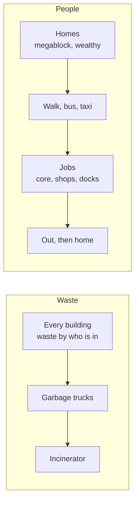

# Plan: Blueprint City as a simulation, with homes, jobs and resource flows

## Context

Class 09 (PWB), "PCG 07: City Simulation", ends with Assignment 2:
- consider whether your city runs as a simulation;
- what the simulation considers: inhabitants, energy, waste;
- resource flows as the way a city transfers data and simulates urban dynamics;
- agents that perform tasks and schedules across the roads and buildings of the city.

Slides 25–30 show Stone Librande's design diagrams for SimCity: every resource is a flow from
where it is made, through something that carries it, to where it is used, and each flow can fail
in a way you can see.

Blueprint City (`/world`) already has the inhabitants, but no schedule and no resources:
- **People** (`life/agents.ts`) are driven by needs (thirst, rest, company, home). "Home" sends
  them into **any** door, and someone else comes out of a random door. No one lives anywhere or
  works anywhere.
- **Traffic** (`life/traffic.ts`): cars and vans turn at random, taxis are dispatched to fares,
  buses go round their loops.
- **Buildings** (`city/placement.ts`): every lot has a grammar building with its district (core,
  commercial, megablock, industrial, wealthy), but a building is only a shape. Each one gets a
  door on its street (`doors` in `agents.ts`).
- **The sky** (`palette.ts` `SKY`) is fixed: one sun, one height, always day.

M1 was first built with a day clock (commit 485c002): a ten-minute day, the sky and the windows
following the hour, a clock readout, and a day machine on the hours. The city has no clock now:
M1 takes those out again and puts each person on a cycle of their own (§1.2).

The state machines in `docs/techniques/agents.md` already sketch the two new machines: a
person's cycle, and a garbage truck.

**Goal:** the city runs as a steady loop. People live in one building and work in another, each
going round a cycle of their own, and their waste flows through the streets, carried by trucks
you can see:

Decisions:
- **No clock.** Nothing happens at an hour. Every rule is a state, a rate per second or a stay
  of so many seconds, so at any moment the city is somewhere in every part of its loop.
- **The sky stays as it is:** `palette.ts` `SKY`, one sun, always day; the windows glow at their
  full strength.
- **Fixed rules, no new sliders.** As with the hubs and the districts, every rate is a constant in
  the code. The only new control is the Waste tint (M3).
- **No building clicks.** The inspector stays on agents; buildings show their state through
  the Waste tint.
- **Pure simulation.** Like `life/agents.ts`, the new code has no three.js. The renderer reads
  its arrays.

---

## 1. The model

### 1.1 Homes and jobs

Every grammar building gets a **role** from its district:

| District | Role | Places per building |
|---|---|---|
| Megablock | Home | one per storey |
| Wealthy | Home | one per two storeys |
| Core | Job (offices) | one per storey |
| Commercial | Job (shops) and shop | one per storey, plus its shop front |
| Industrial | Job (works); the incinerator stands here (§1.3) | one per two storeys |

- Each person is given a **home** and a **job**. Homes are filled first; jobs are weighted by
  their places.
- A building keeps its **occupancy**: how many people are inside it now. Occupancy is what drives
  waste (§1.3).
- The Landmark is a job (offices). The Megatower is a home.

### 1.2 A person's cycle

The needs machine stays as it is and becomes the **Out** state of a cycle. Each step ends after a
stay of the person's own, in seconds, or on arriving:

| From | To | When |
|---|---|---|
| At home | Commute | after the stay at home, 60–150 s |
| Commute | Working | at the job's door |
| Working | Out (break) | halfway through the shift, for half the people |
| Out (break) | Commute | after the nearest drink, seat or circle, or at most 30 s |
| Working | Out | after the shift, 75–150 s in all |
| Out | Going home | after a stop or two (most stop for something), at most 45 s, or when the home need is due |
| Going home | At home | at the home's door |

- **Staggered from the start.** When the city opens, each person starts at a random step and a
  random point of its stay, so there is no rush: the sidewalks are as busy at any moment as at
  any other, and doors open and close all the time.
- Each person's stays are their own, drawn from the person's seed.
- **Jobs first, homes near them.** A job is picked by its places; the home by its places, falling
  off by e for every 70 columns from the job, so a commute is a walk of a minute or so, not a
  crossing of the whole terraced city.
- **Commute and Going home** use the existing ways of getting about: on foot down a flow field, by
  bus (one whose route takes it much nearer, getting off at the stop nearest the building), or by
  taxi (driven to the lane nearest the building; always, past 420 columns, while a taxi is free).
  A field per building would be too many (each is 1.7 MB), so the doors are put in groups of
  about six neighbors with one field each, and each door has a small local field for the last
  steps (worked out one per step while the city is printed). Someone who reaches a neighbor's
  door walks round to their own on it.
- **Away** now means inside a known building: the person comes out of the same door later.

### 1.3 Waste

All of it in `life/waste.ts` (pure), kept once a second. Bins and piles are few on purpose, so
they cost next to nothing to keep or draw:

- **Bins.** One bin to each group of doors (the groups of about six neighbors in §1.2), on the
  curb nearest the group: 18 on `blueprint`. A bin fills at a rate set by who is inside its
  buildings (shops half as fast again), and a little for each building: about ten minutes from
  empty to full.
- **Garbage trucks** are a new kind of vehicle in `life/traffic.ts`: one to six bins, two or
  three per city. Each has its side of the city (the bins split in strips along the city's longer
  way) and runs the state machine in `agents.md`:
  1. parked in the depot (off the road, so it blocks no lane) until a bin on its side is past
     half; it comes out at the depot's curb;
  2. it drives to the fullest bin on its side, past half or spilled, that no other truck is on
     its way to, stands four seconds and empties it; then the next, until it holds nearly four
     bins or no bin on its side is past half;
  3. it hauls the load to the incinerator, unloads (six seconds), and goes back out, or into the
     depot.
- **The incinerator** is the tallest industrial building; in a city with no industry
  (`blueprint`) it is the building farthest from the plaza. Its chimney (a concrete stack with
  two red bands and a glowing top, `buildings/chimney.ts`) goes up with it. Its depot is the curb
  nearest its door. It burns what it is given.
- **A missed bin** (full for 90 s) spills a pile of bags on the sidewalk beside it; at most six
  piles in the whole city at once. A pile draws the flock whose roost is nearest it (within
  60 m): the flock takes it for its roost and flies to it, and goes home once a truck has emptied
  the bin and cleared the pile.
- **The inspector** shows a truck's task and its load ("1.0 of 4 bins").

---

## 2. Files

| File | What changes |
|---|---|
| `life/clock.ts` | Deleted: the clock and the light by the hour |
| `life/city.ts` | Roles, occupancy and the door groups; pure, no three.js |
| `life/agents.ts` | Homes, jobs and the cycle above the needs (stays in seconds, not hours); Away means inside a known building |
| `life/waste.ts` | Bins, the garbage trucks' rounds, the incinerator and the piles; pure, no three.js |
| `life/traffic.ts` | Garbage trucks (sent to a spot, parked in the depot) |
| `buildings/chimney.ts` | The incinerator's chimney |
| `buildings/print.ts` | The windows' glow back at full strength; a tint per building (the Waste tint) |
| `render/WorldView.ts` | The sky back to `SKY`; the incinerator's chimney, added to its building |
| `render/life.ts` | Garbage trucks, the bins (tinted by how full) and the piles |
| `life/ahead.ts` | The path ahead; each agent works out its own (`agents.ts`, `traffic.ts`) |
| `render/select.ts` | The selected agent's path ahead |
| `state.ts` | The Waste ground tint |
| `ui/CameraBar.tsx` | The clock readout taken out |
| `ui/TerrainPanel.tsx` | Ground color: Waste, with its legend |
| `ui/Inspector.tsx` | A person's home, job and step of the cycle (and how long until the next); a truck's task and load |
| `docs/techniques/agents.md` | The cycle and the truck move from "Planned" into the built sections |

---

## 3. Milestones

Each milestone ends with something to see in `/world`.

**M1. Homes, jobs and the cycle.**
- §1.1 and §1.2.
- The clock taken out: the sky back to `SKY`, the windows' glow at full strength, no clock
  readout.
- The inspector shows a person's home, job and step of the cycle.
- *See:* at any moment people walk out of their own doors toward their jobs, others come out of
  work for a break or a stop on the way home, and others walk into their homes.

**M2. Waste.**
- §1.3.
- Garbage trucks, the incinerator, bins and piles.
- *See:* trucks stopping at the bins and driving to the incinerator. With the trucks taken away,
  the piles grow and pigeons settle on them.

**M3. The Waste tint, the path ahead and the docs.**
- **Ground color → Waste:** every building tinted by the bin it shares with its neighbors, green
  (empty) through yellow to red (full).
- **The selected agent's path ahead:** click any person, pigeon, cat or vehicle and a thin line
  runs from it along where it means to go, worked out from what it will do: a person down the
  field they walk, a vehicle along the segments it has planned (to its halt), a cat at its pigeon
  or straight on, a pigeon to its hop, its landing spot or its roost. A ring pulses at its goal;
  where the goal is out of reach the line fades out. People 30 m ahead, vehicles 60 m.
- `agents.md`:
  - the two machines move to the built sections;
  - the resource diagram;
  - screenshots.
- The world README's dev log, and the main README's process log.

---

## 4. Verification

- **Same seed, same run.** Two runs of a seed give the same homes, jobs and rounds at the same
  moments.
- **People:**
  - everyone has a home and a job;
  - after the first two minutes, at every moment at least a fifth are at home and at least a
    fifth at work;
  - a whole round of the cycle, home to home, takes about six minutes (the median), and no one
    takes more than twelve.
- **Waste:**
  - over fifteen minutes, no bin stays full for 90 s while the trucks run (no pile spills);
  - with no trucks, piles appear within five minutes (bins a third full at the start), and
    flocks settle on them.
- **Speed:** a step of the whole simulation stays under 4 ms (it is about 2 ms now), measured on
  `blueprint` after five minutes of running.
- `npm run build` passes.
