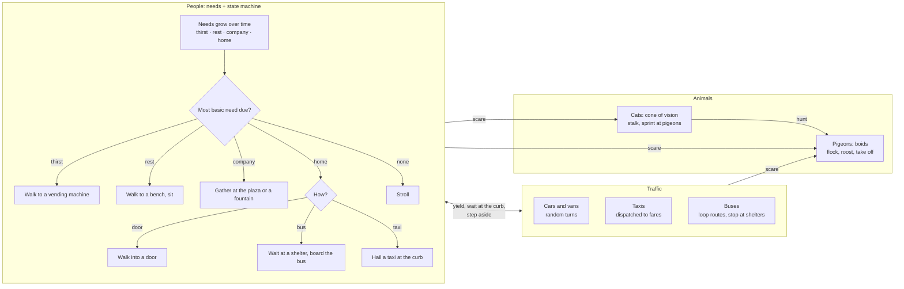

# Technique: Agents

[← Back to the main README](../../README.md) 

Once the city is built, it is lived in: **people, pigeons, cats and vehicles**, each driven by a
different agent model from Class 08, and each reacting to the others and to the city around them.
The simulation is pure TypeScript (no three.js); the renderer draws everything with a few
instanced meshes, and a step of the whole simulation takes about 2 ms.

## Who does what

| Agent | Model | Code |
|---|---|---|
| People | Needs (Maslow order, as in *The Sims*) choosing a goal; a small state machine carrying it out; **flow fields** (one Dijkstra search per goal, shared by everyone) to walk there; separation and keep-right steering so no one walks into a wall, a prop or another person | [`life/agents.ts`](../../site/src/world/life/agents.ts) · [`life/walk.ts`](../../site/src/world/life/walk.ts) |
| Pigeons | Reynolds' **boids** (separation, alignment, cohesion), circling their roost and landing when it is quiet | [`life/agents.ts`](../../site/src/world/life/agents.ts) |
| Cats | Predator with a **cone of vision** and line of sight; stalks slowly, then sprints | [`life/agents.ts`](../../site/src/world/life/agents.ts) |
| Vehicles | **Intelligent Driver Model** for following, junction reservations for turns, shortest paths for taxis and buses | [`life/traffic.ts`](../../site/src/world/life/traffic.ts) |

## How people and vehicles share the streets

- A vehicle brakes for anyone its **body** would pass over in the next few voxels, so it stops
  for someone crossing even on a tight turn.
- Someone about to step off the curb **waits for a gap**, then crosses faster.
- People **walk round** vehicles and **step out of the way** of one beside them; a vehicle kept
  waiting creeps on at walking pace and people make way.
- Going home, a quarter take the **bus** (they wait at a shelter, walk to the lit door and get
  on) and a tenth **hail a taxi** (the nearest free taxi comes to the curb for them). Riders get off
  elsewhere and walk on from there.

## How it looks

| People in a park, pigeons taking off | A bus at its shelter |
|---|---|
|  |  |

| A taxi at the curb for its fare | Traffic on a stepped street |
|---|---|
|  |  |

## In the development log

- [Inhabitants (agents, after Class 08)](../../site/src/world/README.md#2026-10-27-inhabitants-agents-after-class-08)
- [Traffic: cars, vans, taxis and buses](../../site/src/world/README.md#2026-10-28-traffic-cars-vans-taxis-and-buses-and-how-people-live-with-them)
- Feedback that asked for it: [Week 6 feedback](../analysis/Week06-feedback.md), which asked to show how inhabitants and vehicles interact with the city
