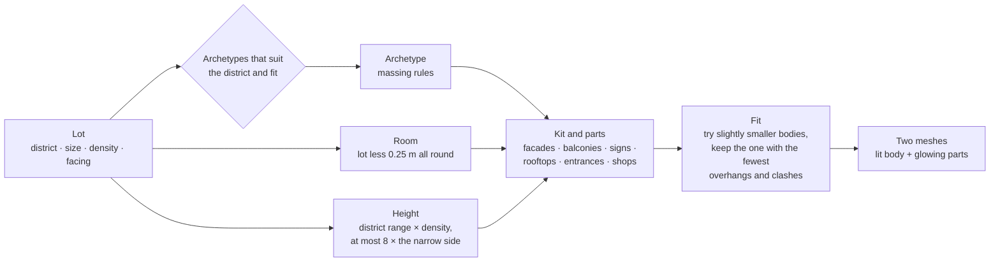

# Technique: Building morphology

[← Back to the main README](../../README.md)

Every building is generated, not modeled: an **archetype** (a set of rules for its massing) is
filled in with **reusable parts** (facades, balconies, signs, rooftop gear, shop fronts) and
sized to the lot it stands on. Eleven archetypes make up the library, previewed at `/buildings`.

## From a lot to a building

## The library

| Archetype | Districts | Smallest side |
|---|---|---|
| Corporate Megatower | core | 12 m |
| Neon Commercial Tower | commercial | 6 m |
| Residential Skyscraper | megablock, core | 6 m |
| Research Lab Tower | industrial, core | 12 m |
| Modular Apartment Block | megablock | 8 m |
| Twin-Tower Complex | megablock | 14 m |
| Stacked Megablock | megablock, commercial | 8 m |
| Vertical Neighborhood | megablock | 14 m |
| Terraced Residential | wealthy, megablock | 10 m |
| Tower and Annex | megablock, commercial | 12 m |
| Landmark Tower | the plaza only | (one per city) |

| Corporate Megatower | Research Lab Tower | Stacked Megablock |
|---|---|---|
|  |  |  |

## Rules worth knowing

- **Cheap depth.** A wall is a dark glass core set back by the window depth, with piers and floor
  bands in front: real window cavities from a few dozen boxes per wall.
- **Two draw calls per building.** Its lit body and its glowing parts (windows, neon, signs) are
  two geometries sharing two materials.
- **Clean geometry.** Development checks find faces sharing a plane (flicker) and parts running
  into each other (clashes); every cut face is nudged by its own hair-width offset.
- **Kept inside the lot.** Each box is clipped to the room, so awnings, signs and balconies never
  hang over the sidewalk; the body is sized so the whole building fits.
- **Where a building goes** is decided by the lots: see
  [Network](network.md) for districts and lots, and the
  [development log](../../site/src/world/README.md#2026-10-28-filling-the-gaps) for how small lots
  are merged and gaps filled.

## In the development log

- [The building library](../../site/src/world/README.md#2026-10-12-the-building-library)
- [Redesigns, entrances and shop fronts](../../site/src/world/README.md#2026-10-13-redesigns-entrances-and-shop-fronts)
- [Buildings on the lots](../../site/src/world/README.md#2026-10-14-buildings-on-the-lots)
- [Buildings stand back from their lot's edge](../../site/src/world/README.md#2026-10-27-buildings-stand-back-from-their-lots-edge)
- Full library notes: [buildings/README.md](../../site/src/world/buildings/README.md)
