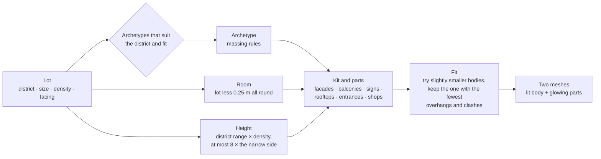
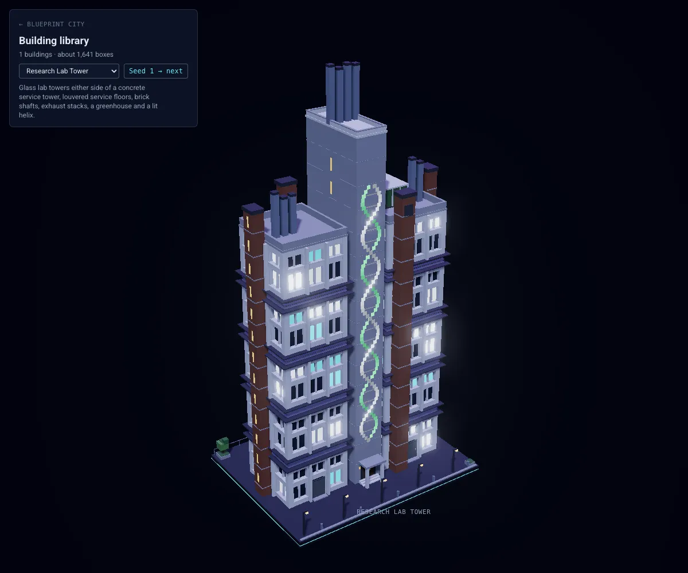
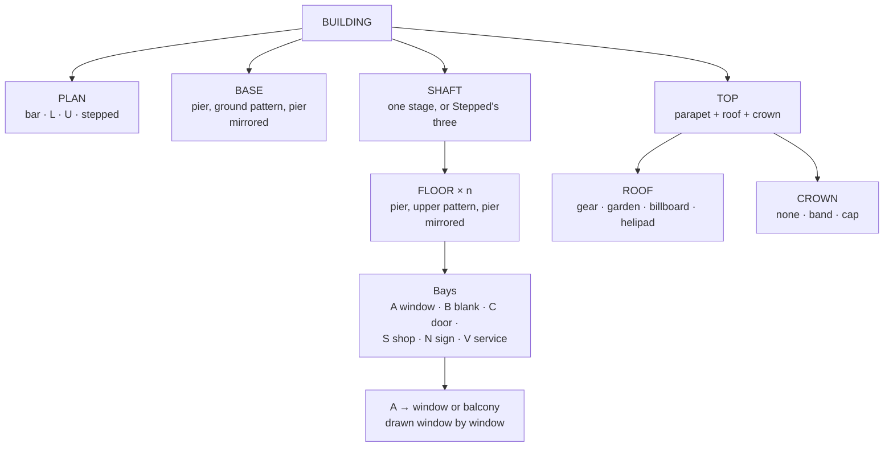
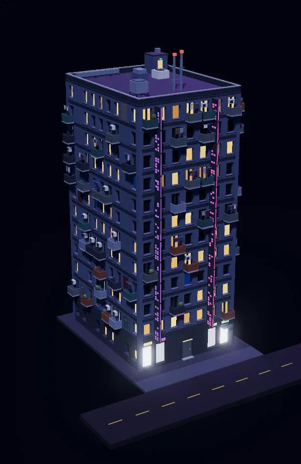
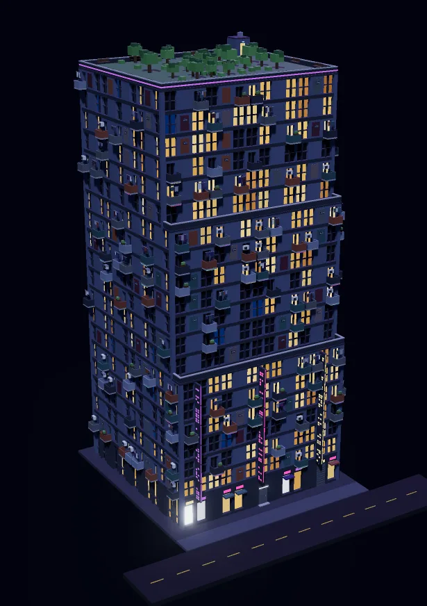
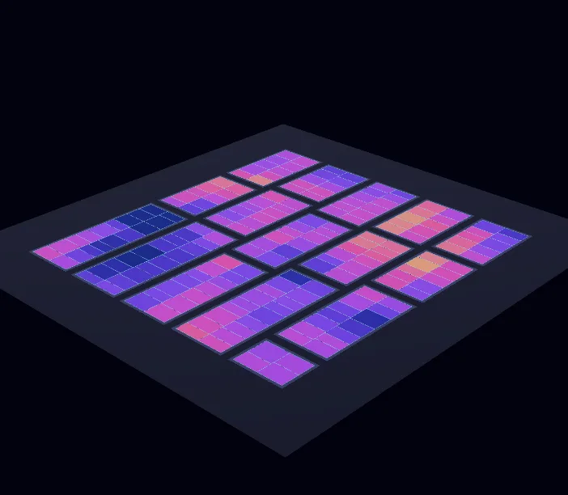
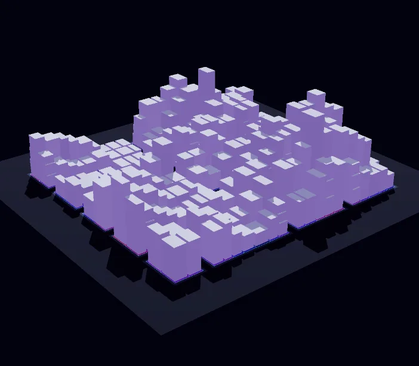
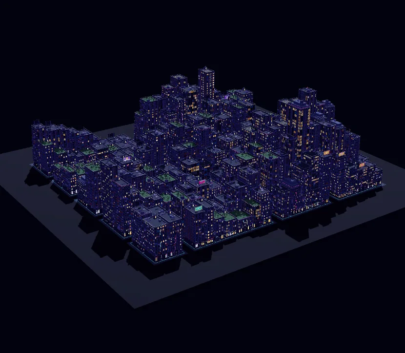

# Technique: Building morphology

[← Back to the main README](../../README.md)

Every building is generated, not modeled: an **archetype** (a set of rules for its massing) is
filled in with **reusable parts** (facades, balconies, signs, rooftop gear, shop fronts) and
sized to the lot it stands on. Eleven archetypes make up the library, previewed at `/buildings`.

A second way to make buildings, the **building grammar** (`/grammar`), derives one rule by rule
from a few parameters, after Class 09's building morphology demo. Its **Simulation** page lays out
streets and lots and grows a grammar building on every lot, with a height map setting how tall
each grows.

## From a lot to a building

## The library

| Archetype | Districts | Smallest side |
|---|---|---|
| Corporate Megatower | core | 12 m |
| Neon Commercial Tower | commercial | 6 m |
| Residential Skyscraper | megablock, core | 6 m |
| Research Lab Tower | industrial, core | 12 m |
| Modular Apartment Block | megablock | 8 m |
| Twin-Tower Complex | megablock | 14 m |
| Stacked Megablock | megablock, commercial | 8 m |
| Vertical Neighborhood | megablock | 14 m |
| Terraced Residential | wealthy, megablock | 10 m |
| Tower and Annex | megablock, commercial | 12 m |
| Landmark Tower | the plaza only | (one per city) |

| Corporate Megatower | Research Lab Tower | Stacked Megablock |
|---|---|---|
|  |  |  |

## Rules worth knowing

- **Cheap depth.** A wall is a dark glass core set back by the window depth, with piers and floor
  bands in front: real window cavities from a few dozen boxes per wall.
- **Two draw calls per building.** Its lit body and its glowing parts (windows, neon, signs) are
  two geometries sharing two materials.
- **Clean geometry.** Development checks find faces sharing a plane (flicker) and parts running
  into each other (clashes); every cut face is nudged by its own hair-width offset.
- **Kept inside the lot.** Each box is clipped to the room, so awnings, signs and balconies never
  hang over the sidewalk; the body is sized so the whole building fits.
- **Where a building goes** is decided by the lots: see
  [Network](network.md) for districts and lots, and the
  [development log](../../site/src/world/README.md#2026-10-28-filling-the-gaps) for how small lots
  are merged and gaps filled.

## The building grammar

A building is not modeled but derived. The rules expand top down, and every choice is either a
parameter on the left panel or a draw from the seed:

- **Bays fill the front exactly.** n = floor((frontage − pier) ÷ bay width), and the bays stretch
  to fill it. Every front is mirrored, so an odd middle bay becomes the door on the ground floor.
- **Patterns are drawn, not typed.** The upper floors get two to four letters (always opening with
  a window), the ground floor two or three (always opening with a shop). Signs take up to 30% of
  the columns, each paired with its mirror.
- **Balconies are a stochastic rule,** A → window | balcony, drawn per window, so the slider adds
  them a few at a time rather than whole columns.
- **Each place draws its own numbers** (face, floor, bay), so moving one slider changes only what
  it reaches, and Randomize changes nothing but the draws.
- **The plan is rectangles.** L and U are wings round a court open to the street; Stepped rises in
  three stages, each 2 m back, leaving parapeted terraces. Facades run along the outline, with a
  column at each outer corner.

The right panel says what the rules made in plain words: the shape, the top, both floors' bays,
the street front, the windows and the signs.

| Default (Bar, gear roof) | Stepped, glass, garden roof, neon band |
|---|---|
|  |  |

### Simulation: a map drives the height

`/grammar/simulation`, after Class 09's city morphology demo, is the assignment's other half:
maps drive each building's height, and lots drive its size.

1. **Streets** make a grid on flat ground. With Irregularity on, each band of blocks staggers its
   own cross streets into T junctions.
2. **Blocks** are two rows of lots back to back, each row facing its own street.
3. **Lots** are cut at the frontage and jittered. The building's body is the lot less its
   setbacks, which start just past what the grammar's balconies and awnings reach.
4. **A hidden Perlin field** sets the height, from Min to Max, sharpened by Contrast, and capped at
   8 × the body's narrower side (the city's slender rule).
5. **Each lot draws its own grammar settings** to suit its size and height: courts on wide lots,
   steps on tall ones, glass and helipads high up, gardens low down.

| The height map (Buildings: None) | Masses |
|---|---|
|  |  |

Grammar view builds about 200 buildings in under half a second without dropping below 60 fps:
- Web Workers build them off the main thread, from the middle out.
- At most 300k vertices go to the GPU per frame.
- Masses stand in for lots still waiting, and for every lot while a slider is dragged.
- The shadows are redrawn only when the buildings change.
- Grammar view stops at 10M vertices, and the lots farthest out keep their masses.

The plan: [building-grammar-plan.md](../plans/building-grammar-plan.md). The code:
[`grammar.ts`](../../site/src/world/buildings/grammar.ts) and
[`massing.ts`](../../site/src/world/buildings/massing.ts) for the rules, and
[`block.ts`](../../site/src/world/buildings/block.ts) for Simulation's layout.

## In the development log

- [The building library](../../site/src/world/README.md#2026-10-12-the-building-library)
- [Redesigns, entrances and shop fronts](../../site/src/world/README.md#2026-10-13-redesigns-entrances-and-shop-fronts)
- [Buildings on the lots](../../site/src/world/README.md#2026-10-14-buildings-on-the-lots)
- [Buildings stand back from their lot's edge](../../site/src/world/README.md#2026-10-27-buildings-stand-back-from-their-lots-edge)
- [The building grammar, M1](../../site/src/world/README.md#2026-11-12-the-building-grammar-m1)
- [The building grammar, M2: the facade grammar](../../site/src/world/README.md#2026-11-12-the-building-grammar-m2-the-facade-grammar)
- [The building grammar, M3: massing](../../site/src/world/README.md#2026-11-16-the-building-grammar-m3-massing)
- [The building grammar's Simulation](../../site/src/world/README.md#2026-11-16-the-building-grammars-simulation)
- Full library notes: [buildings/README.md](../../site/src/world/buildings/README.md)
