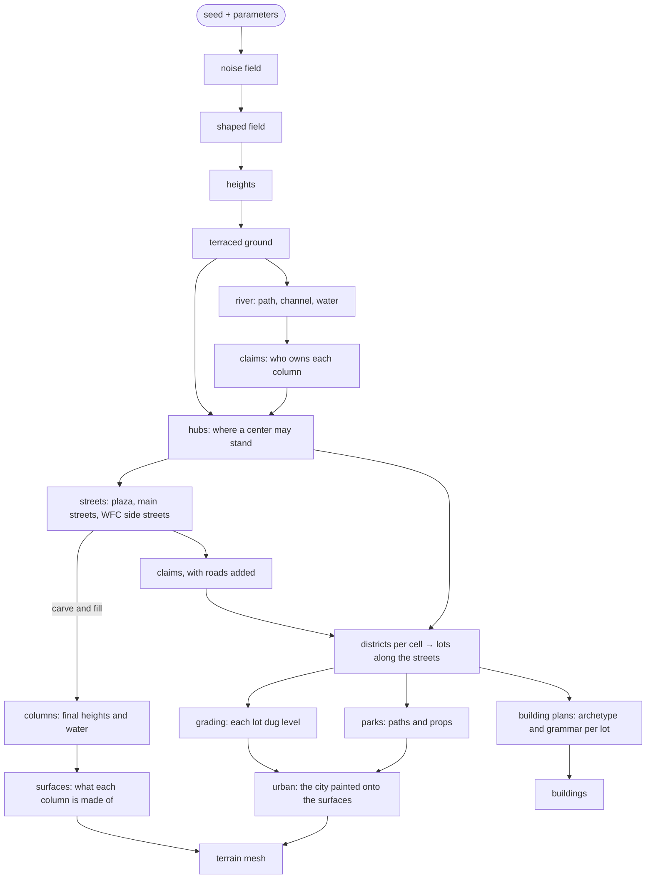
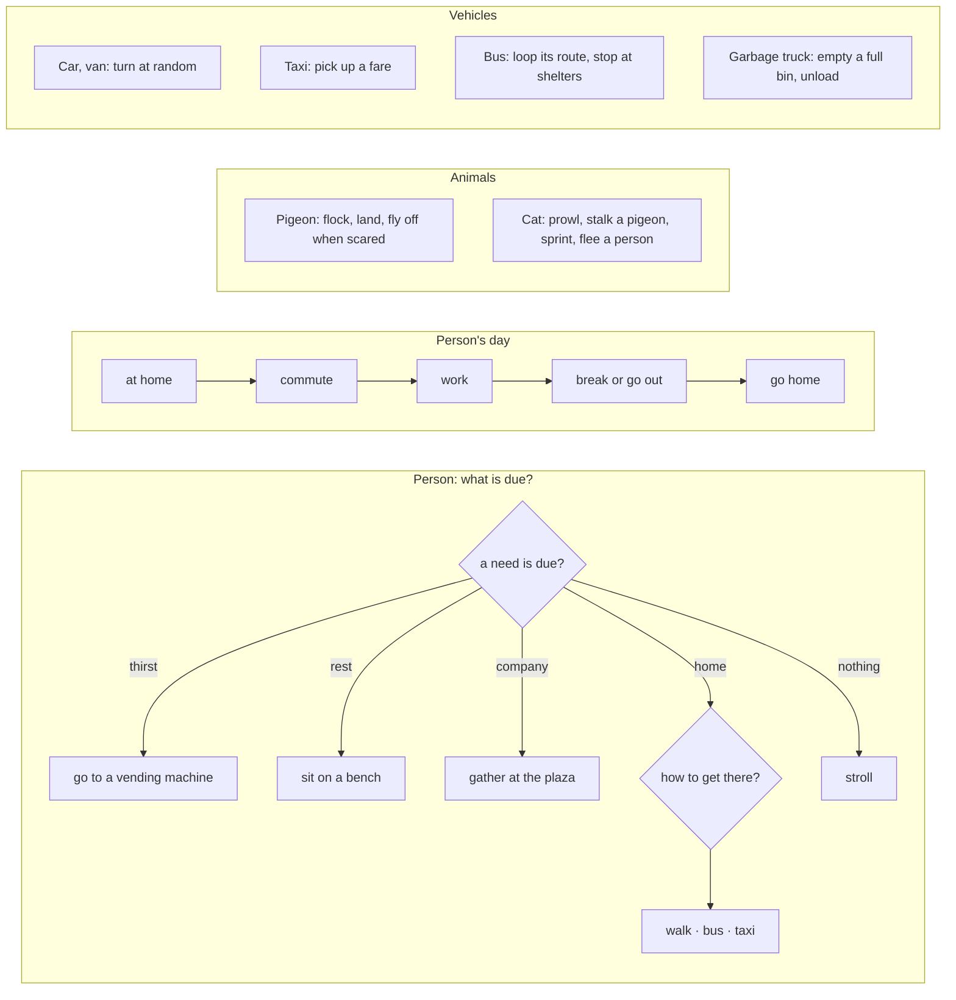

# Technique: Data and layers

[← README](../../README.md)

What the city is made of, which layer reads which, and what the people and vehicles walk on.
Three pictures: the **scales** the data lives at, the **layers** each stage adds, and what the
**agents** do and choose. Names are the code's own, so each box can be found.

## Scales

Everything is measured in voxels (1 voxel = 0.25 m, [`scale.ts`](../../site/src/world/scale.ts)),
but three kinds of data sit on it, and a stage reads the coarser one to decide and the finer one to
draw.

```mermaid
flowchart LR
  subgraph Column["Per column (928 × 928, 0.25 m)"]
    c1[heights · terraces]
    c2[claims: river, bank, road, verge, plaza, lot, park]
    c3[surfaces · urban paint]
    c4[walk map: ground, links to 8 neighbors]
  end
  subgraph Cell["Per cell (116 × 116, 2 m)"]
    k1[hubs: suitability, buildable, side]
    k2[districts: one per cell]
  end
  subgraph Shape["Shapes, in column coordinates"]
    s1[river: control points → curve]
    s2[streets: center lines, junctions, plaza]
    s3[lots: four corners each]
    s4[parks: paths and props]
    s5[building plans: one per lot]
  end
  Cell -->|decides| Shape
  Shape -->|carved, painted| Column
  Column -->|read back by| Agents[Agents: they walk and drive over it]
```

| Scale | Size | Data | Why this scale |
|---|---|---|---|
| Column | 928 × 928, 0.25 m | Heights, claims, surfaces, the walk map | What is drawn, and what a person stands on |
| Cell | 116 × 116, 2 m | Hub suitability, districts | Coarse enough to decide "what belongs where" cheaply |
| Shape | Vectors in column units | River, streets, lots, parks, building plans | Streets and lots are lines and quads, not cells |
| Building | One lot | A grammar's bays, facades, massing, roof | Built from a few parameters, on the voxel grid |
| Agent | One per person, vehicle, bird, cat | A state machine and a position | Moves over the graphs above |

## Layers: each stage adds one

The generator is one object, `Terrain` ([`pipeline.ts`](../../site/src/world/terrain/pipeline.ts)).
Each stage reads the layers before it and adds its own; a changed setting reruns only the stages
from there on. Rendering never generates anything.

The debug view (key **D**) does not build anything: it turns the world gray and, in the left panel, chooses which of these to draw
([`state.ts`](../../site/src/world/state.ts)). Point at the ground in it and a card reads the data under the mouse; point at someone and it says what they are doing and why.

| Layers tab | Draws | From |
|---|---|---|
| Ground color: Districts | One color per district | `districts` |
| Ground color: Heights | The zoning map's height limit | `zoning` |
| Ground color: Claims | River, bank, road, verge, plaza, lot, park | `claims` |
| Ground color: Suitability | How well a cell suits a center | `hubs` |
| Ground color: Waste | Each building by how full its bin is | `life` |
| Ground color: Agents | Everyone by what they are doing: moving, using or resting, waiting, on a task, alarmed | `life` |
| Network, Lots, Parks | Lines and outlines over the ground | `streets`, `lots`, `parks` |
| Buildings, People | The models | `plans`, `life` |

The overlays are uploaded as data textures, one texel per column, and tinted in the shader
([Shader](shader.md)), so a layer can be switched without rebuilding a mesh.

## What the agents do and choose

Each kind of agent looks at a few things and picks what to do next. Every change is recorded with
its reason, so clicking an agent shows what it is doing and why.

| Agent | What it looks at | What it chooses |
|---|---|---|
| Person | Its needs (thirst, rest, company, home), the time left in its stay | Which need to meet first; how to get home (door, bus or taxi); when to go to work, take a break or go out |
| Pigeon | Its flock, people, vehicles and cats near it | Peck on the ground, or fly (flee) and land again |
| Cat | Pigeons in its cone of vision, people nearby | Prowl, rest, stalk then sprint at a pigeon, or flee |
| Car, van | The road ahead, the vehicle in front, anyone crossing | Which way to turn at a junction; when to brake |
| Taxi | Waiting fares | Which fare to fetch; where to drop them |
| Bus | Its route and the people at its shelters | When to stop and open its doors |
| Garbage truck | How full the bins are | Which bin to empty first; when to unload at the incinerator |

They also react to each other: a person scares a cat or a pigeon, a cat hunts a pigeon, a vehicle
waits for someone crossing, and a missed bin spills a pile that draws the pigeons. The full state
machines are in [Agents](agents.md#state-machines).

## Where to read next

- The pipeline and the scales: [Terrain](terrain.md)
- Streets, districts, lots and the agents' graphs: [Network](network.md)
- A building from its rules: [Building morphology](building-morphology.md)
- The state machines and the waste flow: [Agents](agents.md)
- How the layers are drawn: [Shader](shader.md)
