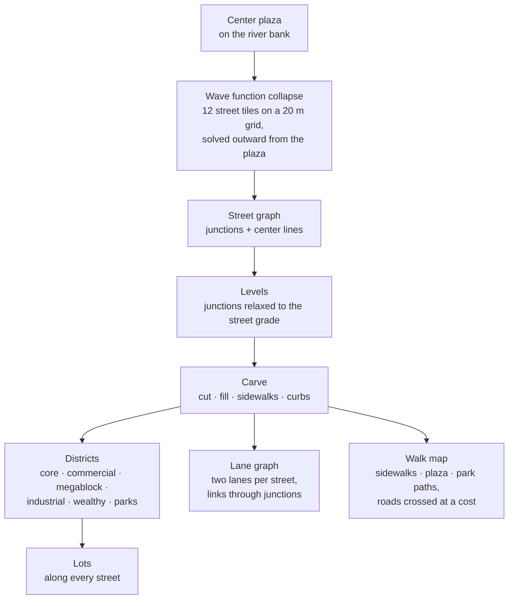

# Technique: Network

[← Back to the main README](../../README.md)

The city is organized by networks: the **street network** grown by wave function collapse, the
**districts and lots** zoned along it, and the **graphs agents move on** (a walking map for
people, a lane graph for vehicles).

## From a plaza to a city plan

## Streets by wave function collapse

- **Tiles:** empty, straights, corners, T-junctions and a cross, each a 20 m cell.
- **Rules:** edges must match; no U-turns, no 2 × 2 loops, no staircases; arms only on ground
  within the street grade; avenues run straight out of the plaza and off the island.
- **Growth:** the collapse starts at the plaza and grows outward; streets not connected to it are
  erased, so the network is always one piece.

## Districts and lots (Cities: Skylines style)

- **Districts** come from distance to the plaza, frontage, height and the river: a compact core,
  a commercial ring and avenue strips, industrial by the river and the exits, wealthy high
  ground, megablocks elsewhere; parks are their own layer on hilly ground.
- **Lots** are cut along both sides of every street, so every lot fronts one: thin blocks get lots
  running through them, a second walk fills the gaps, corner pockets are packed with rectangles,
  and lots under 8 m are merged with a neighbor or given up.

## Graphs for the agents

| Graph | Built from | Used for |
|---|---|---|
| Walk map | Sidewalks, plaza and park paths (cheap), roads (dearer to cross), rough ground (dearer still) | Flow fields: one Dijkstra search per goal gives every column its way there |
| Lane graph | Each street as two lanes; every lane into a junction linked to every lane out by a curve | Vehicles following lanes, junction reservations, shortest paths for taxis and bus routes |

## How it looks

| Streets by wave function collapse, districts | Lots along the streets |
|---|---|
|  |  |

| Small lots merged | Gaps filled |
|---|---|
|  |  |

## Code

[`terrain/streets.ts`](../../site/src/world/terrain/streets.ts) · [`terrain/wfc.ts`](../../site/src/world/terrain/wfc.ts) · [`terrain/districts.ts`](../../site/src/world/terrain/districts.ts) · [`city/placement.ts`](../../site/src/world/city/placement.ts) · [`life/walk.ts`](../../site/src/world/life/walk.ts) · [`life/traffic.ts`](../../site/src/world/life/traffic.ts)

## In the development log

- [The street network, districts and lots](../../site/src/world/README.md#2026-10-09-the-street-network-districts-and-lots)
- [The larger side of the river, and denser lots](../../site/src/world/README.md#2026-10-12-the-larger-side-of-the-river-and-denser-lots)
- [No more small plots](../../site/src/world/README.md#2026-10-28-no-more-small-plots)
- [Filling the gaps](../../site/src/world/README.md#2026-10-28-filling-the-gaps)
- Plan: [town plan](../plans/town-plan.md) · Class work it builds on: [Week 5: Paths](../../site/src/weeks/week05-scatter-paths/README.md)
