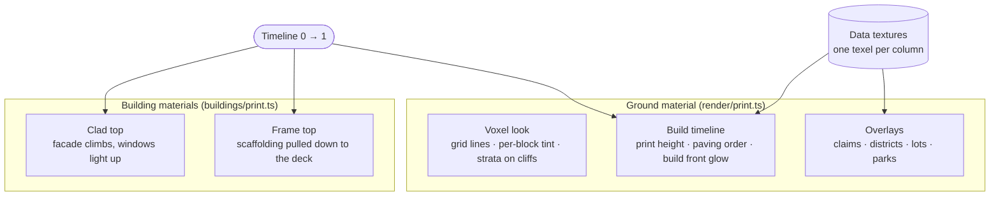

# Technique: Shader

[← Back to the main README](../../README.md) 

Shaders do two jobs in Blueprint City: they give merged voxel faces their **voxel look**, and they
play the **build animation** without rebuilding any geometry per frame. Everything is a patch on
three.js's standard material (`onBeforeCompile`), so lighting and shadows still work.

## Where each shader sits

| Effect | How | Code |
|---|---|---|
| Voxel grid on merged faces | Block outlines, a slight per-block tint and strata bands worked out per pixel from the world position; lines fade where a voxel is under about 4 pixels, so the ground never shimmers | [`render/print.ts`](../../site/src/world/render/print.ts) |
| Overlays | The claim, district and lot maps uploaded as data textures (one texel per column) and tinted in the fragment shader | [`render/print.ts`](../../site/src/world/render/print.ts) |
| Printing the terrain | A vertex patch pulls every vertex above the print height down to it, so the unprinted part becomes a flat glowing cap; shadows use the same patch | [`render/print.ts`](../../site/src/world/render/print.ts) |
| Paving the streets | Each column's paving order is one value in a texture; the shader compares it to the timeline, so streets spread out from the plaza with a glowing front | [`terrain/buildup.ts`](../../site/src/world/terrain/buildup.ts) |
| Constructing buildings | Two heights per building: the frame rises a storey ahead as scaffolding, the finished facade climbs behind it and each storey's windows light up once clad | [`buildings/print.ts`](../../site/src/world/buildings/print.ts) |
| Neon, windows and lamps | Unlit (basic) materials: a building's glowing parts are one mesh with vertex colors; vehicle lamps are instanced with per-instance colors, so brake lights flare | [`buildings/render.ts`](../../site/src/world/buildings/render.ts) · [`render/life.ts`](../../site/src/world/render/life.ts) |

## How it looks

| Build animation: terrain printed as concrete | Overlays: districts and parks |
|---|---|
|  |  |

| Lots overlay over the streets | Finished city at night |
|---|---|
|  |  |

## In the development log

- [The build timeline](../../site/src/world/README.md#2026-10-14-the-build-timeline)
- [Buildings are built, storey by storey](../../site/src/world/README.md#2026-10-26-buildings-are-built-storey-by-storey)
- [One concrete city](../../site/src/world/README.md#2026-10-27-one-concrete-city-surfaces-rewritten-for-the-cyberpunk-island)
- Class work it builds on: [Week 4: Shader Studio](../../site/src/weeks/week04-shaders/README.md) · [Shaders class notes](../notes/shaders-notes.md)
