# Technique: Terrain

[← Back to the main README](../../README.md) 

The island is a height field on a voxel grid: **928 × 928 columns of 0.25 m voxels (232 m
across)**, generated from a seed. The terrain is natural first (noise, terraces, a river), then the
city reshapes it: streets cut and fill, the blocks between them are smoothed, and every lot is
graded flat for its building.

## Pipeline

```mermaid
flowchart LR
  seed([seed]) --> noise[Noise<br/>Perlin by default,<br/>or ridged · billow · cellular]
  noise --> shape[Shaping<br/>power · ridges · height]
  shape --> terr[Terraces<br/>snapped by slope]
  terr --> river[River<br/>spline channel, flows downhill]
  river --> streets[Streets carve<br/>cut · fill · embankments]
  streets --> smooth[Block smoothing<br/>Laplace membrane]
  smooth --> vox[Voxelize<br/>whole-voxel columns]
  vox --> surf[Surfaces<br/>concrete · ledges · stairs]
  surf --> grade[Lot grading<br/>cut & fill to the median]
  grade --> mesh[Greedy mesh]
```

| Stage | Technique | Code |
|---|---|---|
| Noise and shaping | Week 2's noise stack (one type at a time, Perlin by default; octaves, persistence, lacunarity), then a power curve, ridge folding and a height scale | [`noise.ts`](../../site/src/world/terrain/noise.ts) · [`shape.ts`](../../site/src/world/terrain/shape.ts) · [`heights.ts`](../../site/src/world/terrain/heights.ts) |
| Terraces | Height snapped to steps scaled by local slope: gentle ground keeps voxel stairs, steep ground becomes shelves and cliffs | [`terraces.ts`](../../site/src/world/terrain/terraces.ts) |
| River | Week 5's spline paths: a centripetal Catmull-Rom curve whose level may only fall, carved into the ground | [`river.ts`](../../site/src/world/terrain/river.ts) · [`path.ts`](../../site/src/world/path.ts) |
| Block smoothing | The smoothest surface (Laplace's equation) held at the streets' levels, solved coarse to fine on a pyramid of grids | [`streets.ts`](../../site/src/world/terrain/streets.ts) (`smoothBlocks`) |
| Surfaces | One pour of concrete with grime, pale ledges along drops and stairs on steep slopes | [`surfaces.ts`](../../site/src/world/terrain/surfaces.ts) |
| Lot grading | Each lot cut and filled level to the median of its ground | [`grade.ts`](../../site/src/world/terrain/grade.ts) |
| Meshing | Week 3's greedy meshing: equal faces merged into large quads | [`mesh.ts`](../../site/src/world/terrain/mesh.ts) |

## How it looks

| First terrain: noise on 0.25 m voxels | The island as one pour of concrete |
|---|---|
|  |  |

| The claim map (who owns each column) | Blocks smoothed, lots graded |
|---|---|
|  |  |

## Why smoothing and grading

The terraced hill looked good on its own, but once lots were dug down to their lowest ground the
blocks became pits ringed by tall walls. Two changes fixed it:

- **Smoothing** lets the ground between streets take the smoothest shape that still meets every
  sidewalk at its level. It is free within 20 m of paving and back to the original hill by 40 m,
  so the wild terrain beyond the city keeps its terraces.
- **Cut and fill** grades each lot to the median of its ground instead of its lowest point, halving
  the walls (median cut or fill went from 2.5–3 m to 1–1.5 m).

## In the development log

- [Rebuilding the terrain](../../site/src/world/README.md#2026-10-07-rebuilding-the-terrain)
- [City ground](../../site/src/world/README.md#2026-10-27-city-ground)
- [One concrete city](../../site/src/world/README.md#2026-10-27-one-concrete-city-surfaces-rewritten-for-the-cyberpunk-island)
- [Smoother blocks, graded lots, deeper lots](../../site/src/world/README.md#2026-10-28-smoother-blocks-graded-lots-deeper-lots)
- Plan: [terrain plan](../plans/terrain-plan.md)
- Class work it builds on: [Week 2: Noise Grid](../../site/src/weeks/week02-noise-grid/README.md) · [Week 3: Voxels](../../site/src/weeks/week03-voxels-volumes/README.md) · [Week 5: Paths](../../site/src/weeks/week05-scatter-paths/README.md)
