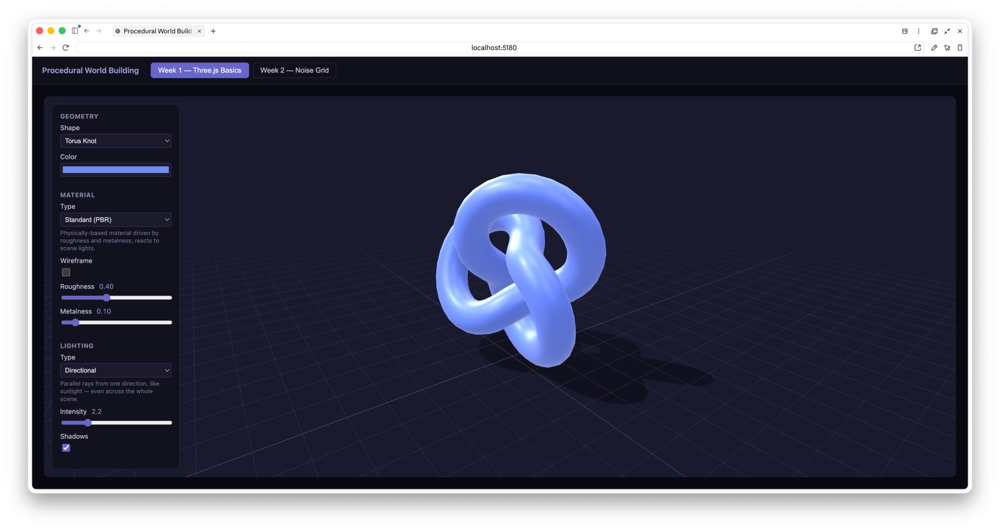
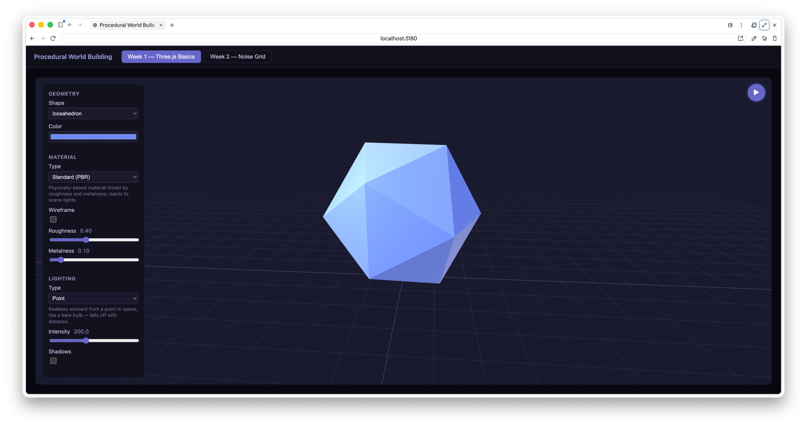
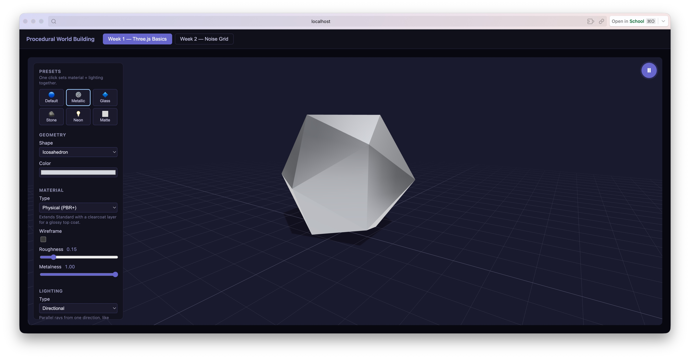
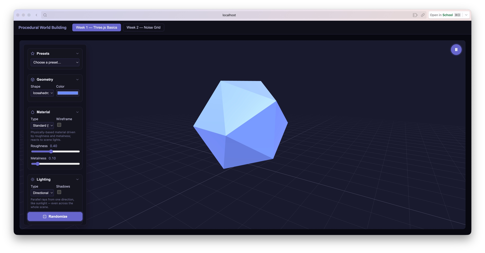
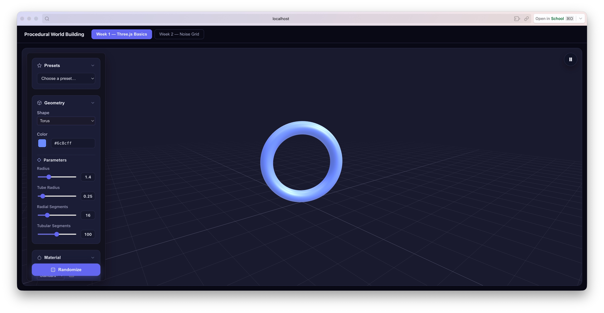
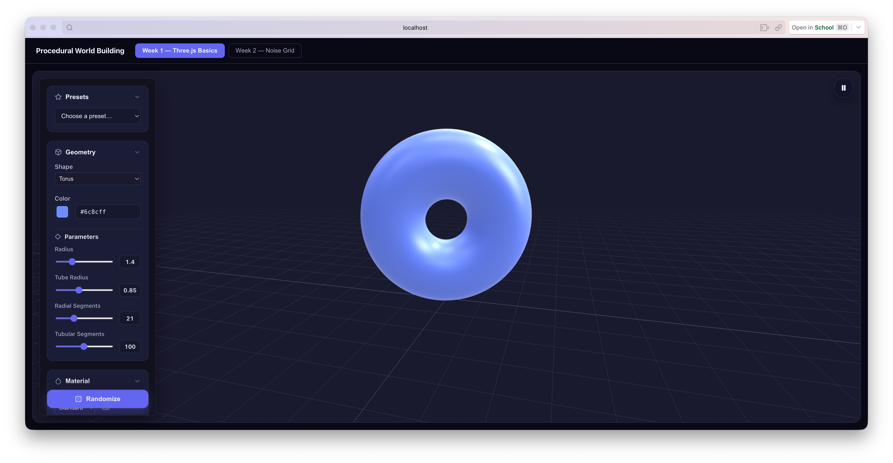

# Week 1 — Three.js Basics

An interactive playground for the fundamental building blocks of a Three.js
scene: geometry, material, and light. The goal was to build intuition for
how those three pieces interact before moving on to procedural generation
in Week 2.

## What it does

A single mesh sits on a grid-helper ground plane, orbitable with mouse
drag/scroll. A floating control panel lets you swap:

- **Shape** — box, sphere, icosahedron, torus, torus knot, cone, cylinder
- **Material** — Standard (PBR), Physical (PBR + clearcoat), Phong,
  Toon (cel-shaded), Basic (unlit) — each with a short description in the
  UI explaining how it shades
- **Color**, **wireframe** toggle, **auto-rotate** toggle
- **Roughness** / **metalness** (Standard/Physical materials) or
  **shininess** (Phong)
- **Light type** — directional (parallel rays, like sunlight), point
  (radiates from a bulb, falls off with distance), spot (a cone with a
  soft penumbra edge) — each has its own intensity range since point/spot
  lights use physically-based candela units while directional is closer
  to lux
- **Light intensity** and a **shadows** toggle (casts onto the ground
  plane via a `ShadowMaterial`, invisible until a shadow actually falls
  on it)

## Notable implementation details

- The scene (renderer, camera, controls, lights, ground) is built once in
  a mount-only `useEffect`; later state changes mutate the existing
  Three.js objects in place (swap geometry, rebuild material, adjust
  light intensity) rather than tearing down and rebuilding the whole
  scene on every control change.
- A `RoomEnvironment` PMREM is used purely so metallic materials have
  something to reflect — a metallic surface has no diffuse color of its
  own, so without an environment map, high metalness just renders black.
- Auto-rotate is read through a ref inside the render loop (rather than
  closed over from `state`) so the `requestAnimationFrame` loop, created
  once on mount, always sees the latest toggle value.

## Development Log

**2026-09-14, 09:20** — Torus knot with the Standard (PBR) material,
directional lighting, and shadows enabled — shadow falls onto the ground
plane via the `ShadowMaterial`.

**2026-09-14, 09:28** — Default state: icosahedron under a point light,
auto-rotate paused (play button top-right), no shadows.

**2026-09-14, 16:09** — Added a set of Presets (Default, Metallic, Glass,
Stone, Neon, Matte) that set material + lighting together in one click —
shown here mid-redesign, still on the original boxy panel layout, with
Metallic applied to the icosahedron (Physical material, roughness 0.15,
metalness 1.00).

**2026-09-14, 17:13** — Redesigned the control panel into collapsible
dark-navy sections with a label-beside-control row layout (Shape/Color,
Type/Wireframe, Type/Shadows each share a row) instead of the earlier
stacked, label-above-control fields.

**2026-09-14, 17:29** — Exposed each shape's construction parameters as
sliders with typable numeric boxes — torus shown here with Radius, Tube
Radius, Radial Segments, and Tubular Segments.

Adjusting those parameters (radius 1.4, tube 0.85, 21 radial segments)
reshapes the torus in real time.

## Files

| File | Purpose |
| --- | --- |
| `index.tsx` | Top-level layout: scene + controls panel + rotate toggle |
| `Scene3D.tsx` | Three.js scene setup and the render loop |
| `sceneFactories.ts` | Builds/updates geometry, material, and light objects from state |
| `ControlsPanel.tsx` | The floating control panel UI |
| `RotateToggle.tsx` | Small auto-rotate on/off button |
| `config.ts` | Default state, per-shape/material/light labels and descriptions |
| `types.ts` | `Week1BasicsState` and the shape/material/light union types |
