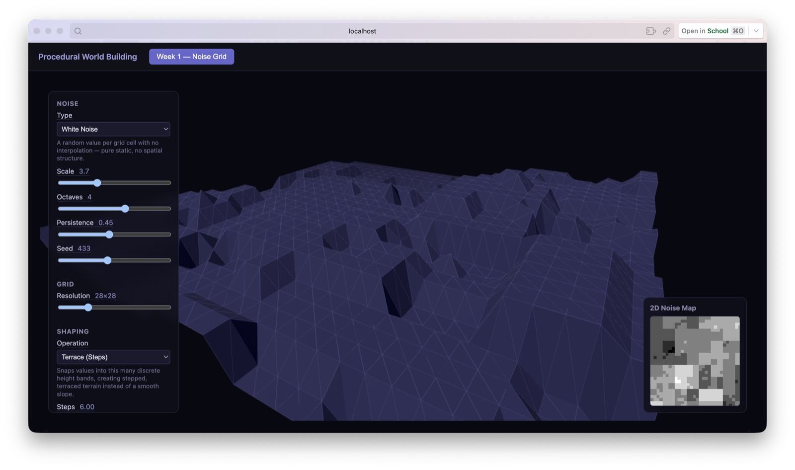
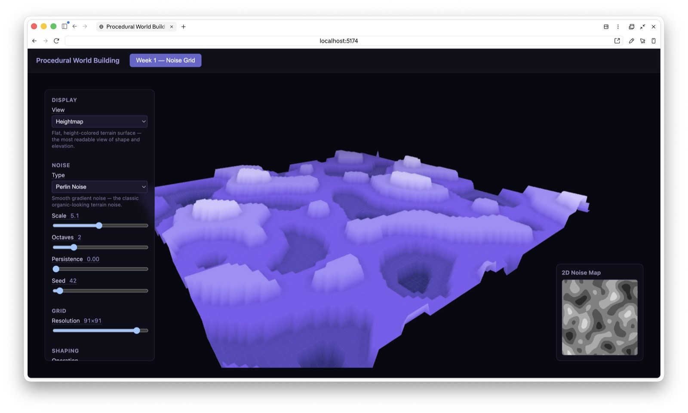
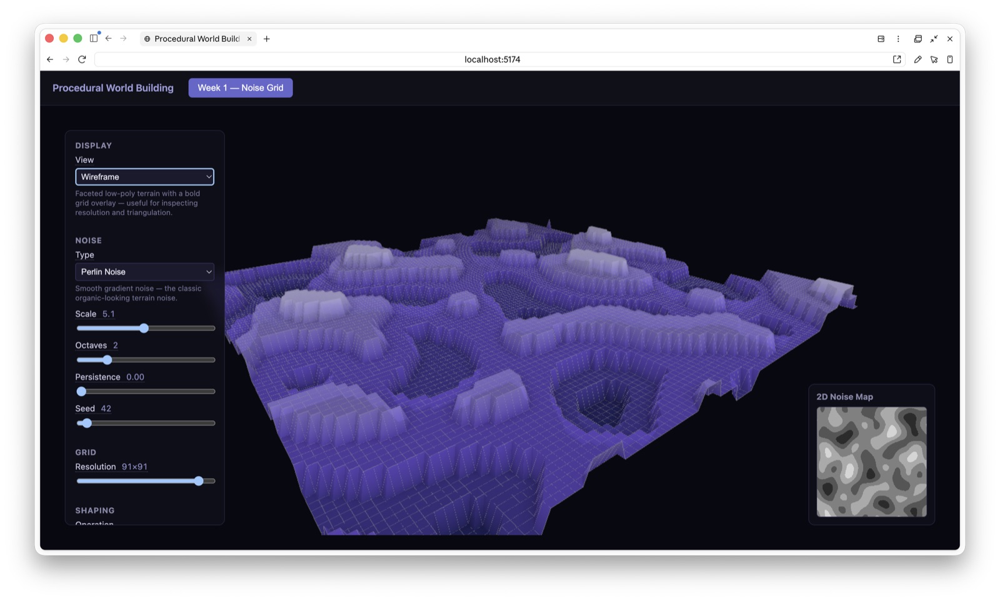

# Week 2 — Noise Grid & Hydraulic Erosion

Started as a 2D/3D procedural terrain viewer built on a noise stack, then
grew into a full submission for **Assignment 2** (add a simulation that
starts/stops, a height field driven by the noise stack, and calibrated
map/terrain resolution) by layering a deterministic hydraulic erosion
simulation on top.

## What it does

**Terrain generation**

- A shared `Float32Array` height field is generated from a noise stack —
  White, Perlin, or Cellular noise, each with scale/octaves/persistence
  and a seed — then optionally reshaped with a power curve, terracing
  (stepped bands), or a ridge transform.
- The same height field drives two linked views: a grayscale 2D noise map
  (`NoiseMap2D`) and a 3D terrain mesh (`GridScene3D`), so both always
  agree. Grid resolution is adjustable to trade fidelity for performance.
- Two 3D view modes — Heightmap (smooth, indexed geometry) and Wireframe
  (faceted, non-indexed, with a grid overlay) — plus camera presets
  (perspective / top / side).
- Clicking a cell on the 2D map drops a pin and shows the matching point
  on the 3D terrain (and vice versa via hover), with a "Clear pin" button
  to remove the selection and crosshair.

**Hydraulic erosion simulation**

- `erosion.ts` implements a droplet-based erosion model (Beyer/Lague
  style): each droplet flows downhill along the bilinearly-interpolated
  gradient, carries sediment capacity based on slope and speed, erodes or
  deposits as it moves, and evaporates over its lifetime. Any sediment a
  droplet is still carrying when it dies (edge of map, evaporated, or
  max lifetime) is deposited at its final position — skipping this step
  was an early bug that leaked material and flattened the terrain within
  seconds.
- The simulation is fully deterministic: a seeded PRNG (`createRng`)
  means the *n*-th droplet is always the same droplet for a given seed.
  That determinism is what makes the transport controls below possible.

**Simulation player (top-right overlay)**

- A media-player-style control: a **timeline slider** across the top
  scrubs through the simulation by droplet count — seeking works by
  regenerating the raw noise field and replaying exactly *N* droplets
  from a fresh seed, rather than storing per-frame history/snapshots.
- Below it, a **speed dropdown** (0.25×–4×) on the left, a **play/pause**
  button in the center, and a **reset** button (back to raw, un-eroded
  noise) on the right.
- Live droplet count is shown under the transport row.

## Development Log

Chronological snapshots of this week's build (this folder was originally
"Week 1 — Noise Grid"; it was later renamed to Week 2 once Week 1 became
its own [Three.js basics workshop](../week01-threejs-basics/README.md)).
The hydraulic erosion simulation and player weren't captured in a
screenshot as they were built — see [What it does](#what-it-does) above
for that part of the timeline.

**2026-09-10, 11:50** — First working version: noise stack (here, White
Noise) with a terracing shaping operation, wireframe view mode, 2D map
linked to the 3D terrain.

**2026-09-10, 12:31** — Switched to Perlin noise with the smooth
Heightmap view mode — the default, most-readable display of shape and
elevation.

**2026-09-10, 12:31** — Same Perlin terrain, toggled to Wireframe view to
inspect grid resolution and triangulation.

## Files

| File | Purpose |
| --- | --- |
| `index.tsx` | Owns shared state (noise params, height field, simulation state); wires seek/reset/play handlers |
| `noise.ts` | White/Perlin/Cellular noise functions |
| `shaping.ts` | Power/terrace/ridge height-curve transforms |
| `erosion.ts` | Droplet-based hydraulic erosion model + seeded RNG |
| `GridScene3D.tsx` | Three.js terrain mesh, camera presets, view modes, erosion render loop |
| `NoiseMap2D.tsx` | 2D grayscale canvas view, pin/crosshair, click-to-select |
| `SimulationPlayer.tsx` | Timeline scrubber + speed/play/reset transport controls |
| `ControlsPanel.tsx` | Noise/View tabbed control panel |
| `colorRamp.ts` | Height-based color ramp for the 3D terrain |
| `config.ts` | Default state and per-control metadata |
| `types.ts` | Shared state and cell/view/camera types |
