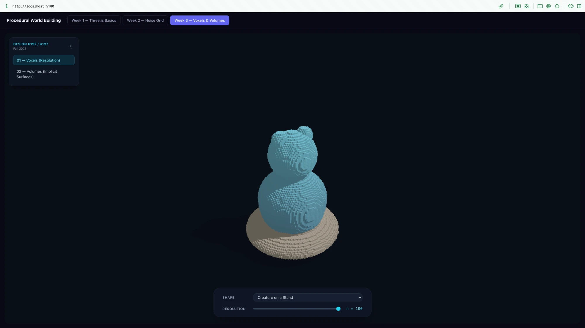
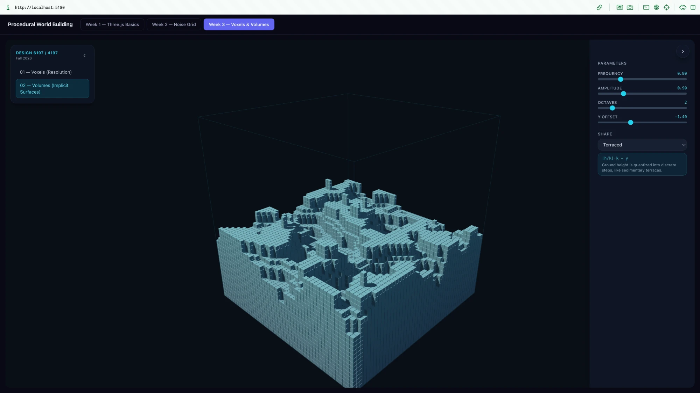
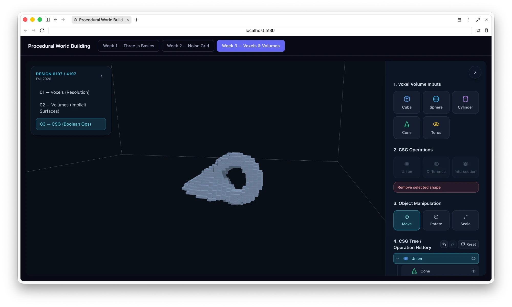
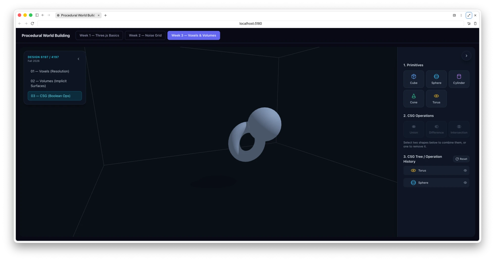
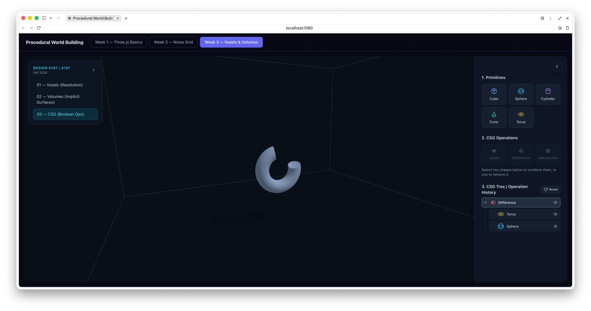
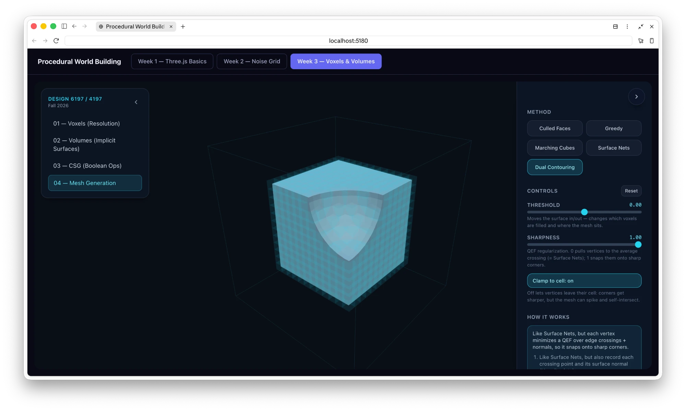
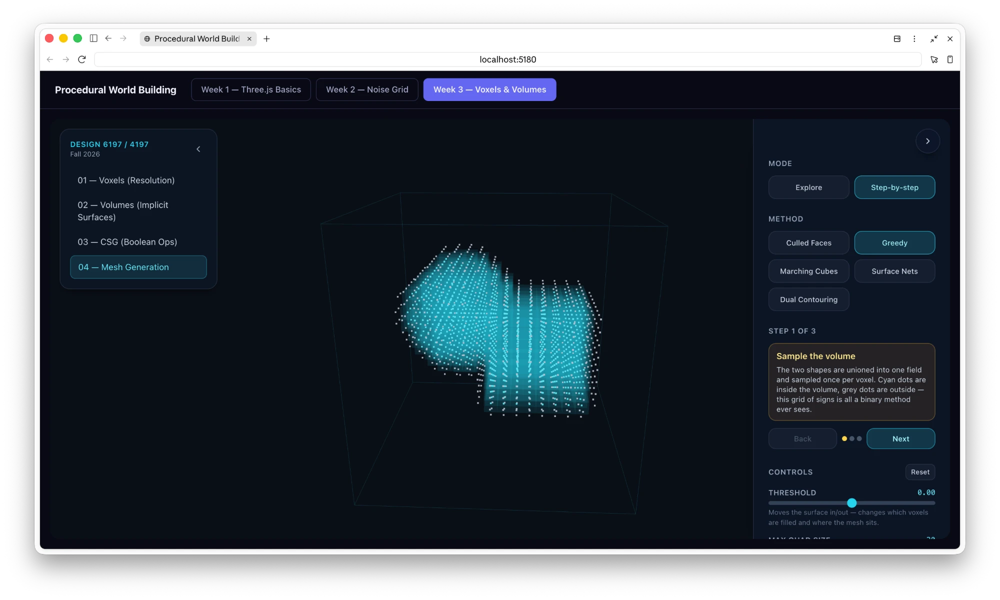
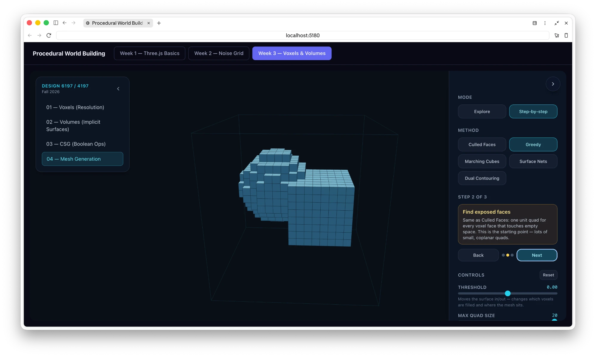
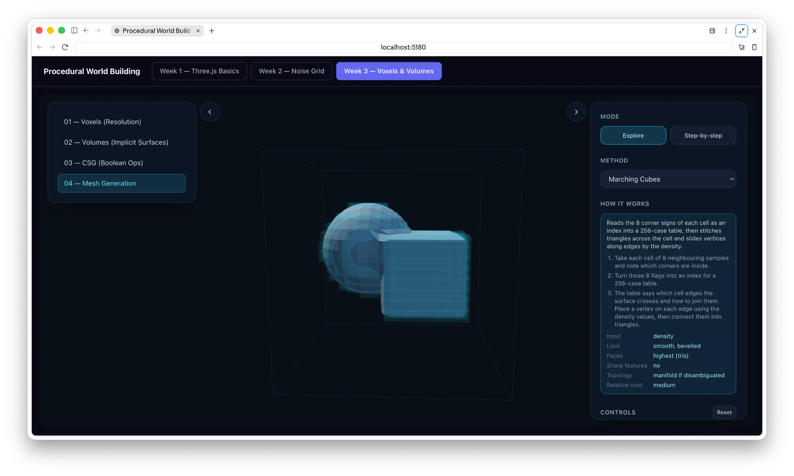

# Week 3 — Voxels & Volumes

[← Back to the main README](../../../../README.md)

Four views about representing shapes as volumes: sampling a shape into a voxel grid, defining
a solid with a formula, combining solids with boolean operations, and turning a volume back
into a surface mesh.

Tab structure: **01 — Voxels (Resolution)**, **02 — Volumes (Implicit Surfaces)**, **03 — CSG (Boolean Ops)**, **04 — Mesh Generation**.

## Key Concepts

- **Voxels** store a shape as filled or empty cells in a 3D grid. Grid resolution trades a
  blocky, readable silhouette against detail and cost.
- **Implicit surfaces** define a solid with an inequality: a point is inside when a function
  of its position is below zero. Noise can drive that function to make terrain.
- **Signed distance fields (SDFs)** give the distance to a surface, negative inside. Boolean
  operations become simple formulas: union `min(a,b)`, difference `max(a,-b)`,
  intersection `max(a,b)`.
- **Mesh extraction** turns a volume back into polygons. Methods differ in their input (binary,
  density, or Hermite data), how smooth or sharp the result is, face count, and cost.

The sections below are the process log for each tab.

---

## 01 — Voxels (Resolution)

Samples a chosen shape (e.g. "Creature on a Stand") into a regular 3D grid and renders each
filled cell as an instanced cube. A single **Resolution** slider (`n`) controls the grid
density, so the tab exists specifically to make the voxelization trade-off visible: low `n`
gives a blocky, legible silhouette; high `n` approaches the smooth original shape.

| n = 22 (chunky) | n = 100 (smooth) |
|---|---|
|  |  |

Rendering technique (reused by every other view in Week 3): a unit `BoxGeometry(1,1,1)` +
`THREE.InstancedMesh`, one `dummy = new THREE.Object3D()` used to write each filled cell's
transform matrix, `mesh.count` trimmed down to only the occupied cells.

## 02 — Volumes (Implicit Surfaces)

Same instanced-voxel rendering, but the fill rule comes from a **procedural noise
function** instead of a fixed mesh: frequency / amplitude / octaves / Y-offset sliders drive a
layered noise field, and a **Shape** dropdown selects how that noise field is turned into a
solid/empty test (e.g. "Terraced," shown below, quantizes ground height into discrete steps
via `⌊h/k⌋·k − y`). The panel explains the formula in plain language under the controls —
this tab is about teaching implicit-surface thinking (an inequality defines a volume) rather
than importing a specific mesh.

## 03 — CSG (Boolean Ops) — the "Voxel Techniques Lab"

This tab went through the most iteration. It teaches **SDF boolean combination** —
`min(a,b)` (union), `max(a,-b)` (difference), `max(a,b)` (intersection) — applied to
voxelized primitives, rather than being a general polygon-modeling tool.

### Iteration 1 — real polygonal CSG (superseded)

The first working version used `three-bvh-csg` (pinned to `0.0.17` for compatibility with the
repo's `three@^0.169.0`) to perform exact polygon boolean operations: a primitive palette, a
tree of combined shapes, click-to-select-and-combine, and a formula/explanation panel. This
produced smooth, crisp CSG meshes — a genuine "mini CAD" feel.

### Iteration 2 — reframed as a voxel-only teaching tool

The scope was deliberately narrowed: **only voxels**, no polygon/surface/wireframe view mode,
no resolution control (that idea belongs to View 01), and no separate A/B formula-explanation
panel. Each primitive is now voxelized directly from a hand-written pseudo-signed-distance
function (`csg-lab/sdfPrimitives.ts`) — exact formulas for box/sphere/torus, simplified
capped-cylinder/cone formulas otherwise, since only the inside/outside sign matters, not true
distance magnitude. Boolean combination happens by combining two SDFs with `min`/`max` before
sampling into the voxel grid (`csg-lab/sdfEngine.ts`), so "Volume A", "Volume B", and "Result"
are all literally the same voxel-rendering pipeline as Views 01/02, just fed by a different
function.

The three-bvh-csg dependency was left installed but is no longer imported by this tab — it
was a deliberate choice not to touch `package.json` for a UI-scoped request.

### Iteration 3 — "Object Manipulation" replaces click-and-drag

Free click-and-drag placement was hard to control precisely, so it was replaced with a
dedicated **Object Manipulation** section: Move / Rotate / Scale buttons that attach a
`THREE.TransformControls` gizmo to the selected shape. This required:

- Switching primitive/operation transforms from ad-hoc position-only state to a full
  `position` + `rotation (quaternion)` + `scale` per node, so rotate/scale are meaningful and
  compose correctly (quaternions avoid gimbal lock).
- Reading the installed `TransformControls.js` source directly to confirm its API and to find
  an upstream bug: `.dispose()` calls `this.traverse(...)`, but `TransformControls` doesn't
  extend `Object3D` and has no `.traverse` — it throws on every unmount. Fixed by calling
  `.disconnect()` and manually disposing the helper's geometries/materials instead.

### Bug fix — "the cross should move with the object"

After adding the gizmo, combined shapes (e.g. Cube − Sphere) showed the gizmo sitting at the
world origin instead of on the shape. Root cause: a combined node's `position` defaulted to
`{0,0,0}` rather than the shape's actual centroid, so the Group the gizmo tracked never moved
even though the voxel data itself was baked at absolute world coordinates.

Fix: when two shapes combine (`csg-lab/treeLogic.ts`'s `combineRoots`), the new node's
`position` is now set to the true centroid of the combined bounds, and its children are
rebased by the inverse offset so the visible geometry doesn't jump. SDF and bounds evaluation
were split into "local" (excludes a node's own transform — used to voxelize the root, paired
with the viewport's Group carrying that transform directly) and "full" (absolute — used for
nested recursion and the live preview). This makes the gizmo track the shape's real pivot in
every mode:

| Move | Union preview | Difference result |
|---|---|---|
|  |  |  |

### Current panel structure

1. **Voxel Volume Inputs** — add Cube / Sphere / Cylinder / Cone / Torus primitives.
2. **CSG Operations** — Union / Difference / Intersection; arms a live preview, then Apply
   commits it (or Cancel backs out); "Remove selected shape" when exactly one is selected.
3. **Object Manipulation** — Move / Rotate / Scale gizmo modes (only shown once a single
   shape is selected).
4. **CSG Tree / Operation History** — indented tree with per-node hide toggle, plus
   Undo / Redo (also bound to Ctrl/Cmd+Z) and Reset.

### Other features added along the way

- **Undo/redo**: a history-wrapping reducer (`past` / `present` / `future`, capped at 50
  steps) around the base state reducer — only structural edits (add, combine, remove,
  transform, hide, reset) push history; transient UI state (selection, panel open/closed)
  does not.

### Known dev-environment quirks encountered

- Vite's dev server occasionally served stale HMR output after heavy edits — resolved each
  time with `preview_stop` → delete `node_modules/.vite` → `preview_start`.
- The in-app browser pane intermittently failed to render screenshots ("pane minimized and
  not painting"); worked around with a fresh tab and text-based page reads when that happened.

### Verification

`npx tsc -b && npm run build` passes cleanly. Manually verified in-browser: adding/combining
primitives, all three boolean operations, Undo/Redo, and the Move/Rotate/Scale gizmo tracking
both a bare primitive and a combined shape correctly (including a live drag → commit → undo
round-trip). Views 01 and 02 re-checked for regressions after the final gizmo fix.

---

## 04 — Mesh Generation

Views 01 to 03 all render *voxels*. This tab asks the next question: how do you turn a volume
into an actual mesh? It starts from a comparison of surface-extraction methods (input type,
look, face count, sharp features, topology, cost) and turns each row into something you can
poke at. Marching tetrahedra was skipped, and instead of one tab per method there is a single
tab with a method dropdown.

| Method | Input | Look | Faces | Sharp features | Topology | Relative cost |
|---|---|---|---|---|---|---|
| Culled Faces | binary | blocky | medium | yes (axis-aligned only) | watertight, often non-manifold | lowest |
| Greedy | binary | blocky | lowest | yes (axis-aligned only) | T-junctions | low–medium |
| Marching Cubes | density | smooth, bevelled | highest (tris) | no | manifold if disambiguated | medium |
| Surface Nets | density | smooth | low (quads) | no | mostly manifold | low–medium |
| Dual Contouring | Hermite | smooth + sharp | low (quads) | yes | risk of non-manifold / self-intersection | high |

### Process

**1. Explore mode with per-method controls.** The first version had a button per method, a
"how it works" card, and a few controls that make each algorithm's key idea tweakable. It
used a carved cube as the test volume, because it has flat faces, sharp edges and a curved
cut in one object. Along the way I removed things that did not help with comparing methods:
the resolution slider (that belongs to tab 01), the volume selector, the wireframe toggle, and
the display toggles. The volume is now fixed at n = 20, and the source voxels are shown as a
faint overlay so you can see what each method starts from.

**2. Step-by-step mode, and a new default volume.** Comparing finished meshes does not show
*how* a method works, so I added a Step-by-step mode that walks through each algorithm one
stage at a time. At the same time the default volume became a cube and a ball unioned
together: the cube gives sharp edges, the ball gives a curved surface, and the place where they
meet is a concave crease that every method has to deal with. Each stage draws what the
algorithm is looking at: inside/outside samples, amber surface cells, pink edge crossings with
orange normals, and green cell vertices. On the last stage the mesh is built face by face
(drag *Built (%)* or press Play), with every face outlined so merged rectangles are visible.

| Step 1: sample the volume | Step 2: find exposed faces (Greedy) |
|---|---|
|  |  |

A short recording of Greedy's last step, where the exposed faces are merged into rectangles
as the mesh builds: [mesh-greedy-merge-walkthrough.mov](screenshots/mesh-greedy-merge-walkthrough.mov).

| Method | Steps |
|---|---|
| Culled Faces | sample, emit exposed faces |
| Greedy | sample, exposed faces, merge into rectangles |
| Marching Cubes | sample, surface cells, look up triangles per cell |
| Surface Nets | sample, surface cells, edge crossings, one vertex per cell, connect quads |
| Dual Contouring | sample, surface cells, crossings and normals (Hermite data), solve the QEF, connect quads |

**3. Simplifying the UI.** Once the features were in, most of the work was making the panel
easier to read:

- The method buttons became a dropdown, with "How it works" directly under it.
- The two modes now show different things. Explore shows Method, How it works and Controls.
  Step-by-step shows only the step section (its heading names the current method).
- All descriptions were rewritten in plainer language, without em dashes.
- The left navigation and the right settings panels now share one `SidePanel` component: the
  same card style, the same slide animation, and the same round toggle button, and the arrow
  sits outside the panel so it never covers the controls. The navigation also lost its
  "Design 6197 / 4197" header and its wrapped labels.

### How the methods are implemented (`mesh-gen/`)

- **One shared volume.** `fields.ts` defines a signed-distance-style field (a cube unioned with
  a ball). `buildVolume` samples one value per voxel centre. Binary methods only look at the
  sign, density methods interpolate the value, and Dual Contouring also bisects the true field
  for the edge crossing and takes its gradient as the normal (the Hermite data).
- **Culled vs. greedy** share one sweep (`meshBlocky`): find the exposed faces in each slice,
  then either emit each one or grow it into the largest rectangle. The surface is the same,
  with far fewer quads.
- **Marching cubes** reuses the 256-case `edgeTable` and `triTable` exported by three.js's
  `MarchingCubes.js`. Vertices are welded per grid edge so the vertex count is comparable with
  the quad-based methods.
- **Surface nets and dual contouring** share their connectivity: one vertex per sign-changing
  cell and one quad per sign-changing grid edge. They differ only in where the vertex goes,
  either the mean of the edge crossings or the minimizer of a regularized quadratic error
  function (QEF). That single difference is what keeps the cube's edges crisp in Dual
  Contouring and rounds them in Surface Nets.
- **Step data** (surface cells, crossings, normals, vertices) is captured while each mesher
  runs, so the step-by-step view shows the algorithm's real intermediate results and not a
  re-drawn approximation.

### Controls

Each method has controls that expose its key idea, plus a shared *Threshold* slider that moves
the surface in or out. The panel also lists live vertex, face and triangle counts and build time.

| Method | Control | What it shows |
|---|---|---|
| Culled Faces | Cull hidden faces | off adds all 6 faces per voxel, including buried ones |
| Greedy | Max quad size | 1 means no merging (same as Culled), 20 means fully greedy |
| Marching Cubes | Interpolate along edges | off puts vertices at edge midpoints, so the surface snaps to coarse positions |
| Surface Nets | Average edge crossings | off puts each vertex at its cell centre, so the surface follows the grid |
| Dual Contouring | Sharpness, Clamp to cell | sharpness 0 behaves like Surface Nets; unclamped vertices can spike or self-intersect |

## Files

| File | Purpose |
| --- | --- |
| `index.tsx` | The Week 3 page: sidebar navigation, plus the Resolution and Implicit Surfaces views and panels |
| `SliderField.tsx` | Labelled slider used by the Week 3 panels |
| `constants.ts` | Shared world-space scale so every view is similarly sized |
| `icons.tsx` | Inline SVG icons shared by every view |
| `useDebouncedEffect.ts` | Runs an effect only after inputs stop changing (avoids rebuilding on every slider tick) |
| `csg-lab/` | Tab 03: SDF primitives and boolean engine, voxel sampler, CSG tree, undo/redo state, transform gizmo, panel and viewport |
| `mesh-gen/` | Tab 04: the test volume (`fields.ts`), the five meshers (`meshers.ts`), panel, step-by-step view and viewport |
| `screenshots/` | Images and the recording referenced above |

Shared across weeks: the side panel in [`site/src/components/`](../../components).
