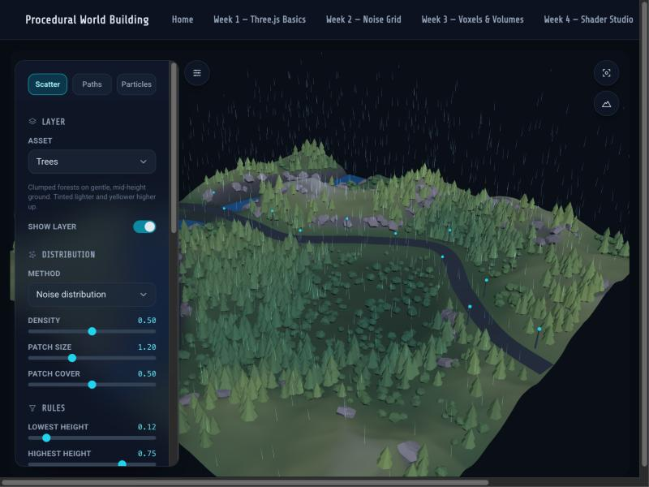
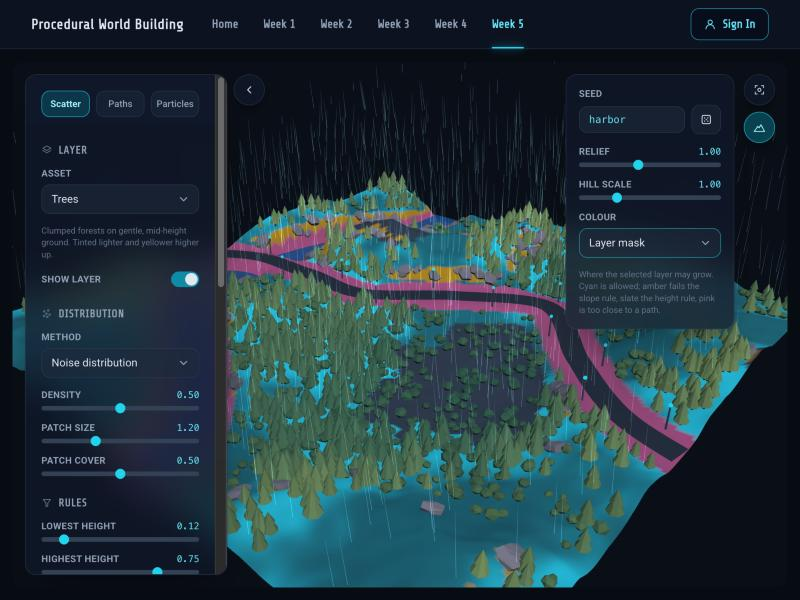
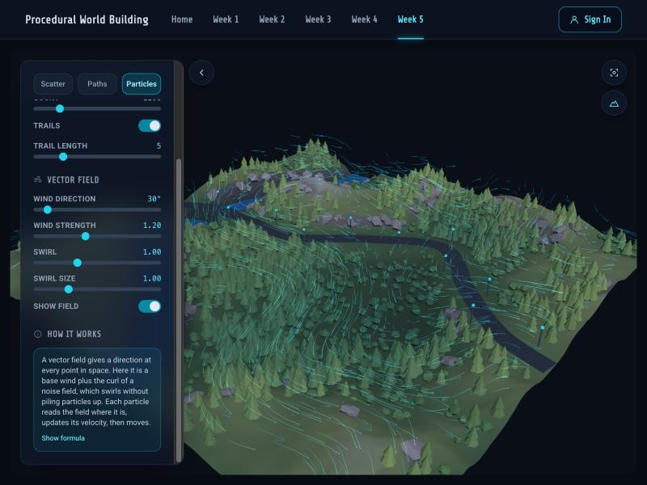

# Week 5 — Scatter & Paths

[← Back to the main README](../../../../README.md)

The three parts of Class 06 (PCG 04) on one terrain: **distributions** (scattering assets),
**paths** (spline overlays) and **vector fields & particles**. Each part has its own tab in the
side panel. The terrain card (top right) holds the seed, relief, hill scale and terrain colour.

The lecture notes behind this tab are in
[Distributions, Paths & Vector Fields — Class Notes](../../../../docs/notes/distribution-and-paths-notes.md).



## The pipeline

```
seed → heightmap (fbm + ridged noise)
     → paths: control points read the terrain, curves deform it
     → scatter layers: candidates → rules → oriented, sized, tinted copies
     → particles move through a vector field every frame
```

Every step is seeded, so the same seed always gives the same world. Each layer draws its random
numbers in the same order whatever the rules are, so moving one slider never reshuffles the rest.

## Scatter (Assignment 1)

Four layers, picked from the **Asset** dropdown, each with its own rules:

| Layer | Default method | Rule that defines it |
|---|---|---|
| Trees | Noise distribution | Mid-height, slope under 33° (the lecture's example), clumped in noise patches |
| Bushes | Random | Low ground, gentle slopes |
| Rocks | Random | The opposite: only on slopes **over** 28°, leaning fully with the surface |
| Windmills | Poisson disk | Flat hilltops, at least 4 units apart; blades turn with the wind |

- **Distribution:** random, noise distribution (noise as a density map) or Poisson disk
  (minimum spacing, nothing overlaps).
- **Rules:** a height band, a slope band and "avoid paths".
- **Variation:** align to surface (blend between world up and the surface normal), size,
  size variation and a tint from the terrain under each copy (lighter and yellower higher up).
- **Result:** how many candidates were thrown, how many were placed, and how many each rule
  rejected.
- **Layer mask** (terrain card → Colour) paints where the selected layer may grow: cyan is
  allowed, amber fails the slope rule, slate the height rule, pink is too close to a path.



## Paths (Assignment 2)

A road and a river, each a centripetal Catmull-Rom spline. The influence runs in three
directions:

- **Mesh → spline.** The control points are chosen by reading the terrain row by row: the river
  moves to the lowest ground within reach, the road to the most level ground. The curve is then
  projected onto the surface. The river's water level can only go down along its length.
- **Spline → mesh.** With **Deform terrain** on, a distance field to each curve flattens a road
  bed (blended back over the **Embankment** width) and carves the river channel. Turn it off to
  see the curves simply draped over the untouched terrain.
- **Spline → scatter.** The same distance field keeps scatter layers off the paths (plus
  **Scatter clearance**), and lamp posts are placed along the road every **Lamp spacing** units.

## Particles (Assignment 3)

Point data in a vector field. The field is a base wind (direction and strength) plus the curl of
a noise field, which swirls without piling particles up. **Show field** draws it as arrows.

- **Rain:** gravity plus drag towards the wind; drops respawn at the top when they hit the ground.
- **Wind:** particles hover over the terrain and follow the field; their trails draw flow lines.
- **Clouds:** large, soft sprites drifting high above, wrapping around the edges.

Trails keep each particle's last positions in a ring buffer and draw them as fading line
segments. Every particle is drawn with the same soft round sprite texture.



## Files

| File | What it does |
|---|---|
| `terrain.ts` | Heightmap, bilinear height, normals and slope |
| `paths.ts` | Control points, splines, distance fields, deformation, lamp posts |
| `scatter.ts` | Candidate generation (random, noise, Poisson disk), rules and per-copy variation |
| `particles.ts` | The curl-noise wind field and the particle simulation with trails |
| `terrainColors.ts` | Terrain colour for each view, including the layer mask |
| `assets.ts` | Low-poly asset geometry, path ribbons and the particle sprite |
| `Viewport.tsx` | The Three.js scene: terrain, instanced assets, paths, particles |
| `WorldPanel.tsx` | The side panel with the Scatter, Paths and Particles tabs |
| `ViewportControls.tsx` | Frame button and the terrain card |
