# Blueprint City: the procedural world

[← Back to the main README](../../../README.md) · [Concept](../../../docs/concept.md) · [Terrain plan](../../../docs/plans/terrain-plan.md) · [Town plan](../../../docs/plans/town-plan.md)

Route: `/world` (seed in the URL, e.g. `/world?seed=blueprint`).

A voxel diorama generated from a seed: terrain first, then a river, a street network, districts
and lots, with buildings to come. Every stage has its own settings on the left panel, and a change
reruns only the stages from the one it touched. The timeline at the bottom replays the city being
made, in the order the stages run: the terrain prints from the plinth up, the river carves its
channel and fills, the plaza is built, and the streets grow out from it.

## Where it stands (2026-10-13)

```text
seed → noise → shaping → heights → terraces → river → claims → hubs → streets → voxelize → surfaces → mesh → districts + lots + parks
```

- **Terrain:** done. 232 m across, 0.25 m voxels (928 × 928 columns), land only, with a river.
- **Streets:** done (third design, wave function collapse from the plaza).
- **Districts, lots and parks:** done, Cities: Skylines style (whole districts, every lot on a
  street, parks as their own layer).
- **Buildings:** a library of eleven archetypes, previewed at `/buildings`, not yet placed on
  the lots.
- **Next:** place buildings on the lots by district (one landmark at the plaza), then scatter
  and bridges.

Overlays can be opened from the URL: `/world?show=districts,lots,parks`.

Code: `terrain/` holds one file per stage; `ui/TerrainPanel.tsx` is the panel, `ui/PrintBar.tsx`
the build timeline, `render/print.ts` the ground shader, `terrain/buildup.ts` the timeline's data. `noise.ts` and `rng.ts` are shared with
Week 5.

---

## Development log

### 2026-10-07: version 1, the full city pipeline

The first complete version: a 14-stage seed → rules → city pipeline (island, terrain, water,
voxels, suitability, districts, roads, growth, buildings, bridges, props, atmosphere,
performance). The settings panel had one tab per course topic (Terrain, Voxels, Shader, Paths,
Scatter).

It worked, but it was too much at once and hard to tune or explain, so the same day it was taken
back to terrain only (commit `5e83a14`) and then wiped, to rebuild the world one step at a time.
The code is in the git history at commit `bd582ca`.

| Rainy night | Dusk |
|---|---|
| 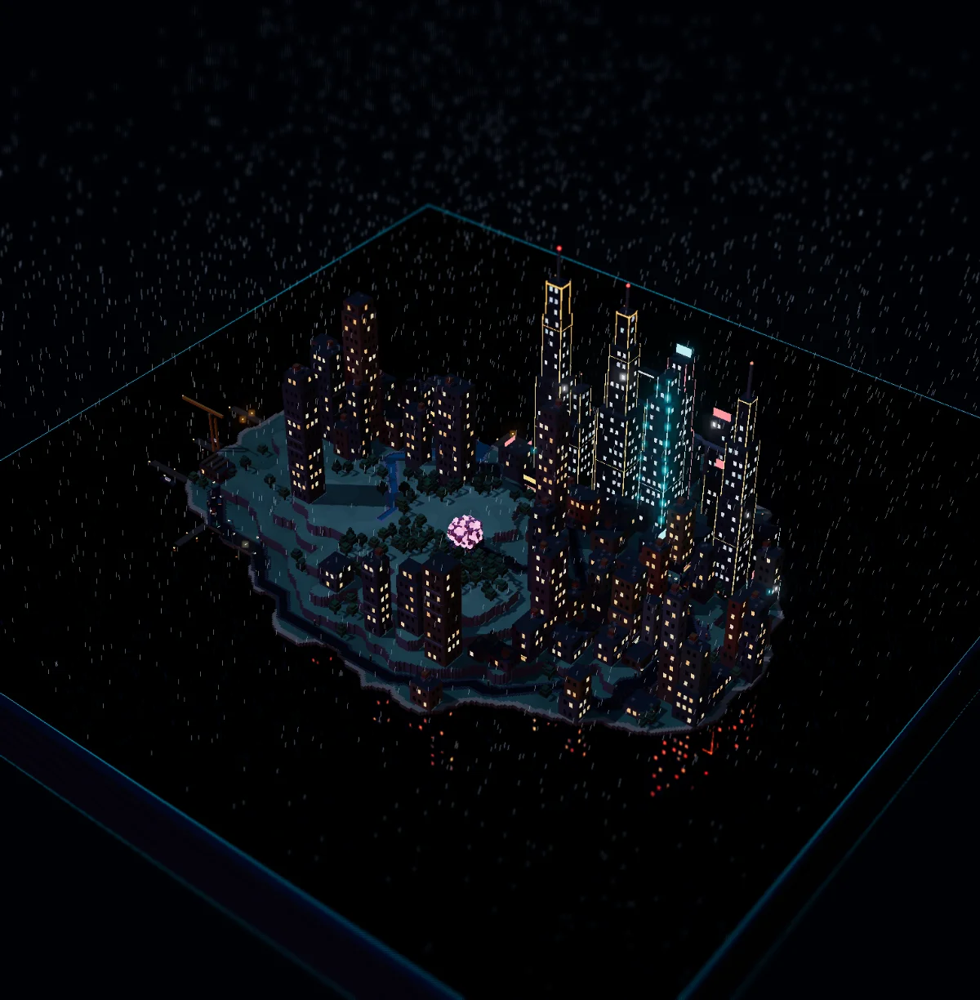 | 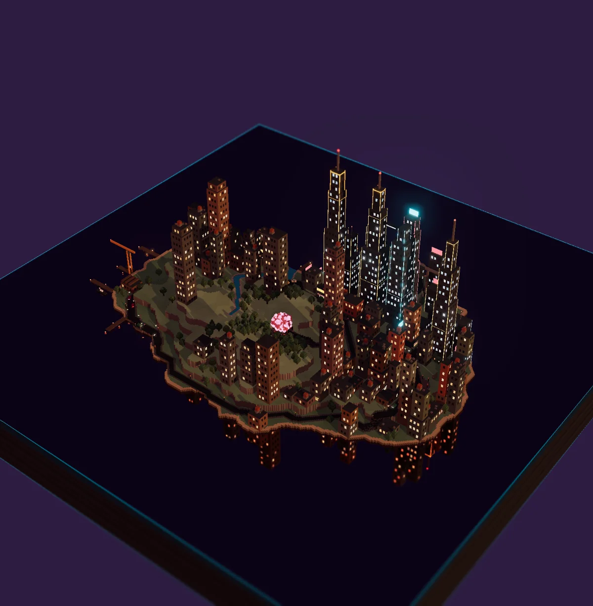 |

| Districts overlay | Growth, District phase |
|---|---|
| 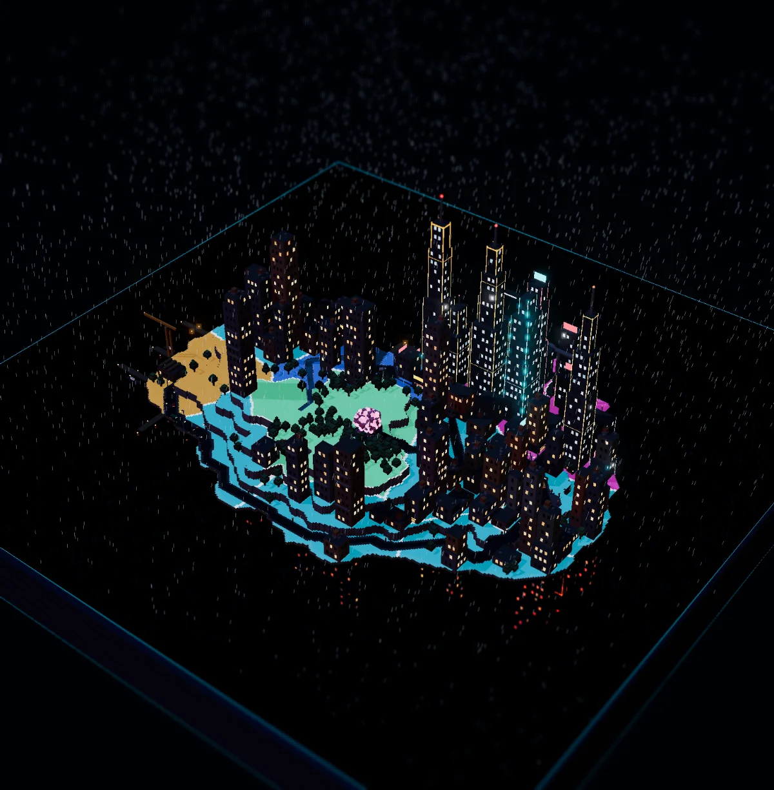 | 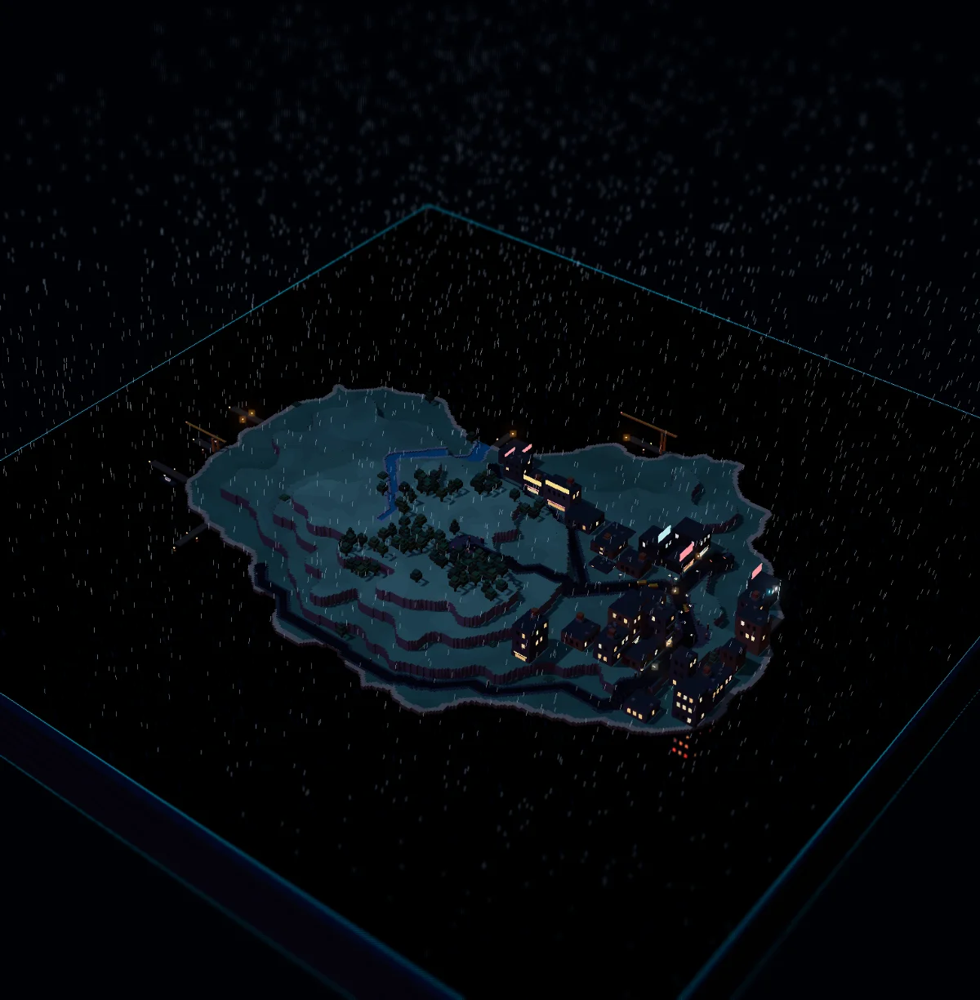 |

### 2026-10-07: rebuilding the terrain

Following [the terrain plan](../../../docs/plans/terrain-plan.md).

- **Smaller voxels:** 0.25 m instead of 0.5 m, so slopes read as fine voxel stairs and cliffs as
  tall stacks of small blocks.
- **Noise:** Week 2's noise stack (Perlin, Ridged, Billow, Cellular, White; Scale, Octaves,
  Persistence, Lacunarity), sampled at an adjustable Resolution, rounded to whole voxels and
  greedy-meshed chunk by chunk.
- **Shaping:** Power, Ridge sharpness and Height.
- **Terraces:** snapping scaled by local slope. Gentle ground keeps its voxel stairs; steep ground
  becomes shelves and cliffs.
- **Surfaces:** riverbed, bank, rock, dirt and grass by rules on slope and height, with a ground
  shader that draws the voxel grid, a per-block tint and strata bands on cliff sides.

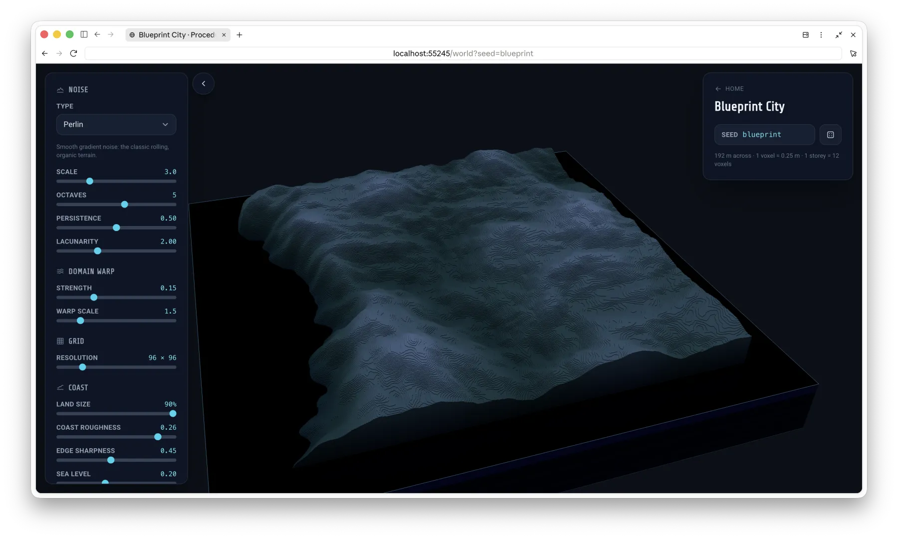

*The first step: noise → voxel columns, with the Noise, Grid and Coast sections. The coast and
domain warp seen here were removed the next day.*

### 2026-10-08: the first street

- **River valley,** with Week 5's path technique: control points that seek low ground, a
  centripetal Catmull-Rom spline, and a carve with banks. The water stays level across the
  channel and steps down steadily along it. The control points can be dragged in the view.
- **Hubs:** one center by the river, on the flattest ground, for a single megacity.
- **The first street:** an route from the center plaza that climbs in switchbacks, never
  steeper than 15%, carved into the hills and built up over dips.

| The river and the first street                                                                           | The same view with Show claims                                                        |
| -------------------------------------------------------------------------------------------------------- | ------------------------------------------------------------------------------------- |
| 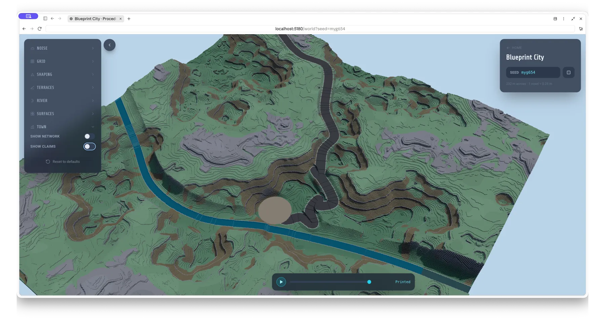 | 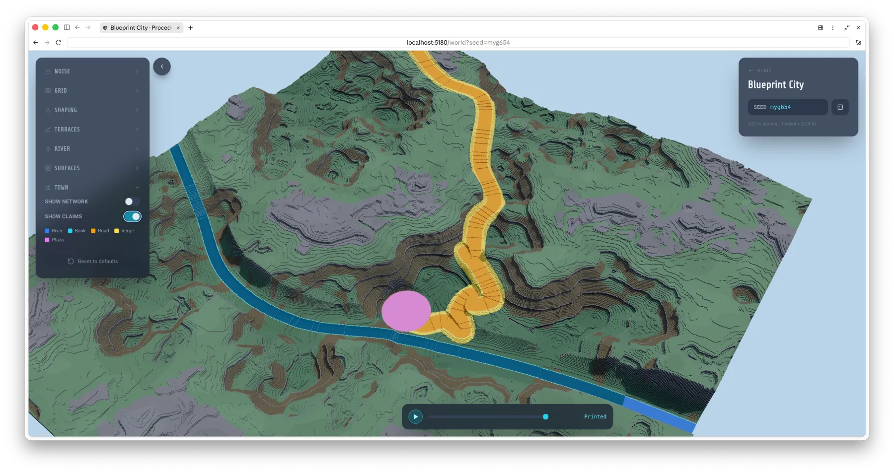 |

### 2026-10-09: the street network, districts and lots

The street network went through three designs in two days:

1. **Point to point:** each link routed on its own. Streets met at sharp angles and crossed away
   from junctions.
2. **Grown:** streets grown from the plaza, steered by a direction field and held to local rules.
   Better angles, but sparse on hilly seeds and few closed blocks.
3. **Wave function collapse:** street tiles on a grid, solved outward from the plaza.

What the network is now:
- **Avenues:** 3 to 5 straight from the plaza (the seed picks), held to a 15% grade; side streets
  may climb 25%.
- **Width:** every street is 3.5 m.
- **Junctions:** square pads on the voxel grid, as wide as the streets meeting there.

Then the **district map**, an internal map of what kind of building belongs where:
- **Six districts:** corporate core, neon strip, megablocks, industrial / docks, wealthy, parks,
  from access to the plaza, street frontage, distance to the river and slope.
- **Lots** along the streets, each in its district's color, never touching a road, the plaza, the
  river or another lot.
- **Show districts** and **Show lots** draw them without rebuilding the ground.

| Show districts and Show lots | Show claims: streets, verges, plaza and lots |
|---|---|
| 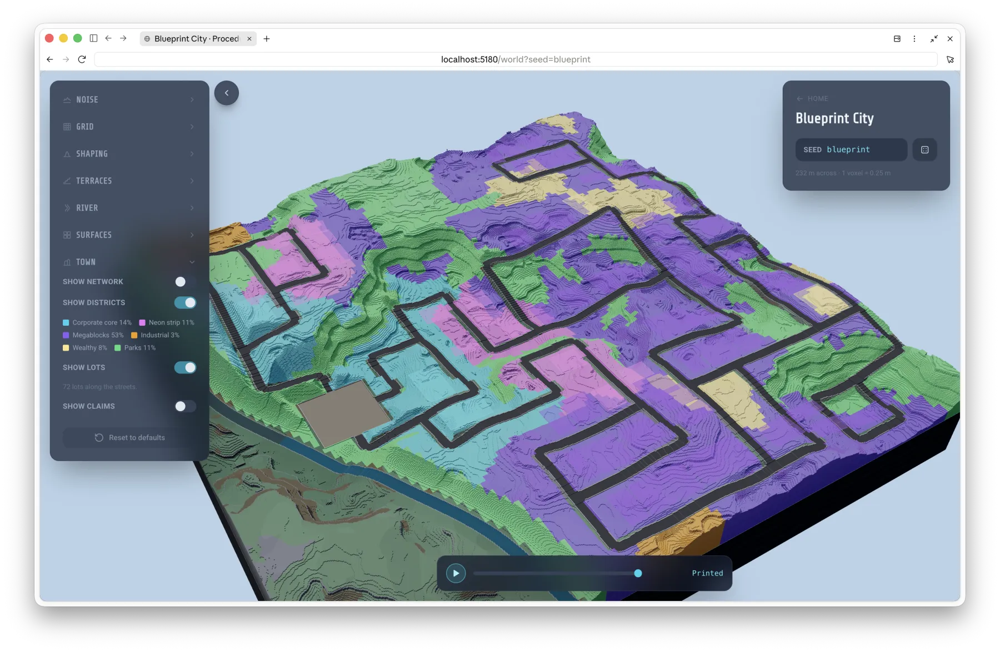 | 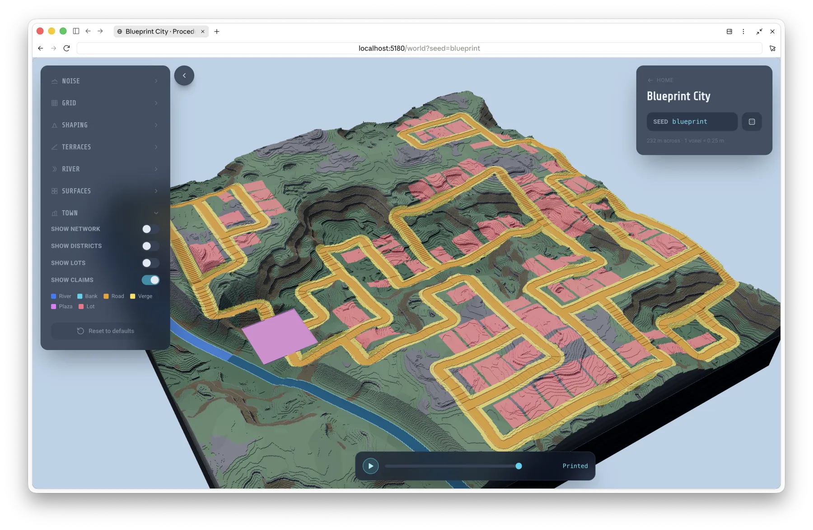 |


### 2026-10-12: the larger side of the river, and denser lots

- **The city's side:** the river splits the land in two, and the city now always starts on the
  side with more land. Before, the center went to the best spot on either side, so on some seeds
  the city sat on the narrow strip.
- **Grid section removed:** the noise Resolution is fixed at 96 × 96.
- **Denser lots:** lots covered only 13–25% of the district land, too sparse for a cyberpunk city.
  The land the street lots leave (block interiors, corners, land behind the outer streets) is now
  packed with **back lots** reached by alleys, and every lot keeps a 1 m alley from its
  neighbors. Cover is 48–55% on the 7 test seeds, and the stage got faster (72–139 ms).
- **Town views fixed:** Show lots is now a ground tint, like Show districts and Show claims, so
  lots follow the slopes and hide behind hills instead of floating through them. The tints no
  longer paint the diorama's outer walls, and the network's dots, lines and tile squares are
  hidden behind the ground (the squares now follow the slopes). Districts are now tinted per
  column: they reach right up to the street edge, and the paving itself stays clear.
- **Lots and districts like Cities: Skylines:** back lots needed alleys, and the alleys doubled up
  and climbed cliffs, so they're gone. Every lot now fronts a street: each side is cut into lots
  of whole 8 m zone cells that deepen until they meet the lots from the street behind, and a
  second pass fills the corners. Districts are smoothed into a few whole areas (none under
  1,500 m², reaching across streets), like painted districts. Cover is 20–41%.
- **Fewer, whole districts:** the corporate core is one compact disc around the plaza (at most
  50 m out), and nothing smooths it away or spreads it. Neon wraps it as one band of street
  frontage, with strips out along the avenues. Small leftover pieces under 2,000 m² join their
  neighbor.
- **Parks are not a district:** they are a layer of their own on top of the districts, claimed
  like roads so no lot goes there. Each seed picks 3 to 6 parks, each a round patch of
  700–1,400 m² grown outward from a spot on steep or hilly ground outside the core, and every
  park keeps at least 25 m from every other (fewer fit on a small city). They have their own **Show parks** switch; Show districts ignores them and
  shows the districts underneath.
- **Neon strip renamed Commercial,** and twice as wide: it reaches 28 m back from the street
  (was 14 m) in a 40 m ring around the core (was 20 m), plus the avenue strips. It now covers
  14–42% of the land (was 5–13%).

| Show districts and Show parks | Show lots |
|---|---|
| 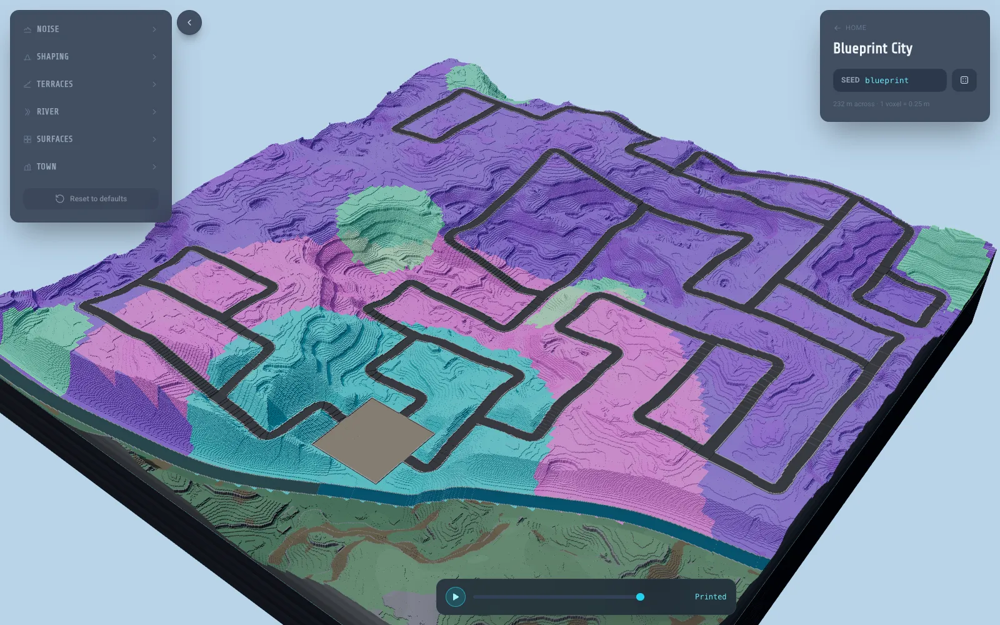 | 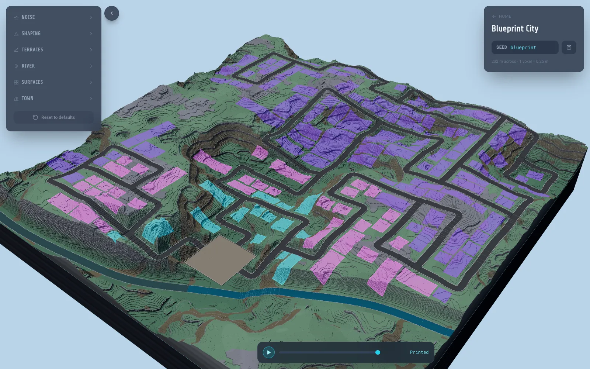 |

*Districts and parks (left) and lots (right) after these changes, on the default `blueprint` seed.*

### 2026-10-12: the building library

A library of cyberpunk voxel buildings for the lots, in [`buildings/`](buildings/README.md), with
a preview at `/buildings` (`/buildings?b=<id>&seed=<n>` opens one building). Plain three.js, like
the rest of `/world`, built at the city's 0.25 m voxel scale.

**The kit.** Every building is made from shared parts:
- recessed windows with mullions and sills;
- balconies with railings, and AC units on brackets;
- blade signs and screens;
- rooftop gear, skybridges and platforms;
- shop rows and entrances.

Every building:
- is seeded, so the same seed always gives the same building;
- takes a few milliseconds to build;
- is two draw calls (a lit body and its glowing parts);
- lists the districts it suits, ready for placing on lots.

The first version had ten archetypes: five skyscrapers and five high-density residential blocks.

**Making it hold up close.** Most of the first day went into the details looking right from any
angle:
- **Flicker:** faces sharing a plane flickered as the camera moved. Every part now keeps its own
  depth (parts stand a fraction of a voxel proud of the wall). A development check,
  `findOverlaps`, measures what's left: from 700–2,300 m² per building down to under 1 m² on
  most.
- **Parts running into each other:** a second check, `findClashes`, records every part's space
  and lists any two that run into each other. It found rooftop gear piled up, balconies inside
  skybridges, trees in walls and a bench under the awnings. Optional details now go only where
  they have room (or retry, or are left out), and skybridges reserve their space before the
  facades are dressed.
- **Facade details,** one at a time:
  - balconies got railings on three sides;
  - lit windows are lit from sill to head (no half-lit ones);
  - AC units became wall units on brackets, 1.2 m wide, with 30% left out at random;
  - an outside fire stair was tried on the Stacked Megablock, then removed.
- **Signs on solid wall.** Blade signs floated in front of windows or out over alleys. They now
  hang centered on a pier or corner column of their own mass (`pierSign`), sliding up or down to
  find room but never past their wall. Screens over fins or AC units stand off on brackets.

### 2026-10-13: redesigns, entrances and shop fronts

**Four buildings redesigned from references.** For each, I looked up real buildings first.
- **Corporate Megatower,** after SUMMIT One Vanderbilt and Edge (30 Hudson Yards), now 150 m:
  - a shaft tapering in four-floor tiers, its south face leaning;
  - thin ledges and lit glass reveals like SUMMIT's;
  - Edge's triangular sky deck jutting 12 m out near the top;
  - a stepped glass crown and a spire.
- **Neon Commercial Tower,** now 75 m:
  - blade signs only on every other inner pier, so they never cover each other;
  - neon bands broken around the screens;
  - warm lit windows only, so the signs carry the color.
- **Research Lab Tower** (replacing the Industrial Technology Tower), after Louis Kahn's Richards
  Medical Research Laboratories and the Salk Institute:
  - two glass lab towers either side of a windowless concrete service tower;
  - louvered service floors between every two lab floors;
  - brick stair and exhaust shafts climbing the outside, and exhaust stacks;
  - a greenhouse, and a double helix up the service tower.
  - Before it there was an industrial tower (an exoskeleton, smokestacks and a cooling tower),
    which was deleted. The first industrial design lives on as the residential **Tower and
    Annex**, the eleventh archetype.
- **Landmark Tower,** a TV tower after the CN Tower and Berlin's Fernsehturm, now 170 m:
  - buttress fins at the foot of a tapering round shaft, with a glass lift;
  - a disc observation pod with a deck and a restaurant, then a sky pod;
  - a banded antenna mast.
  - Its research: what landmarks in different countries share. They are visible from afar,
    unlike their neighbors, have a silhouette you can draw, a crowned top and a public viewing
    level. It is the tallest building in the library.

| The library (seed 1) | Corporate Megatower |
|---|---|
| 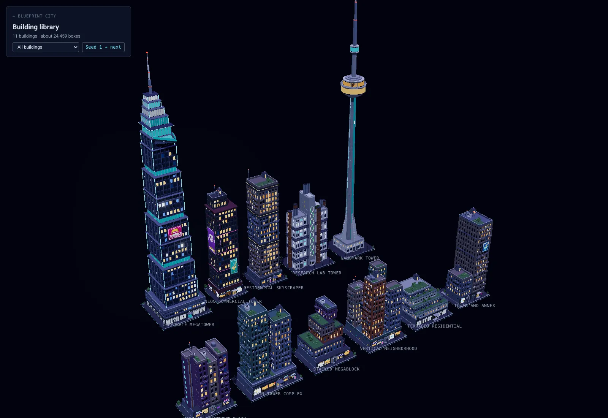 | 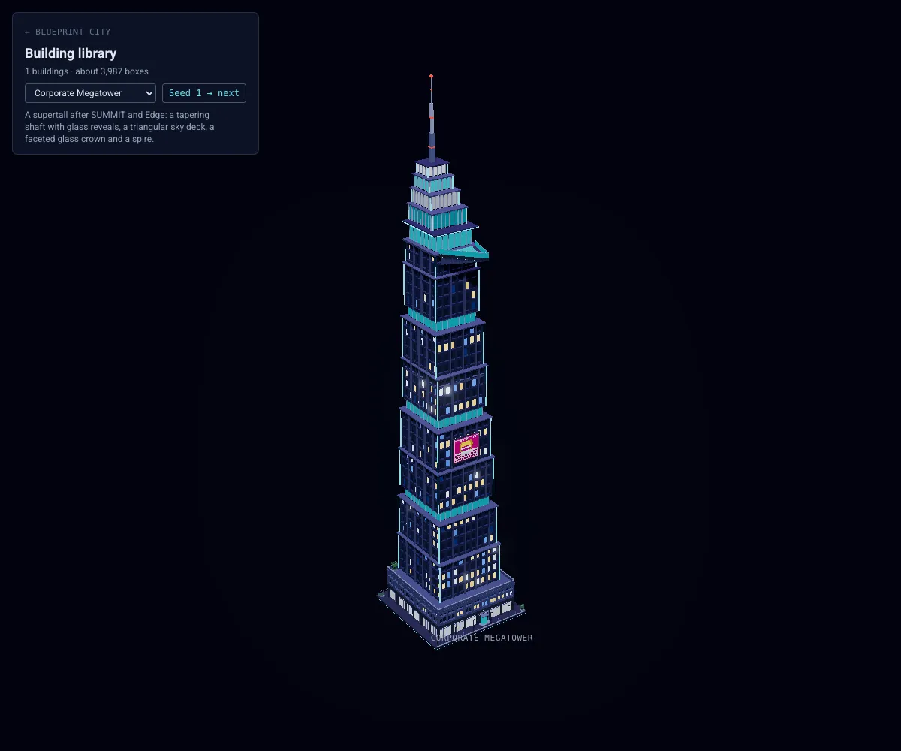 |

| Research Lab Tower | Landmark Tower (TV tower) |
|---|---|
| 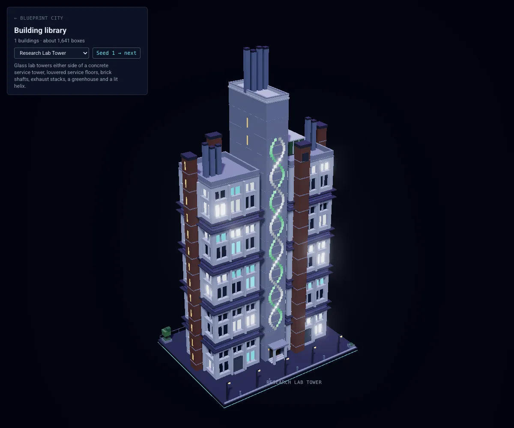 | 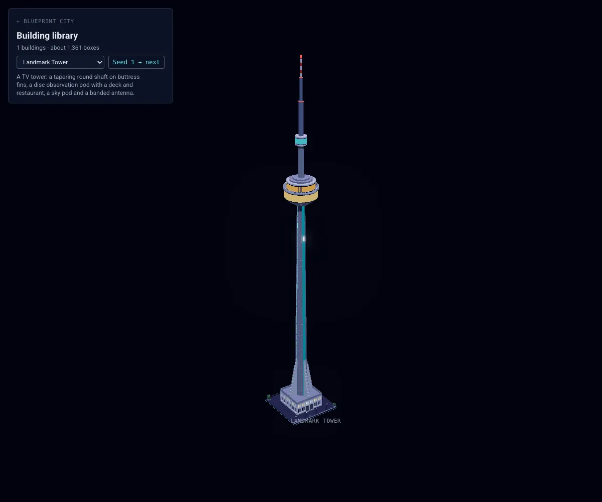 |

**Screens.** The posters went through three rounds:
1. **Finer pixels:** a 0.25 m pixel grid, with each row's runs of one color merged into one box.
2. **More designs,** from cyberpunk pixel-art ad references.
3. **Without the neon look:** posters are now lit like backlit prints, below the bloom
   threshold. The designs are a ramen shop, a phone launch, a drink with a price burst, a cat
   mascot, a logo, a headline and a synthwave travel ad. A building doesn't repeat a design.

**A way into every building.** An audit found that only two buildings had their own doors; the
others reached the street only through shops. Now:
- Every building has a ground entrance facing the street. Each door records itself, and a check
  confirms every building has one, with a clear walkway to the lot edge, on 8 seeds.
- Entrances come in five styles, after real types, each matched to the building:
  - **glass doors** (Neon Commercial, the Tower and Annex's tower);
  - a **revolving door** (Corporate Megatower);
  - a **porte-cochère** (Residential Skyscraper, Twin-Tower);
  - a **portico** (Terraced Residential, the Research Lab);
  - a Hong Kong **tong lau gated stair hall** (Modular, Stacked, Vertical Neighborhood, the annex).

**Shop fronts.** Nearly every building had shops on all four sides.
- Now only the street side has shops; the other sides are plain service walls with a back door,
  vents and posters.
- The Neon Commercial Tower keeps shops all round. The Corporate Megatower and Terraced
  Residential have a glazed lobby front instead.
- Each shop unit is one of five types: a store, a closed roller shutter with graffiti, a noodle
  bar (noren curtains, a red lantern, stools), a convenience store or a hatch kiosk.

| Neon Commercial Tower | Stacked Megablock |
|---|---|
| 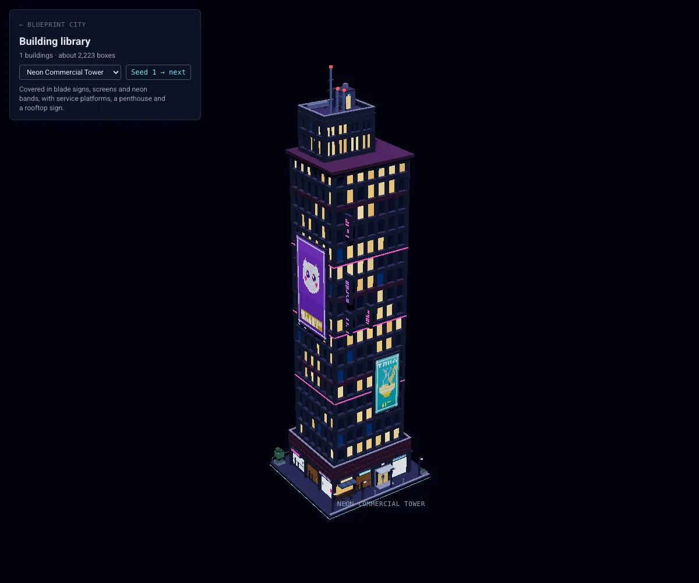 | 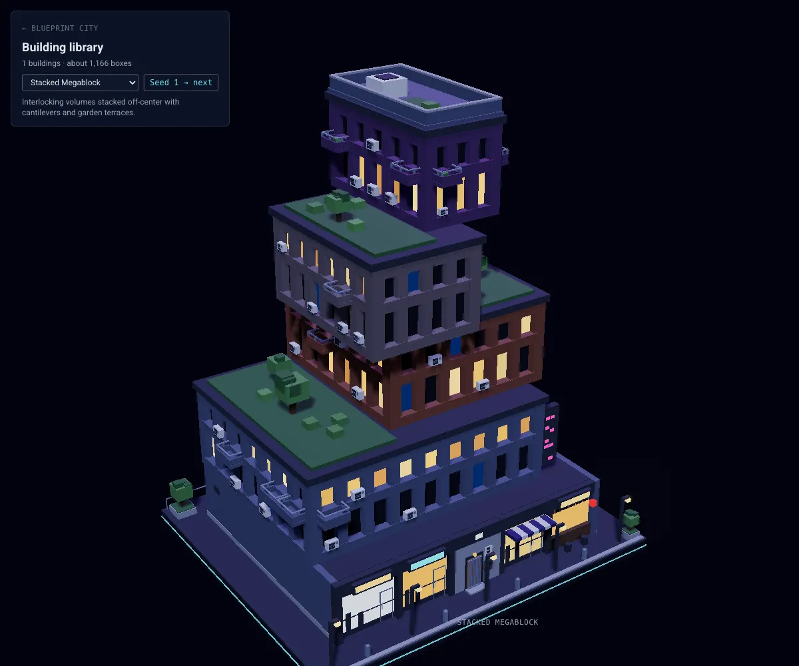 |

| Terraced Residential | Tower and Annex |
|---|---|
| 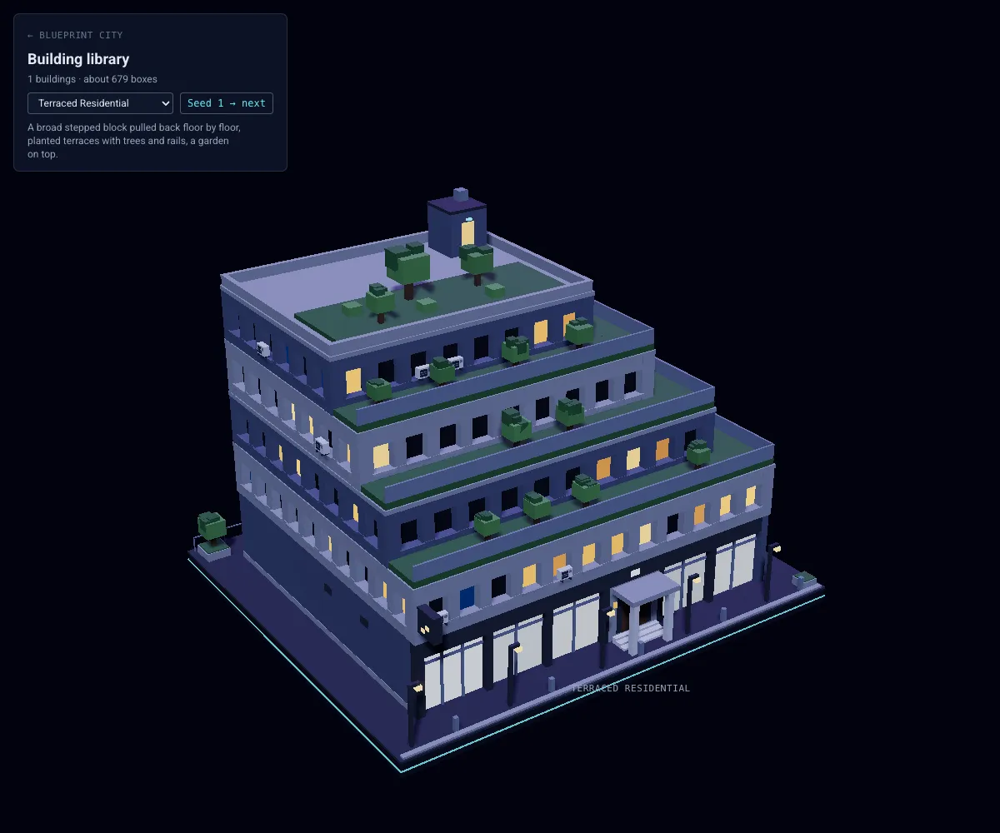 | 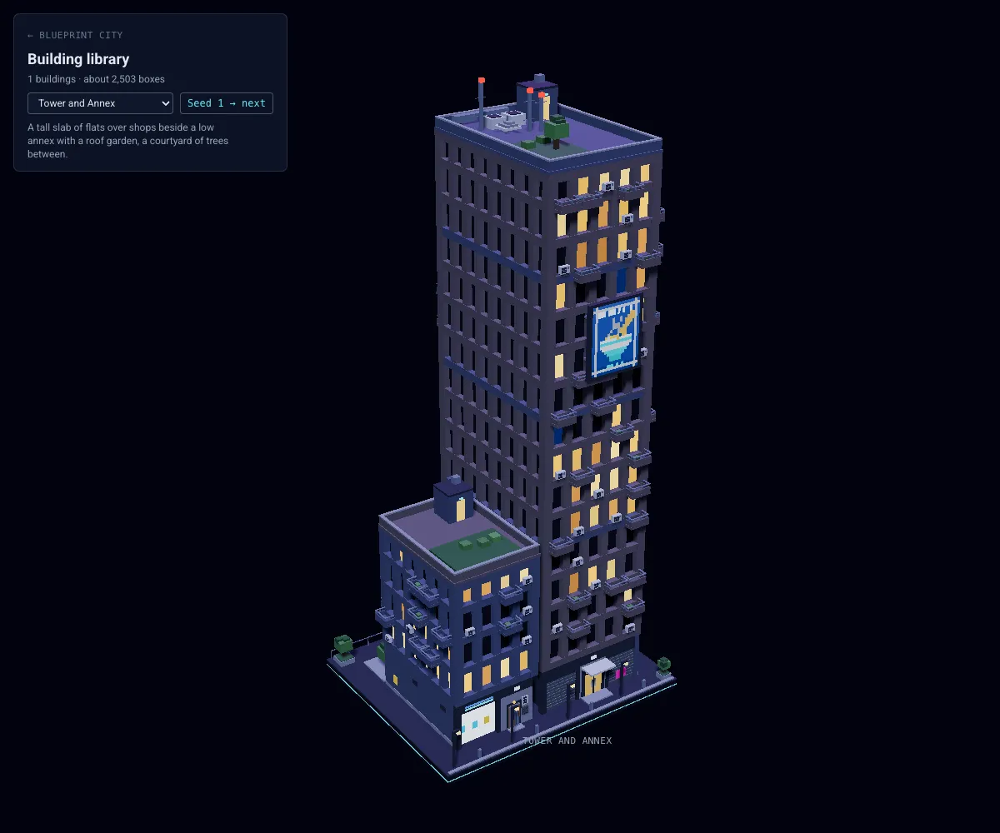 |

Where it ends up: eleven archetypes, every one with no clashes on 8 seeds and under 0.5 m² of
flicker (the Vertical Neighborhood has about 4 m² left, not yet tracked down).

### 2026-10-14: the build timeline

The timeline at the bottom used to print the finished ground layer by layer, so the river and
streets were already cut into it. It now replays the city in the order it is made, over 8 s:
1. **Printing terrain:** the ground before the river and the streets.
2. **Carving the river:** the river's cut sinks layer by layer to the channel floor.
3. **Filling the river:** the water runs down the channel from the source to the mouth.
4. **Building the plaza:** paving spreads from its center out.
5. **Growing streets:** paving spreads along the network by distance from the plaza, the street
   cuts open as it reaches them, and a glowing build front leads it. Streets not yet built look
   like the grass around them.

The finished ground is drawn as always. The ground the river and the streets cut away is drawn
on top of it as two extra meshes (`terrain/buildup.ts`) and cleared as the timeline passes.
Paving order is one value per column, which the ground shader reads, so nothing is rebuilt per
frame.

**The dry river, fixed.** Watching the fill showed the downstream half of the default river had
no water. The river's level only ever falls, and after it passed a low pit it kept falling below
the plinth floor (−1.3 voxels at the mouth). The bed can't go lower than one voxel above the
plinth, so there was no room for water above it, and the river cut a dry trench through the high
ground to the mouth. The level now stops one channel depth (1 m) above the lowest bed. Four of
eight test seeds had dry stretches (the default only 47% wet); all eight are now fully wet. The
channel floor is unchanged; the valley sides beside those stretches are a little gentler.

**Faster settings changes.** A change (slider released) used to block the page for about
1.3 s with no feedback: the whole pipeline (0.8–1.15 s in the browser, districts alone up to
0.5 s), the new build-animation data (0.18 s) and the upload, all before the next frame.
- The timeline bar shows **Generating…** right away (1 ms after release), and the slider stays
  where it was let go, because the work starts two frames later.
- The ground is drawn as soon as its mesh is ready. Districts and lots, which only the overlays
  use, finish a moment later (`generateTerrain(..., { deferDistricts })`, then `finishTerrain`).
- The build animation's data is made only when the timeline plays or is scrubbed. A settings
  change doesn't replay it, so it no longer pays for it.

A Terrace Height change is now done in about 1.07 s end to end, with the new ground on screen
well before that.


### 2026-10-14: buildings on the lots

The building library now stands on the city (`city/placement.ts`, drawn by
`WorldView.setBuildings`). Each lot gets one building:
- **Which:** picked with the seed from the archetypes that suit the lot's district and fit it
  (each has a smallest side it still reads well at, from 6 m for the neon tower to 14 m for the
  twin towers).
- **How big:** the footprint is the whole lot; the height follows the district (core 55–140 m,
  wealthy 14–30 m) and the lot's density, but never more than 8 times the narrower side.
- **Facing:** the entrance turned to the lot's street.
- **On slopes:** the building stands on the lot's lowest ground, its uphill side set into the
  hill, so nothing floats (it had a concrete plinth until 2026-10-27).
- **The Landmark** stands at the center of the plaza (no lot is big enough), at least 25 m above
  everything else.

The default seed places 141 buildings. They are built a few per frame (about 10 ms each frame),
so the page stays responsive. The timeline has a new last phase, **Raising buildings**: the
Landmark first, then outward from the plaza, each growing up out of its lot. **Show buildings**
in the Town section turns them off.

### 2026-10-26: one panel, and the city slides clear of it

A UI review of /world found the panels hid the city. Now:
- **One panel, on the left.** The title card (home, title, seed) that sat on the right is
  the top of the settings panel (`TitleBlock` in `ui/TitleCard.tsx`), so only one side of the view
  is covered and one round button (or E) shows and hides everything.
- **The city slides clear of it.** When the panel is open, the picture shifts right by half the
  panel's width (a view offset in `WorldView.setInsetLeft`; the camera doesn't move), easing as the
  panel opens and closes, so the city sits in the part still in view. At load, the camera is
  framed for that part.
- The scale line under the seed ("232 m across · 1 voxel = 0.25 m") is gone.

Tried and reverted the same day: an accordion panel (one section open at a time), plain-language
slider names with always-visible hints, and the layer switches moved to the top.

### 2026-10-26: rebuild feedback, build stages, one type system, lighter glass (UI review 4, 10, 12, 13)

- **Rebuild feedback.** While a rebuild runs, a spinner turns by the setting just changed, and a
  quiet "Rebuilding the city…" pill shows at the top of the part of the view the panel leaves. (A
  circular-arrow mark by every setting that rebuilds was tried and removed the same day.)
- **Build stages on the timeline.** Under the scrubber, the six stages (terrain, river, water,
  plaza, streets, buildings) as segments sized to their share: done ones filled, the current one
  bright; the status reads "Growing streets · 5/6".
- **One type system.** Titles and section headings in Share Tech; every small uppercase label
  (Home, Seed, the settings) in the shared label style; every value (the seed, numbers, speed,
  status) in the shared mono value style. The seed field and the Home link had their own.
- **Lighter glass.** The panel, its round button, the time bar and the pill use `WORLD_GLASS`: a
  lighter tint that darkens what is behind it (backdrop brightness) instead, so it looks less heavy
  over the bright diorama and its text keeps its contrast (a plain lighter tint made the headings
  unreadable). `SidePanel` takes a `glass` class for this; the weeks keep their dark cards.

### 2026-10-26: Blueprint City's own UI style, 80% size

/world now has its own controls (`ui/kit.tsx`; the weeks keep `components/controls.tsx`):
- **Colors: a blueprint.** Panels in deep navy ink (`#0b1626` at 75%, dimming what is behind)
  with fine pale-blue rules; **cyan** (`#5ad8ff`, the neon) for everything you can touch (slider
  fills and thumbs, switches, the play button, section icons); **warm amber** (`#ffd27a`, the lit
  windows) for every value (the seed, numbers, speed, status, the current build stage), so a value
  never reads as a control.
- **Parameters as rows.** The name in sentence case on the left (it was all caps), the value in an
  amber chip on the right, and under them a thin track filled in cyan up to the value, with a small
  pale tick where the default sits, so a changed setting shows how far it moved. Sections are
  separated by hairlines instead of wide gaps; the switches are smaller.
- **80% size.** The interface (panel, time bar, rebuild note) is drawn with CSS `zoom: 0.8`
  (`UI_SCALE` in `index.tsx`); the view's inset for the open panel scales with it.
- **One track for time and stages.** The time bar's scrubber and its row of stage segments are one
  now: the track itself is the six stages (each as long as its share, small gaps between), filled
  in cyan up to now, the current stage's remaining part a shade lighter; the range input lies on
  top, transparent but for its thumb, and its tooltip names the current stage.

### 2026-10-26: Buildings are built, storey by storey

The timeline's last stage used to 3D-print each building in thin 0.5 m layers under a cyan print
line. It now reads as construction (`buildings/print.ts`):

- **A frame a storey ahead.** The frame rises one storey (3 m) at a time, with an ease-out, then
  waits; the finished facade climbs steadily up behind it, so a building site is always one to
  two storeys of scaffolding over finished floors.
- **Scaffolding look.** Above the facade the walls are drawn as dark-blue netting with steel
  poles every meter, ledgers every half storey and a diagonal brace, in safety yellow; the deck at
  the frame top is bare concrete; a broken row of amber work lights runs along the frame's edge.
- **Windows light floor by floor**, each as soon as its storey is clad (they were all dim until
  the building was done).
- Unbuilt floors still cast no shadow until the building is finished.

### 2026-10-27: No plinths; steady signs

- **No plinths.** Each building on a slope used to stand on the lot's highest ground over a dark
  concrete plinth down to its lowest, which read as an odd platform under every building. It now
  stands on the lot's lowest ground, its uphill side set into the hill, and the plinths are gone.
- **Signs no longer flicker.** A billboard's pixels sit a tenth of a voxel in front of its frame,
  and sign glyphs are as fine; with the near plane fixed at 1 voxel the depth buffer couldn't tell
  them apart from afar, so they striped and broke up. The near plane now follows the camera, just
  short of the diorama's box (`fitNear` in `WorldView`), which gives the depth buffer hundreds of
  times the precision at the usual viewing distance.
- **Lots are graded.** With the building on the lot's lowest ground, the rest of the lot's ground
  stood up inside it (up to 10 m on megablock lots) and flickered against its floor. After the
  lots are laid out, each is now dug level to its lowest ground, with one column of margin around
  it (never streets, sidewalks, the plaza or the river), and the mesh is redone from the graded
  ground (`terrain/grade.ts`, run in the districts stage). `columns` stays the ungraded ground the
  lots were laid out on. Checked on four seeds (256 buildings): no ground inside any footprint
  (before: all but one building).
- **The dig is part of construction.** In the build timeline a lot keeps its old ground until its
  building starts: the first DIG_SHARE (20%) of the building's time sinks the dug-out ground from
  its top down to the graded floor, then the building goes up out of the level pit. The dug-out
  ground is one mesh (`meshDig`, made in `buildUp`) with each vertex's lot in an `aLot`
  attribute; a one-row float texture holds every lot's current ceiling, which `printMaterial`'s
  `lotCaps` clamps it to, so all lots dig on their own clocks in one draw call.
- **Buildings rise 10% slower.** The timeline's phases are now set in seconds at 1×
  (`PHASE_SECONDS` in `terrain/buildup.ts`; each phase's share and the whole length follow from
  them): the buildings take 1.76 s instead of 1.6 s, every other phase keeps its length, and the
  whole build plays in 10.16 s.

### 2026-10-27: City ground

The ground was painted as wild land everywhere (grass, dirt, rock), so the city stood in a
meadow. Once the districts and lots are known, `paintCity` (`terrain/urban.ts`) repaints the
ground inside the city, and the mesh is redone with it:

- **Sidewalks** on the verges between streets and lots (they were grass), a step lighter than the
  roads.
- **Concrete pads** on the lots and the margin their grading digs.
- **Pavement** on the rest of the districts' ground (alleys, yards, back lots), darker, with half
  the tone patches, like worn, patched asphalt; bare rock inside a district becomes concrete.
- **Scrub** on steep ground inside the districts (the planted slopes between terraces), and tended
  **lawn** in the parks.
- **Retaining walls**: where the ground steps under sidewalk, pavement or concrete, the side is
  concrete (`URBAN_GROUND.wallTop/wallBottom`) instead of cliff rock.
- Outside the districts the land stays wild.

Colors are in `palette.ts` (`URBAN_GROUND`). In the build timeline the city's ground comes with
the paving front, like the streets' cuts and fills (`buildUp` counts repainted columns as changed),
and every lot, flat ones too, keeps its old ground until its building starts: the grading's
`dugBy` now marks each lot's own columns, so a flat lot's old ground is part of the dig mesh (drawn
with a polygon offset over its new floor) and goes when the dig begins.

### 2026-10-27: Hard ground everywhere but the parks

- **The whole ground is built.** `paintCity` now repaints the land outside the districts too: flat
  ground becomes **paving slabs** (2 m tiles), bare rock and steep ground **concrete**, the river's
  bank a concrete **quay**; inside the districts flat ground stays asphalt **pavement**. Only the
  parks keep grass (lawn). The scrub surface is gone.
- **Slabs.** Plaza, paving, sidewalks and lot pads (`TILES` in `terrain/surfaces.ts`: 1.5, 2, 1
  and 3 m) are laid as square tiles, alternate tiles a shade darker and lighter (`SLAB`, ±7%,
  whatever Ground tones is).
- **The plaza is dark stone slabs** (`URBAN_GROUND.plaza`) instead of beige; before the city is
  painted (the ground drawn first while the districts finish) it is still the plain plaza color.
- **Retaining walls everywhere** the ground steps, except under lawns and the riverbed
  (`NATURAL_SIDES`), which keep cliff rock.
- **Planting strips on narrow steps.** Ground on a step at most 1 m deep (`NARROW`: a rise on one
  side and a drop on the other, along x or z, within 4 columns), the voxel stairs on hillsides and
  thin terraces, is a dark-green **planter** (`URBAN_GROUND.planter`) behind its concrete walls,
  instead of more concrete steps. About 18–30% of the ground, depending on the seed.
- **Rectangular parks.** A park is no longer a round patch grown from a spot: it is a whole
  rectangle of district cells, long side 1–2 times the short (the seed picks), placed at the same
  best-scoring spots, either way round and shifted up to a quarter of its sides to fit, shrunk to
  90% then 80% of its size where a whole one doesn't fit (a street or the edge would cut it), else
  the spot is skipped. Six seeds tried: 3–6 parks each.
- **Every lot gets its building.** Lots narrower than 6 m are skipped, and the narrowest lots
  are exactly 6 m; measured from their rotated corners they came out a hair under (5.9999…), so
  every 8 × 6 m lot stood empty (11 on `blueprint`), which the concrete pads made plain to see. The
  test now allows 0.01 m (`MIN_LOT`); five seeds tried, no empty lot.

### 2026-10-27: Landscaped parks

Parks are no longer bare lawn: each is laid out and furnished (`city/parks.ts`, planned in the
districts stage; drawn from `city/parkModels.ts` by `WorldView.setParks`).

- **Layouts.** One of three per park (the seed picks): **cross** (two straight paths meeting at a
  round court with a fountain), **loop** (a rounded path inset from the edge, a spur out to each
  side, a pavilion in the middle) or **grand** (both, the fountain where they meet). Paths are 2 m
  wide, painted as pale stone setts (`SURFACE.path`, 1 m tiles, `URBAN_GROUND.path`).
- **Terraces.** Parks lie on hillsides (up to ~12 m of rise across one), so every facility is set
  on a terrace: its footprint and a column around it cut and filled to its median height and paved
  (so it shows retaining walls). The court is levelled whole; other spots that would need more
  than 2 m of cut or fill (1 m for a bench) are passed over for flatter ones. The terraces are part
  of `Parks.ground`, which the finished mesh is built from; the paving front brings them, like the
  rest of the city's paint.
- **Facilities.** The fountain (a lit basin, a two-tier spout and its jet) or a pavilion (deck,
  posts, stepped roof, lantern); four flower beds around it; a playground in most parks (sand pit,
  slide tower, swings, a spring rider); 1–3 picnic tables; benches along the paths in paved
  niches, facing the path, some with a litter bin; lamps between them (amber, warm or cyan per
  park); a vending machine at an entrance.
- **Plants.** Hedges along the edge in some parks (open where paths come in); trees thick along
  the edge and sparse on the open lawn, kept off the paths, each park with a favorite of three
  kinds (round broadleaf, slim conifer, pink blossom with fallen petals); shrubs, some flowering,
  along the paths and between the trees.
- **Built in turn.** Each park is one solid and one glow mesh (the buildings' materials). Every
  vertex carries its prop's base and start (`aGrow`), and the shader grows each prop out of its
  base with a small overshoot: parks start outward from the plaza as the buildings do, and within
  a park the middle first (`PARK_SPREAD`, `PARK_GROW`). They cast shadows once the city is built.

### 2026-10-27: Gentler parks, flower gardens, no clashing props

- **The parks' ground is regraded** (`planParks` returns it as `Parks.ground`, and the finished
  mesh is now built from it; until now the terraces the props were set on were planned but never
  drawn, so props could float or sink). Inside, the ground is smoothed (a 3 m box blur) and its
  rise around the park's mean height scaled to `FLATTEN` (25%): the lawn is nearly level. At the
  edge a short bank brings it to within `WALL` (1.5 m) of the ground around, and a stone-capped
  retaining wall takes the rest. Each path comes in at the street's level and ramps to the park's
  over `ENTRY` (measured along the paths from where they come in, so a path running beside the edge
  stays level), with the lawn either side sloping down to its stairs over `FLANK` instead of
  standing as a wall. Steps of 0.75 m or more get a stone coping. Columns a lot's dig reached are
  left to the lot. Five seeds: the inner lawn's rise fell from 6–11 m to 1.3–3 m, and no step in a
  park is over 1.75 m (it was 4 m). Terraces may cut or fill at most 1 m (0.5 m for the small ones).
- **Flower gardens.** One park per city (two from four parks up) is a garden: only paths, flower
  beds (a pair in the middle, four around them, more along the paths, long side to the path) and
  benches.
- **No prop runs into another, the ground or a building.** Every prop keeps clear of the others:
  tree crowns (radius to their farthest block corner, `crown`) of each other, of every prop that
  reaches above their underside (`ROOM`; hedges and beds as rows of circles), of the ground under
  them and of the park's edge; a blossom's fallen petals and a shrub's spread of every prop; shrubs
  only on level ground; hedges only where their whole depth is level and free; benches centered
  on their niches; bins on pads wider than their lids.
- **No flickering faces.** Plant blocks are snapped to a quarter voxel and each grown by a
  different hair (`plant` in parkModels.ts), so no two faces of a plant share a plane; the bench's
  frame, the lamp's lantern, the fountain's falling water and the flowers in a bed were moved off
  the planes they shared. A check over five seeds (every prop's boxes against every other prop's,
  the ground, the park's edge and nearby buildings, and same-direction coplanar faces of different
  colors within a prop) finds none.

## 2026-10-27: Even park stairs, footings kept covered, iron fences

- **Stairs.** A path no longer ramps from the street to the park over a fixed 9 m. It is held to a
  grade instead (`limitPaths` in city/parks.ts): along the paths, each column stays within half a
  voxel per column of every way in (held at the street's level) and of the court. The result is
  stairs of single 25 cm steps, however long that makes them. Where a way in is too close to the
  court for that grade, the stairs run straight between the two, steeper but even, with no wall at
  either end. The lawn beside the stairs slopes to them once the court is levelled. Terraces paved
  beside a path (flower beds, bench niches, bin pads, the vending machine) are skipped where they
  would leave a step of more than 50 cm to it. Over five seeds the tallest step on a path went from
  2–3 m to 1 m, and steps over 50 cm went from about 400 per city to a handful.
- **Footings.** Regrading could cut the park up to 2 m below a neighboring lot's floor, which bared
  the building's footing so it looked afloat. Within 4 columns of a lot, a park is no longer cut
  below that lot's floor, and it eases down from there over 3 m.
- **Fences.** A low (0.8 m) black iron fence runs around each park's edge: posts about every 2 m,
  two rails, a picket every voxel. It is open where the paths come in and steps with the ground in
  level runs. The clash check (props, ground, park edge, buildings, coplanar faces) still finds
  none over five seeds.

## 2026-10-27: Inhabitants (agents, after Class 08)

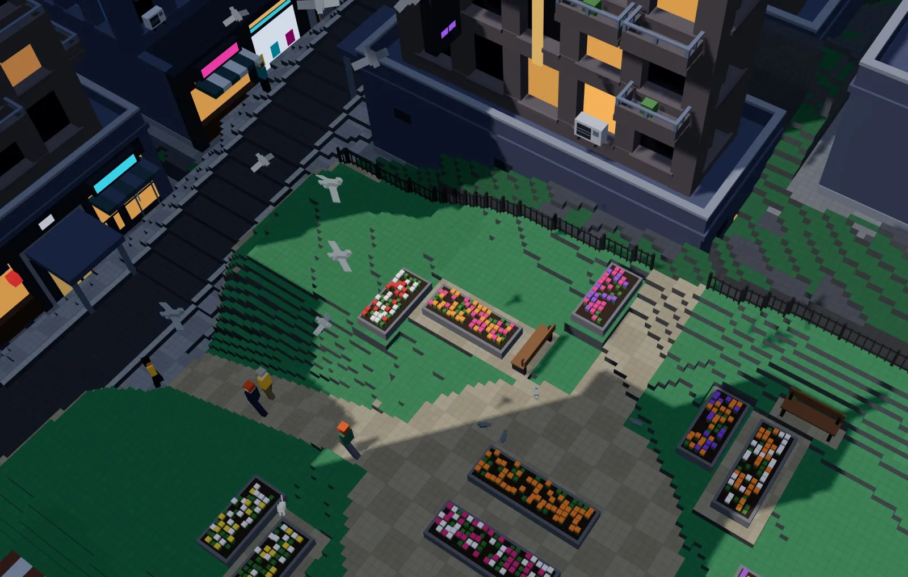

The city is lived in once it is built (`life/`, drawn by render/life.ts; "Show life" in the
Town section, `?hide=life` to start without). 420 people, 150 pigeons and 8 cats, each kind from
one of the agent models, and each reacting to the others.

- **Where they can go** (life/walk.ts). Sidewalks, the plaza and the park paths are paving; roads
  cost more (crossed, not walked down); open ground and the river bank cost more still (crossed
  only where there is no paved way: the parks are ringed by open ground, not sidewalk). Park lawns
  are the animals' only. Park props, fences and the Landmark are blocked out; columns beside
  anything people can't walk on cost a little more, so walkers keep to the middle of a path;
  strips a single column (25 cm) wide are closed; no step is over 2 voxels. Getting anywhere is a
  flow field: one search from every place of a kind (all benches, all vending machines, the
  meeting places round the fountains, pavilions and plaza, all doors, and eight far stroll points)
  gives each column its distance, and walkers go downhill in it. Fields are worked out a slice at
  a time (3 ms a frame), so the page never stalls on them.
- **People: needs and a state machine.** Thirst, rest, company and home grow at each person's own
  rates; when only strolling, the most basic need past its threshold wins (thirst, then rest, then
  company, then home: Maslow's order). They walk to it, then walk to the path in front of a free
  seat and sit down (getting up back onto the path), stand at a vending machine, or stand talking
  in a circle of at most four, facing each other (a full circle sends them on). Going home, they
  walk into a door, and someone new comes out of another.
- **Bodies.** A person is 0.75 voxel round: its body never overlaps a column it couldn't stand on
  (walls, props, fences), and it is eased off any it has come to touch. People keep their distance
  (2.4 voxels), are never closer than 1.6, and bear right of anyone coming the other way. Someone
  who gets no nearer the goal for 2.5 s squeezes past the people in the way for 1.5 s; after three
  of those, they go somewhere else. Seated, the shins hang clear of the seat's front edge.
- **Pigeons: boids.** One flock per roost (the plaza, each park's court). On the ground they peck
  and hop; they walk off from anyone coming within 2.25 m and fly from closer, and the alarm puts
  up the flock around them. In the air: separation, alignment, cohesion, circling the roost at
  9–18 m, kept over the roofs (a coarse grid of the highest roof per 2 m cell); they land again
  once the roost has been quiet for a while.
- **Cats: predator and prey, with perception.** A cat prowls its home range and sees pigeons in a
  120° cone up to 11 m, unless a building or a wall blocks the line. It stalks slowly and low (a
  pigeon notices it only late), sprints from 2.75 m, and sits down to wash when the flock goes up.
  People walking by send it running.
- Three seeds (blueprint, harbor, delta), ten simulated minutes each: per sample, no person's body
  in a wall (0–0.02) and 0.01–0.26 pairs closer than 1.2 voxels, besides the 1–2% squeezing past;
  0.02–0.1% of walkers made no headway over 10 s. 1.3–1.8 ms per step headless.

## 2026-10-27: Buildings stand back from their lot's edge

- **The whole building keeps within its lot, less 2 voxels (0.5 m) all round** (`GAP`, `room` and
  `fitBuilding` in city/placement.ts). Until now the body filled the lot (most lots are only 6 m
  across, and no model was built narrower than 6 m), and what sticks out of the walls reached past
  it: entrances up to 2.6 m, billboards and signs 2.5 m, shop awnings 1.4 m, balconies 1 m, over the
  sidewalks and stairs. Now the body is built GAP smaller than the room all round (so awnings and
  signs have that strip to stick out into, and models may now be as narrow as 4 m), and every box
  of the model is cut at the room's edge (`Kit.clip`; a cut side gets its face, each cut a hair
  apart so no two share a plane). The body is centered on the lot.
- **Sizes that build badly are avoided.** A few archetypes put faces in one plane (flicker) or run
  parts into each other at some sizes; `fitBuilding` then tries the next of a short list of body
  sizes (a little narrower or wider, down to filling the room) and keeps the cleanest. The modular
  block now needs 8 m (narrower, a tall one's modules ran into each other), and a lot no building
  of its district fits gets the slimmest one of any district that does (narrow industrial lots
  used to get a lab tower squeezed below its 12 m).
- Three seeds (blueprint, harbor, delta): no part of any building past its room or over a street
  (it was 109 of 150 on blueprint); part clashes 0 (were 0–108); flickering faces about as before
  (a few 5 m-deep neon towers have 2 m² at a sign's top edge). Building the models takes about
  four times as long (1 s for blueprint), still spread over frames.

## 2026-10-27: One concrete city: Surfaces rewritten for the cyberpunk island

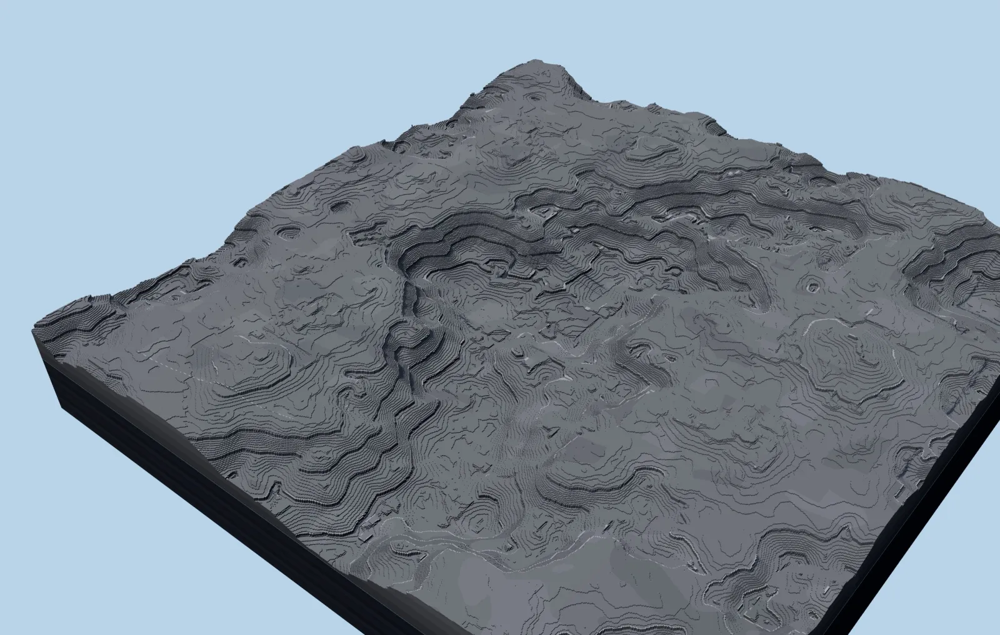

- **The whole island is one pour of concrete** (terrain/surfaces.ts). Surfaces no longer makes
  grass, dirt and rock: everything that isn't river, street or plaza is concrete, with two kinds
  read from the land, with their settings (the panel's Surfaces section):
  - **Grime** (was Ground tones; 0.12): how strongly the concrete is stained in large noise patches.
  - **Ledge drop** (was Rock cliff; 0.75 m): a rim with a neighbor at least this much lower gets a
    pale coping (`ledge`) along the drop.
  - **Stair slope** (was Dirt slope; 30°): hillsides steeper than this are flights of concrete
    steps (`stairs`), each tread a voxel up, alternately lighter and darker.
  - Grass limit is gone: no ground is set apart by its height.
  Every step in the ground is faced with a concrete retaining wall (only lawns and the riverbed
  keep cliff sides), so the terraces read as built.
- **The city's paint** (terrain/urban.ts) now only adds what the city laid on it: the plaza's
  slabs, sidewalks, the quay along the bank, the parks' lawns and paths, and the lots' pads, of the
  same concrete as the ground around them. The patchwork of slab paving, asphalt, concrete and
  planter strips it used to lay over unbuilt ground is gone (`pavement`, `paving` and `planter`
  are no longer painted). The build animation is concrete from its first layer: the ground before
  the streets, what the river and streets cut away, and the streets not yet paved (render/print.ts
  showed them as grass, in green bands along where the streets would go).
- Three seeds: concrete 62–74% of the island, stairs 5–7%, ledges 1–2%; the rest streets,
  sidewalks, plaza, parks and river.

## 2026-10-28: Traffic: cars, vans, taxis and buses, and how people live with them

| Bus stop | Taxi pickup |
|---|---|
| 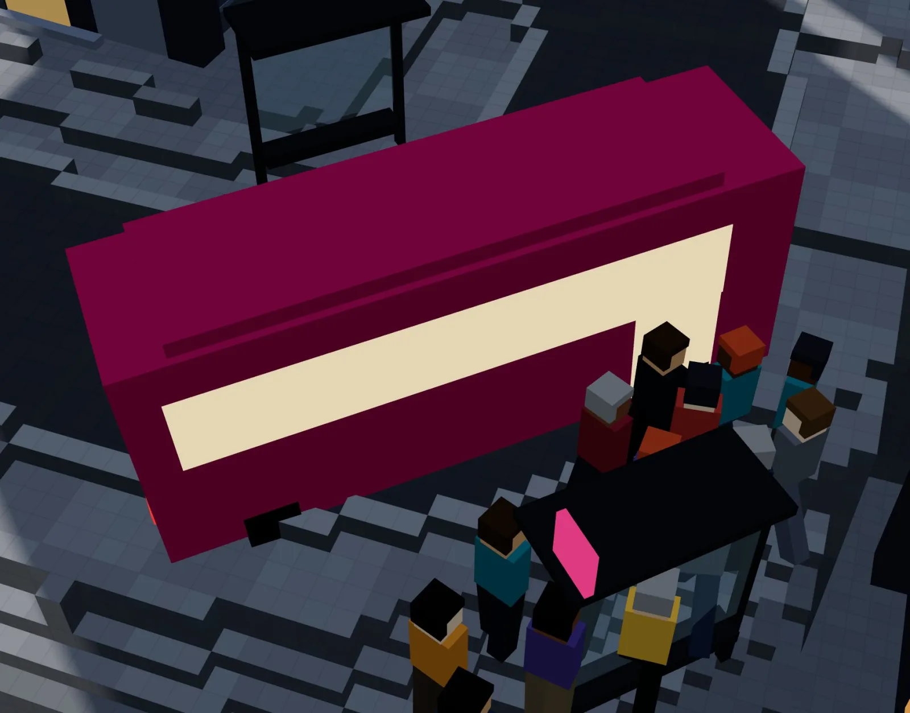 | 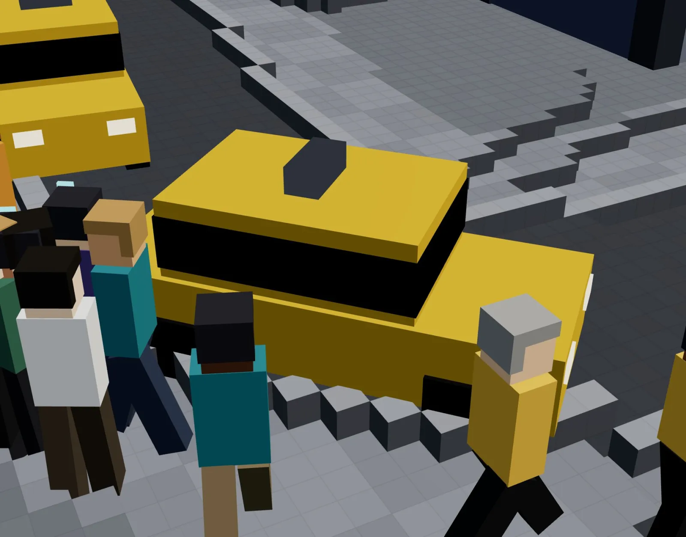 |

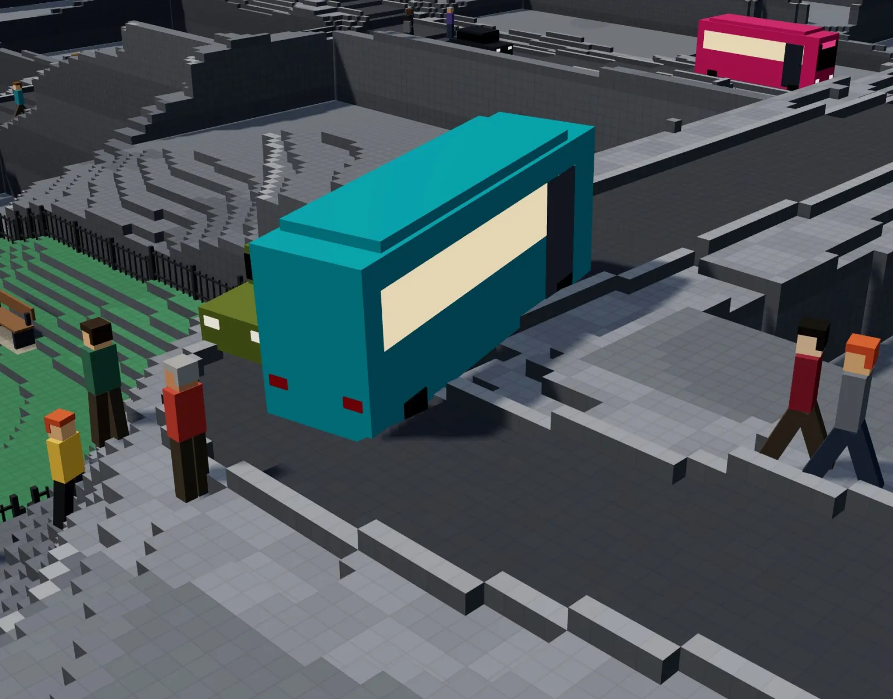

- **The road graph** (life/traffic.ts): every street is two lanes, keeping right, each 0.24 of the
  street's width off its center line and trimmed back from the junctions. At a junction, each lane
  coming in is joined to each lane going out (not back the way it came) by a link, a smooth curve.
  The streets into the plaza (people only) and other dead ends turn traffic round; short dead ends
  (under 10 m) are kept out of. Streets running off the island's edge are where traffic leaves and
  comes back on.
- **The fleet**: kei cars (3.4 × 1.4 m), vans, yellow taxis and community buses (6 × 1.65 m) that
  fit the 3.5 m streets, no more than one per 17.5 m of lane or three per junction (`LIFE` in
  index.tsx: 14 cars, 4 vans, 8 taxis, 2 buses a route). Each follows the one ahead by the
  Intelligent Driver Model, slows for bends, and rides over the top of a stepped street's steps.
  Cars and vans turn at random and now and then leave the island; taxis and buses route by
  shortest path.
- **Junctions**: a vehicle asks for its link 10 m before the stop line. Links that cross, merge or
  start from the same lane conflict (two going straight on in opposite directions don't). Once at
  the line, it is let in in the order they got there, if its link conflicts with no one inside and
  no one waiting before it, and if there is room beyond the junction for it ("don't block the
  box"). It holds the junction until its back is out of the link. A vehicle stuck 45 s (a knot) is
  towed: taken off and brought back elsewhere.
- **People and vehicles**:
  - A vehicle stops for anyone its *body* would pass over in the next few voxels (on a tight turn
    its corners cut over the corner of the sidewalk). Kept waiting 3 s, it creeps on at walking
    pace, minding only people on the road at its bumper, and people make way.
  - Someone about to step off the curb waits (up to 12 s) while a vehicle is coming, then crosses
    30% faster. People walk round vehicles, never into one, and step out of the way of one beside
    them. Walking down a road now costs 10 per column (was 7), so people keep to the sidewalks.
  - Going home, 25% take the bus: they walk to the nearest shelter and wait, facing the road; when
    their bus pulls up, its door lights up and they walk to it and get on. At each stop riders get
    off with a chance of 35%, and walk on from there. Two routes go round six streets far apart,
    one each way, with shelters on both sides of those streets in each route's color.
  - 10% hail a taxi at the curb (holding up a glowing phone). The nearest free taxi (roof light
    lit) comes, pulls up beside them, takes them aboard and drops them somewhere else in the city,
    at least 40 m away. They give up and walk home after 90 s (150 s for a bus).
  - Pigeons go up as a vehicle passes.
- **Drawing** (render/life.ts): instanced, a few draw calls for the fleet. Headlights are always on;
  tail lights flare when braking; buses have lit windows and a destination sign in their route's
  color.
- Three seeds (blueprint, harbor, neon7), four minutes each, simulated headless: 1–4 vehicles towed
  per seed, no one standing inside a vehicle (it was in the hundreds before people stepped aside),
  vehicles overlapping in under 1% of samples (mostly a bus's corner on a bend), and taxis and
  buses picking up and dropping off. Harbor's network is three streets between the same two
  junctions, so it jams most. A step of the whole simulation (people, animals, traffic) takes
  about 2 ms.

## 2026-10-28: Smoother blocks, graded lots, deeper lots

| Ground (buildings hidden) | With buildings |
|---|---|
| 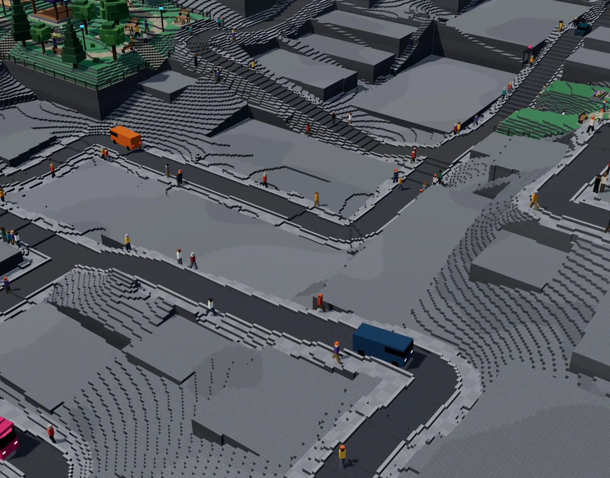 | 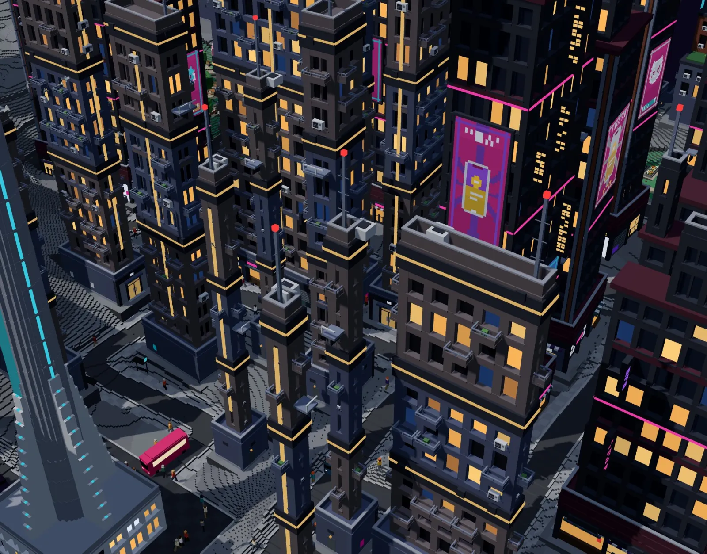 |

- **Blocks smoothed** (terrain/streets.ts, `smoothBlocks`, a new step after the carve): the ground
  between the streets keeps the hill's terraces no longer. It takes the smoothest shape (a membrane,
  Laplace's equation) held at the paving's levels (streets, sidewalks, plaza) and the river's,
  within 12 m of paving, and back to the ground as it was by 30 m (20 m and 40 m since "Filling the
  gaps" below; the hills beyond the city keep
  their terraces). Solved coarse to fine on a pyramid of grids (Gauss-Seidel), about 0.2–0.5 s.
- **Lots cut and filled** (terrain/grade.ts): each lot is graded to its `floor`, the median of its
  ground, as much cut as fill, instead of dug down to its lowest column; the building stands on the
  floor (`base` in city/placement.ts). The build animation's dig shows only what is cut; filled ground
  is there from the start.
- Together, on three seeds (blueprint, harbor, neon7): a lot's cut or fill was 2.5–3 m (median, dug
  to its lowest) with 5.5–6 m at the 90th percentile; now 1–1.5 m and 2.5–3.25 m. The smoothing
  alone (both with the new grading) takes steps of 2 m or more between neighboring city columns
  from 2167 to 1676 on blueprint (−23%) and from 512 to 338 on neon7.
- **Why the library barely showed**: the street tiles are 20 m, so many blocks are two parallel
  streets one tile apart, 13.5 m sidewalk to sidewalk; lots from both streets met halfway at about
  6 m deep, and with the 0.25 m gap round each building the room was 5 m, under every archetype's
  smallest side. So nearly every lot fell back to the slimmest archetype of all,
  neon-commercial-tower (125 of 155 on blueprint), whatever its district. Now:
  - a block shallower than 20 m isn't split: its lots run through it, fronting both streets
    (terrain/districts.ts, `THROUGH_BLOCK`); median lot depth 5.5 → 11 m;
  - lots are the district's width in zone cells or one more (was ± one), and commercial lots two
    cells (was one);
  - a lot nothing of its district fits gets its district's slimmest building if that is within
    1.5 m of fitting (`SQUEEZE`), so small megablock and core lots get residential towers, not shop
    towers.
  Blueprint: neon-commercial-tower 24, residential-skyscraper 77, stacked-megablock 6,
  terraced-residential 4, modular-apartment-block 3, twin-tower-complex 1. The corner lots that pack
  the frontage the street walk leaves are still almost all 6 m squares, and many street lots are cut
  short where the street bends every tile, so the wide archetypes (megatower, lab, twin towers,
  vertical neighborhood) still seldom fit.

## 2026-10-28: No more small plots

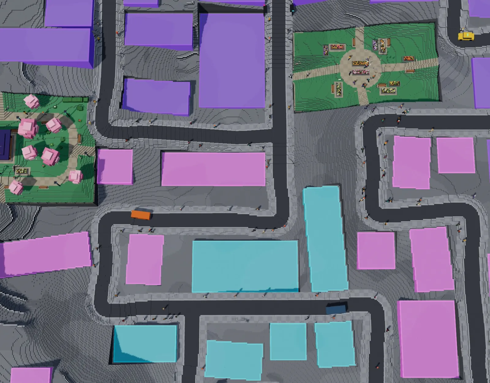

- **Small lots merged or given up** (terrain/districts.ts, step 6, `mergeSmallLots`): a lot under
  10 m either way (`MERGE_BELOW`) is merged with the neighbor beside it on the same frontage, across
  their alley (same district, same facing, as deep as the shallower, at most 24 m wide
  (`MERGE_WIDEST`), ground within the district's step), choosing the neighbor that gives the roomiest
  lot. A lot still under 8 m (`MIN_PLOT`) is given up; its ground is left free concrete. Lots are
  renumbered. About 25 ms.
- **Corner lots** now pack rectangles no smaller than 8 m a side (was 6 m, `MIN_DEPTH`): the
  corner pockets were almost all 6 × 6 m or 16 × 6 m, too shallow to merge with the street lots
  (they face another way).
- Lots: blueprint 115 → 93, harbor 23 → 21, neon7 53 → 39; every lot's narrower side is now at least
  8 m (rooms 7 m). Blueprint's buildings: residential-skyscraper 61, neon-commercial-tower 15,
  terraced-residential 5, stacked-megablock 5, modular-apartment-block 4, twin-tower-complex 2,
  vertical-neighborhood 1.

## 2026-10-28: Filling the gaps

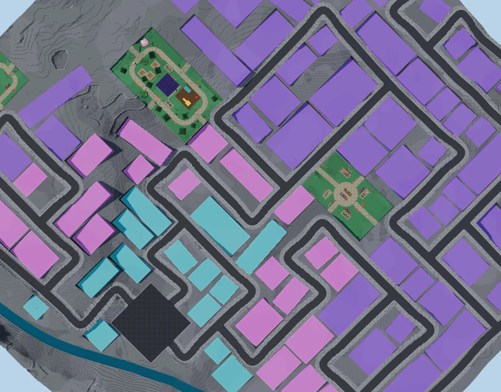

- Empty frontage next to the streets (beside bends, at block ends, on the hill inside a loop) got
  no lot. Three reasons, three changes (terrain/districts.ts, terrain/streets.ts):
  - **The street walk runs twice**: the second walk fills the gaps the first left with lots of any
    whole-meter width from 8 m (`MIN_PLOT`) up to the district's, not only whole 8 m zone cells.
    The first walk's small lots are merged or given up before the corner lots are packed, so
    what they leave is packed too.
  - **Corner lots** are tried in every size from the district's down to 8 m, 2 m apart
    (`CORNER_STEP`; was five sizes), and need only a quarter of their narrower side on the paving
    (was half), within a 1 m forecourt (`FORECOURT`): beside a bend the verge curves away from a
    grid-aligned side.
  - **Smoothing reaches farther**: free within 20 m of paving (was 12 m), the ground's own by 40 m
    (was 30 m), so steep ground near the streets (the hill inside a loop) is gentle enough for lots.
- Lots: blueprint 96 → 107, harbor 21 → 22, neon7 45 → 51. On blueprint, every free 8 × 8 m square
  near a street is now used except where the ground still drops more than 6 m across it (by the
  river and on the hills past the city). Blueprint's buildings: residential-skyscraper 61,
  neon-commercial-tower 15, stacked-megablock 13, modular-apartment-block 7, terraced-residential 5,
  vertical-neighborhood 2, twin-tower-complex 2, tower-and-annex 2; neon7 now has a
  corporate-megatower and a research-lab-tower too.
