# Blueprint City: the procedural world

[← Back to the main README](../../../README.md) · [Concept](../../../docs/concept.md) · [Terrain plan](../../../docs/plans/terrain-plan.md) · [Town plan](../../../docs/plans/town-plan.md)

> **From empty ground to a working city: built layer by layer, then brought to life by people and traffic.**

Route: `/world` (seed in the URL, e.g. `/world?seed=blueprint`).

A voxel diorama generated from a seed: terrain first, then a river, a street network, districts
and lots, with buildings to come. Every stage has its own settings on the left panel, and a change
reruns only the stages from the one it touched. The timeline at the bottom replays the city being
made, in the order the stages run: the terrain prints from the plinth up, the river carves its
channel and fills, the plaza is built, and the streets grow out from it.

## Where it stands (2026-10-13)

```text
seed → noise → shaping → heights → terraces → river → claims → hubs → streets → voxelize → surfaces → mesh → districts + lots + parks
```

- **Terrain:** done. 232 m across, 0.25 m voxels (928 × 928 columns), land only, with a river.
- **Streets:** done (third design, wave function collapse from the plaza).
- **Districts, lots and parks:** done, Cities: Skylines style (whole districts, every lot on a
  street, parks as their own layer).
- **Buildings:** done. Every lot builds from the building grammar (`/grammar`), weighted by its
  district, with the Landmark at the plaza, all at the people's scale.
- **Simulation:** done (`docs/plans/city-simulation-plan.md`): homes and jobs with a cycle for
  everyone (no clock), and the city's waste carried by garbage trucks to the incinerator.
- **Street lamps:** done (`docs/plans/street-furniture-plan.md`), a few along every street.
- **Next:** the town plan's steps 7–8 (`docs/plans/town-plan.md` §9): bridges, then check and
  tune.

Overlays can be opened from the URL: `/world?show=districts,lots,parks`. One ground tint shows at
a time (`districts`, `claims` or `suitability`); `network` draws the street network on top.

Code: `terrain/` holds one file per stage; `ui/TerrainPanel.tsx` is the panel, `ui/PrintBar.tsx`
the build timeline, `ui/CameraBar.tsx` the camera toolbar, `render/print.ts` the ground shader, `terrain/buildup.ts` the timeline's data. `noise.ts` and `rng.ts` are shared with
Week 5.

---

## Development log

### 2026-10-07: version 1, the full city pipeline

The first complete version: a 14-stage seed → rules → city pipeline (island, terrain, water,
voxels, suitability, districts, roads, growth, buildings, bridges, props, atmosphere,
performance). The settings panel had one tab per course topic (Terrain, Voxels, Shader, Paths,
Scatter).

It worked, but it was too much at once and hard to tune or explain, so the same day it was taken
back to terrain only (commit `5e83a14`) and then wiped, to rebuild the world one step at a time.
The code is in the git history at commit `bd582ca`.

| Rainy night | Dusk |
|---|---|
| 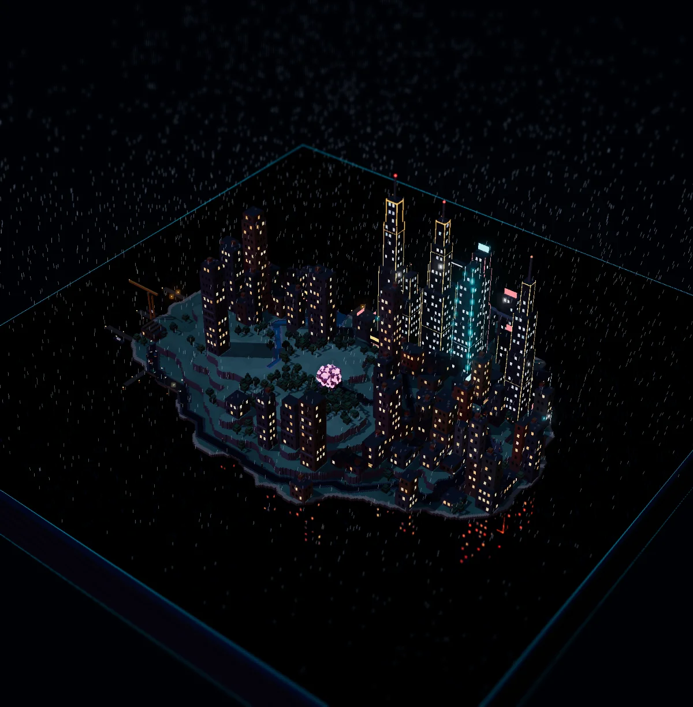 | 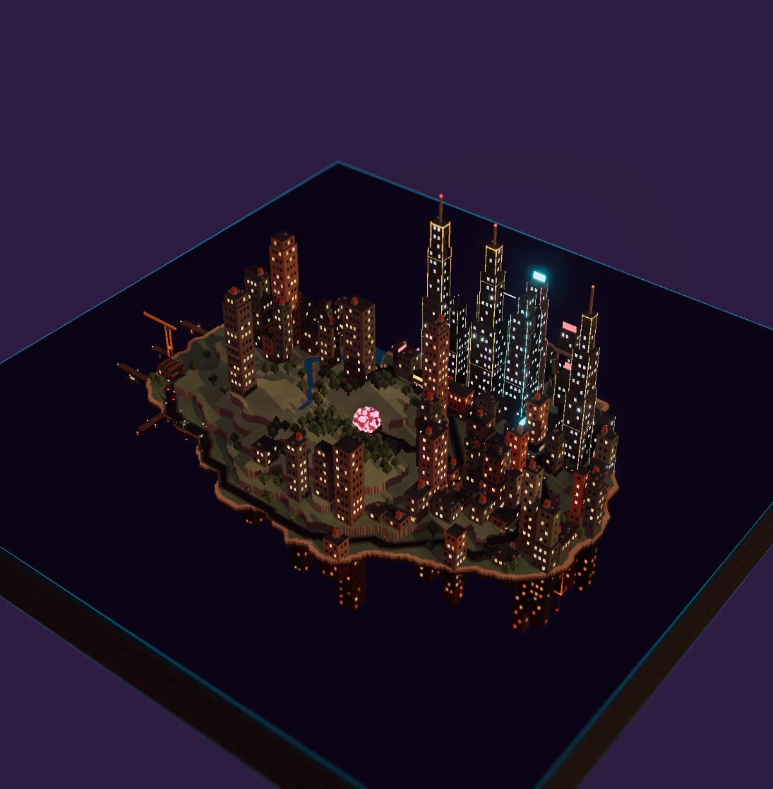 |

| Districts overlay | Growth, District phase |
|---|---|
| 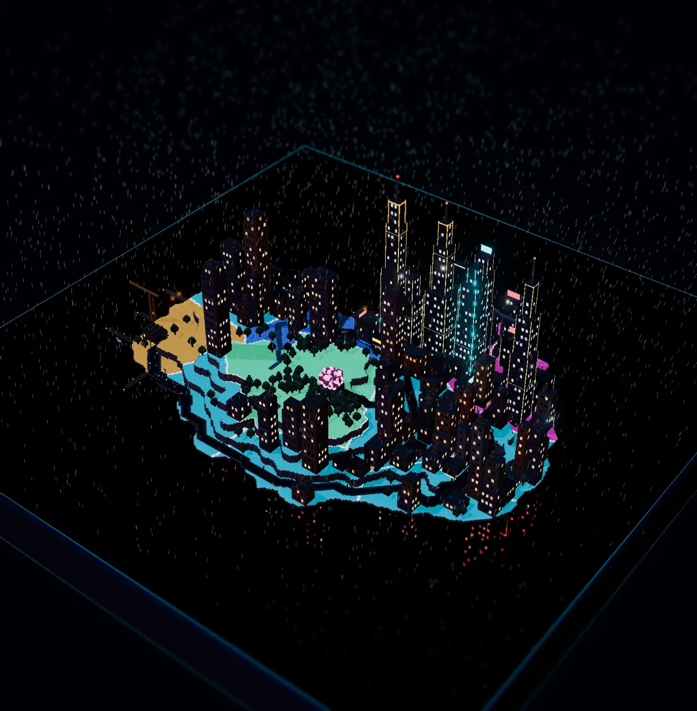 | 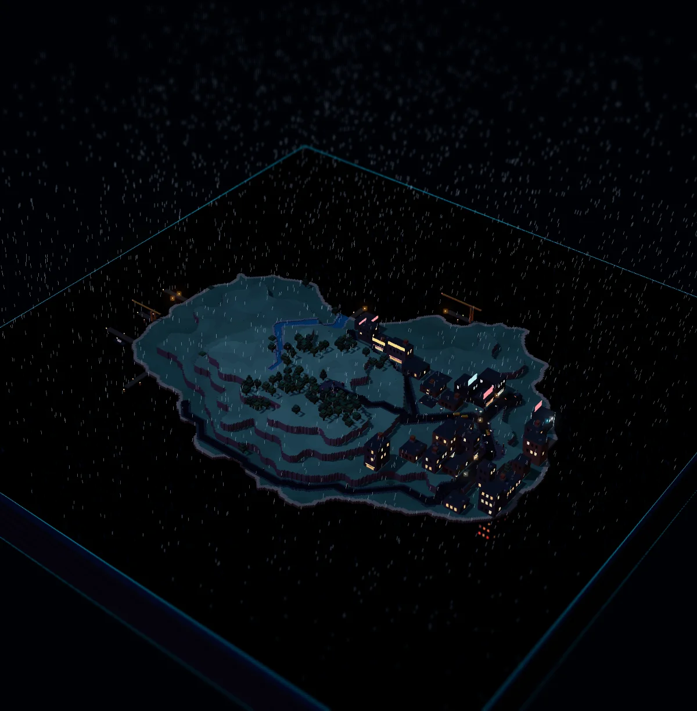 |

### 2026-10-07: rebuilding the terrain

Following [the terrain plan](../../../docs/plans/terrain-plan.md).

- **Smaller voxels:** 0.25 m instead of 0.5 m, so slopes read as fine voxel stairs and cliffs as
  tall stacks of small blocks.
- **Noise:** Week 2's noise stack (Perlin, Ridged, Billow, Cellular, White; Scale, Octaves,
  Persistence, Lacunarity), sampled at an adjustable Resolution, rounded to whole voxels and
  greedy-meshed chunk by chunk.
- **Shaping:** Power, Ridge sharpness and Height.
- **Terraces:** snapping scaled by local slope. Gentle ground keeps its voxel stairs; steep ground
  becomes shelves and cliffs.
- **Surfaces:** riverbed, bank, rock, dirt and grass by rules on slope and height, with a ground
  shader that draws the voxel grid, a per-block tint and strata bands on cliff sides.

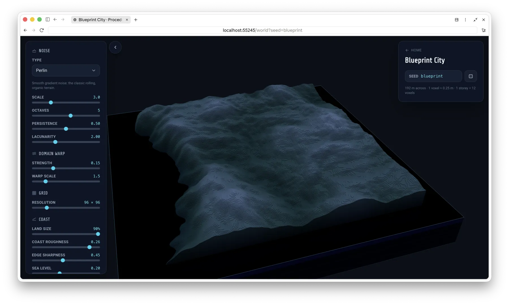

*The first step: noise → voxel columns, with the Noise, Grid and Coast sections. The coast and
domain warp seen here were removed the next day.*

### 2026-10-08: the first street

- **River valley,** with Week 5's path technique: control points that seek low ground, a
  centripetal Catmull-Rom spline, and a carve with banks. The water stays level across the
  channel and steps down steadily along it. The control points can be dragged in the view.
- **Hubs:** one center by the river, on the flattest ground, for a single megacity.
- **The first street:** an route from the center plaza that climbs in switchbacks, never
  steeper than 15%, carved into the hills and built up over dips.

| The river and the first street                                                                           | The same view with Show claims                                                        |
| -------------------------------------------------------------------------------------------------------- | ------------------------------------------------------------------------------------- |
| 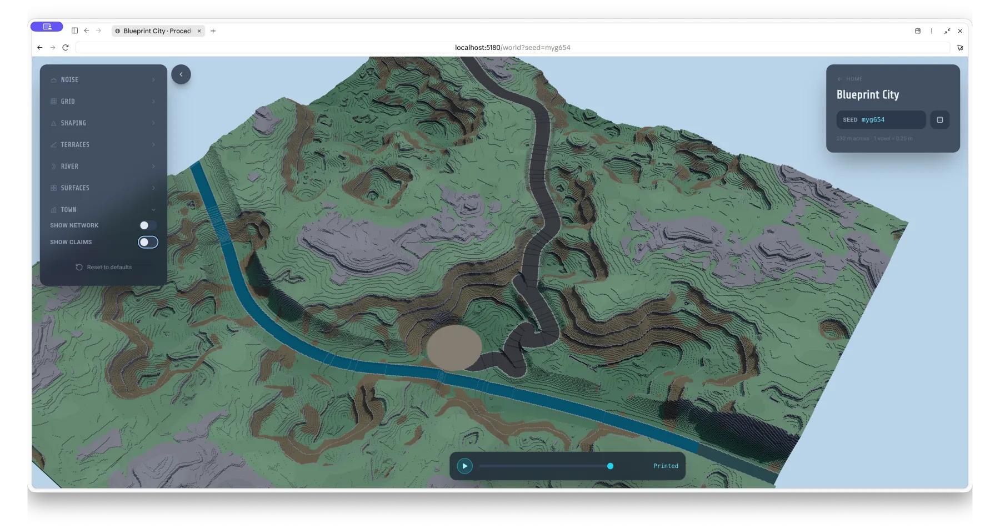 | 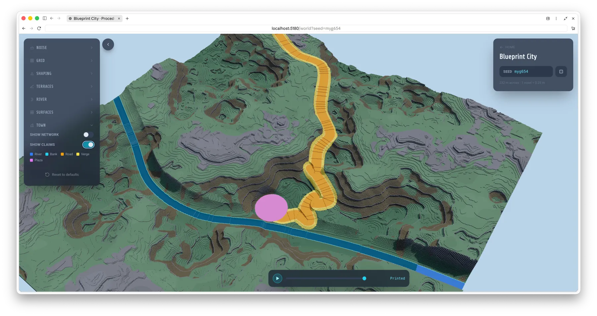 |

### 2026-10-09: the street network, districts and lots

The street network went through three designs in two days:

1. **Point to point:** each link routed on its own. Streets met at sharp angles and crossed away
   from junctions.
2. **Grown:** streets grown from the plaza, steered by a direction field and held to local rules.
   Better angles, but sparse on hilly seeds and few closed blocks.
3. **Wave function collapse:** street tiles on a grid, solved outward from the plaza.

What the network is now:
- **Avenues:** 3 to 5 straight from the plaza (the seed picks), held to a 15% grade; side streets
  may climb 25%.
- **Width:** every street is 3.5 m.
- **Junctions:** square pads on the voxel grid, as wide as the streets meeting there.

Then the **district map**, an internal map of what kind of building belongs where:
- **Six districts:** corporate core, neon strip, megablocks, industrial / docks, wealthy, parks,
  from access to the plaza, street frontage, distance to the river and slope.
- **Lots** along the streets, each in its district's color, never touching a road, the plaza, the
  river or another lot.
- **Show districts** and **Show lots** draw them without rebuilding the ground.

| Show districts and Show lots | Show claims: streets, verges, plaza and lots |
|---|---|
| 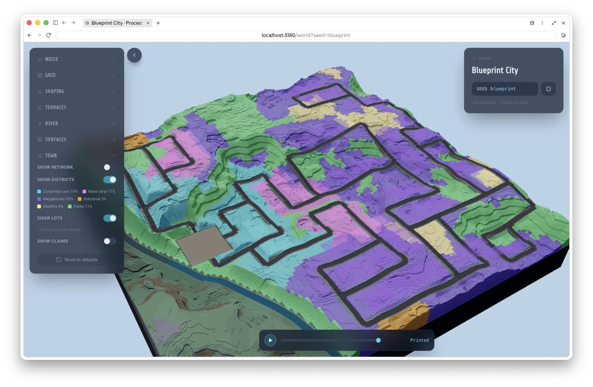 | 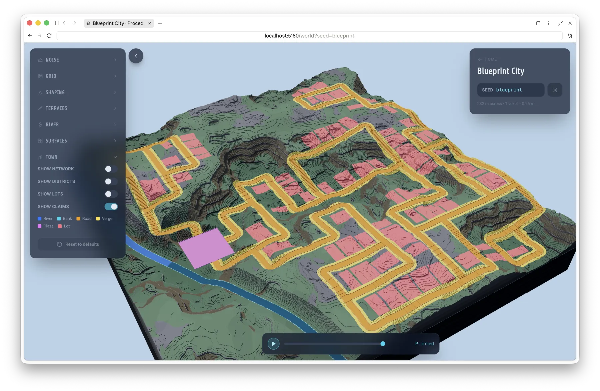 |


### 2026-10-12: the larger side of the river, and denser lots

- **The city's side:** the river splits the land in two, and the city now always starts on the
  side with more land. Before, the center went to the best spot on either side, so on some seeds
  the city sat on the narrow strip.
- **Grid section removed:** the noise Resolution is fixed at 96 × 96.
- **Denser lots:** lots covered only 13–25% of the district land, too sparse for a cyberpunk city.
  The land the street lots leave (block interiors, corners, land behind the outer streets) is now
  packed with **back lots** reached by alleys, and every lot keeps a 1 m alley from its
  neighbors. Cover is 48–55% on the 7 test seeds, and the stage got faster (72–139 ms).
- **Town views fixed:** Show lots is now a ground tint, like Show districts and Show claims, so
  lots follow the slopes and hide behind hills instead of floating through them. The tints no
  longer paint the diorama's outer walls, and the network's dots, lines and tile squares are
  hidden behind the ground (the squares now follow the slopes). Districts are now tinted per
  column: they reach right up to the street edge, and the paving itself stays clear.
- **Lots and districts like Cities: Skylines:** back lots needed alleys, and the alleys doubled up
  and climbed cliffs, so they're gone. Every lot now fronts a street: each side is cut into lots
  of whole 8 m zone cells that deepen until they meet the lots from the street behind, and a
  second pass fills the corners. Districts are smoothed into a few whole areas (none under
  1,500 m², reaching across streets), like painted districts. Cover is 20–41%.
- **Fewer, whole districts:** the corporate core is one compact disc around the plaza (at most
  50 m out), and nothing smooths it away or spreads it. Neon wraps it as one band of street
  frontage, with strips out along the avenues. Small leftover pieces under 2,000 m² join their
  neighbor.
- **Parks are not a district:** they are a layer of their own on top of the districts, claimed
  like roads so no lot goes there. Each seed picks 3 to 6 parks, each a round patch of
  700–1,400 m² grown outward from a spot on steep or hilly ground outside the core, and every
  park keeps at least 25 m from every other (fewer fit on a small city). They have their own **Show parks** switch; Show districts ignores them and
  shows the districts underneath.
- **Neon strip renamed Commercial,** and twice as wide: it reaches 28 m back from the street
  (was 14 m) in a 40 m ring around the core (was 20 m), plus the avenue strips. It now covers
  14–42% of the land (was 5–13%).

| Show districts and Show parks | Show lots |
|---|---|
| 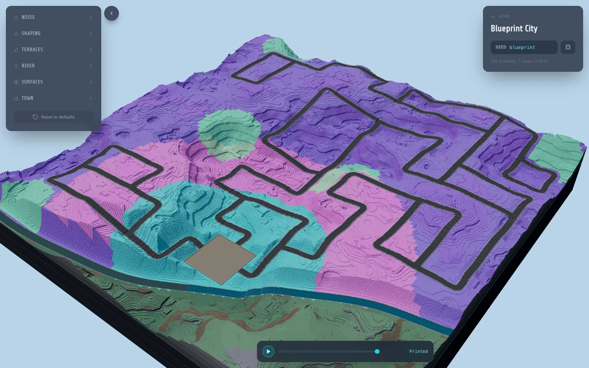 | 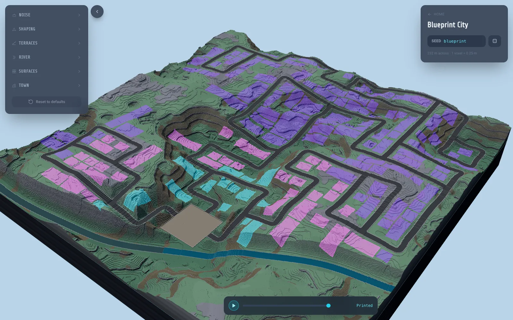 |

*Districts and parks (left) and lots (right) after these changes, on the default `blueprint` seed.*

### 2026-10-12: the building library

A library of cyberpunk voxel buildings for the lots, in [`buildings/`](buildings/README.md), with
a preview at `/buildings` (`/buildings?b=<id>&seed=<n>` opens one building). Plain three.js, like
the rest of `/world`, built at the city's 0.25 m voxel scale.

**The kit.** Every building is made from shared parts:
- recessed windows with mullions and sills;
- balconies with railings, and AC units on brackets;
- blade signs and screens;
- rooftop gear, skybridges and platforms;
- shop rows and entrances.

Every building:
- is seeded, so the same seed always gives the same building;
- takes a few milliseconds to build;
- is two draw calls (a lit body and its glowing parts);
- lists the districts it suits, ready for placing on lots.

The first version had ten archetypes: five skyscrapers and five high-density residential blocks.

**Making it hold up close.** Most of the first day went into the details looking right from any
angle:
- **Flicker:** faces sharing a plane flickered as the camera moved. Every part now keeps its own
  depth (parts stand a fraction of a voxel proud of the wall). A development check,
  `findOverlaps`, measures what's left: from 700–2,300 m² per building down to under 1 m² on
  most.
- **Parts running into each other:** a second check, `findClashes`, records every part's space
  and lists any two that run into each other. It found rooftop gear piled up, balconies inside
  skybridges, trees in walls and a bench under the awnings. Optional details now go only where
  they have room (or retry, or are left out), and skybridges reserve their space before the
  facades are dressed.
- **Facade details,** one at a time:
  - balconies got railings on three sides;
  - lit windows are lit from sill to head (no half-lit ones);
  - AC units became wall units on brackets, 1.2 m wide, with 30% left out at random;
  - an outside fire stair was tried on the Stacked Megablock, then removed.
- **Signs on solid wall.** Blade signs floated in front of windows or out over alleys. They now
  hang centered on a pier or corner column of their own mass (`pierSign`), sliding up or down to
  find room but never past their wall. Screens over fins or AC units stand off on brackets.

### 2026-10-13: redesigns, entrances and shop fronts

**Four buildings redesigned from references.** For each, I looked up real buildings first.
- **Corporate Megatower,** after SUMMIT One Vanderbilt and Edge (30 Hudson Yards), now 150 m:
  - a shaft tapering in four-floor tiers, its south face leaning;
  - thin ledges and lit glass reveals like SUMMIT's;
  - Edge's triangular sky deck jutting 12 m out near the top;
  - a stepped glass crown and a spire.
- **Neon Commercial Tower,** now 75 m:
  - blade signs only on every other inner pier, so they never cover each other;
  - neon bands broken around the screens;
  - warm lit windows only, so the signs carry the color.
- **Research Lab Tower** (replacing the Industrial Technology Tower), after Louis Kahn's Richards
  Medical Research Laboratories and the Salk Institute:
  - two glass lab towers either side of a windowless concrete service tower;
  - louvered service floors between every two lab floors;
  - brick stair and exhaust shafts climbing the outside, and exhaust stacks;
  - a greenhouse, and a double helix up the service tower.
  - Before it there was an industrial tower (an exoskeleton, smokestacks and a cooling tower),
    which was deleted. The first industrial design lives on as the residential **Tower and
    Annex**, the eleventh archetype.
- **Landmark Tower,** a TV tower after the CN Tower and Berlin's Fernsehturm, now 170 m:
  - buttress fins at the foot of a tapering round shaft, with a glass lift;
  - a disc observation pod with a deck and a restaurant, then a sky pod;
  - a banded antenna mast.
  - Its research: what landmarks in different countries share. They are visible from afar,
    unlike their neighbors, have a silhouette you can draw, a crowned top and a public viewing
    level. It is the tallest building in the library.

| The library (seed 1) | Corporate Megatower |
|---|---|
| 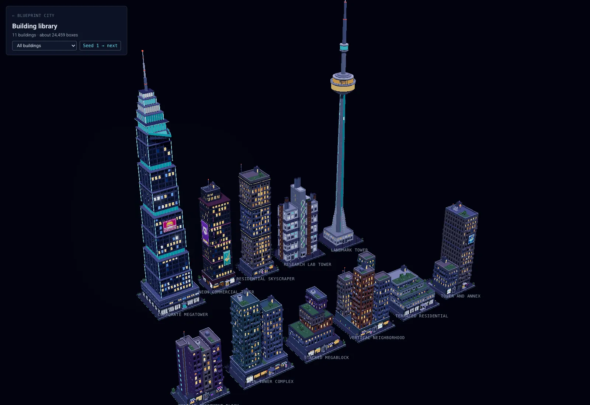 | 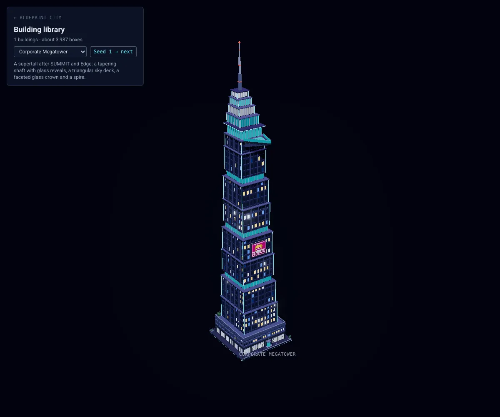 |

| Research Lab Tower | Landmark Tower (TV tower) |
|---|---|
| 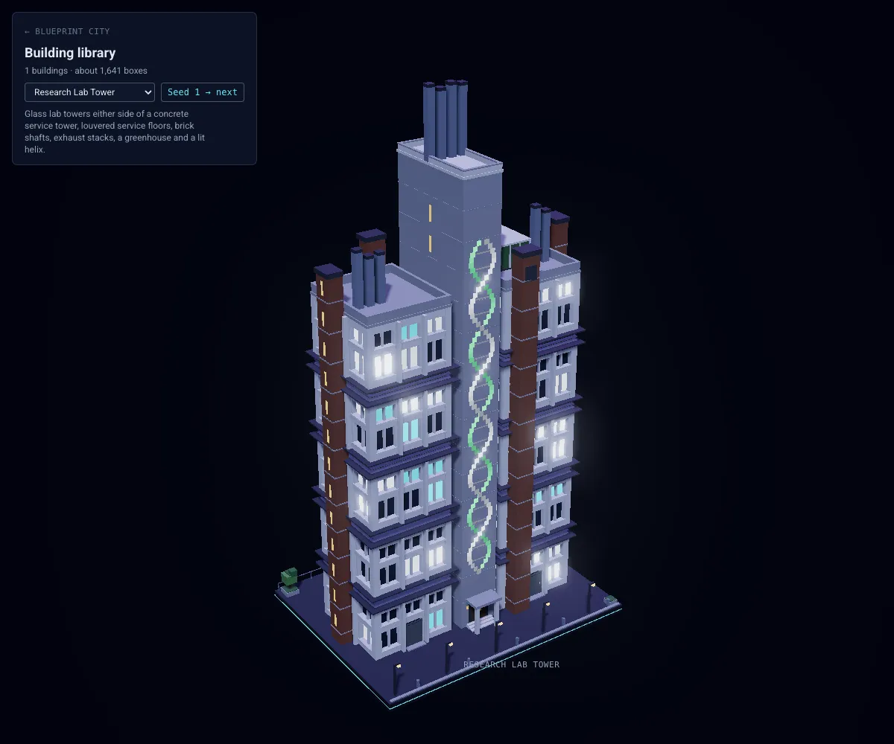 | 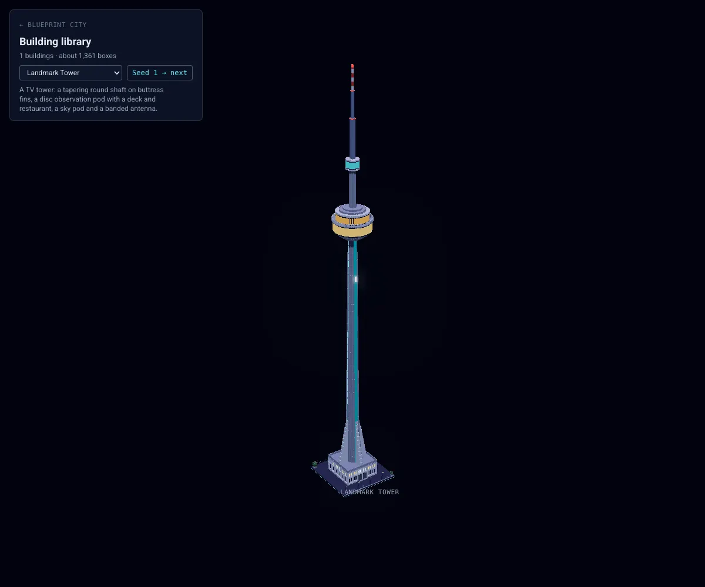 |

**Screens.** The posters went through three rounds:
1. **Finer pixels:** a 0.25 m pixel grid, with each row's runs of one color merged into one box.
2. **More designs,** from cyberpunk pixel-art ad references.
3. **Without the neon look:** posters are now lit like backlit prints, below the bloom
   threshold. The designs are a ramen shop, a phone launch, a drink with a price burst, a cat
   mascot, a logo, a headline and a synthwave travel ad. A building doesn't repeat a design.

**A way into every building.** An audit found that only two buildings had their own doors; the
others reached the street only through shops. Now:
- Every building has a ground entrance facing the street. Each door records itself, and a check
  confirms every building has one, with a clear walkway to the lot edge, on 8 seeds.
- Entrances come in five styles, after real types, each matched to the building:
  - **glass doors** (Neon Commercial, the Tower and Annex's tower);
  - a **revolving door** (Corporate Megatower);
  - a **porte-cochère** (Residential Skyscraper, Twin-Tower);
  - a **portico** (Terraced Residential, the Research Lab);
  - a Hong Kong **tong lau gated stair hall** (Modular, Stacked, Vertical Neighborhood, the annex).

**Shop fronts.** Nearly every building had shops on all four sides.
- Now only the street side has shops; the other sides are plain service walls with a back door,
  vents and posters.
- The Neon Commercial Tower keeps shops all round. The Corporate Megatower and Terraced
  Residential have a glazed lobby front instead.
- Each shop unit is one of five types: a store, a closed roller shutter with graffiti, a noodle
  bar (noren curtains, a red lantern, stools), a convenience store or a hatch kiosk.

| Neon Commercial Tower | Stacked Megablock |
|---|---|
| 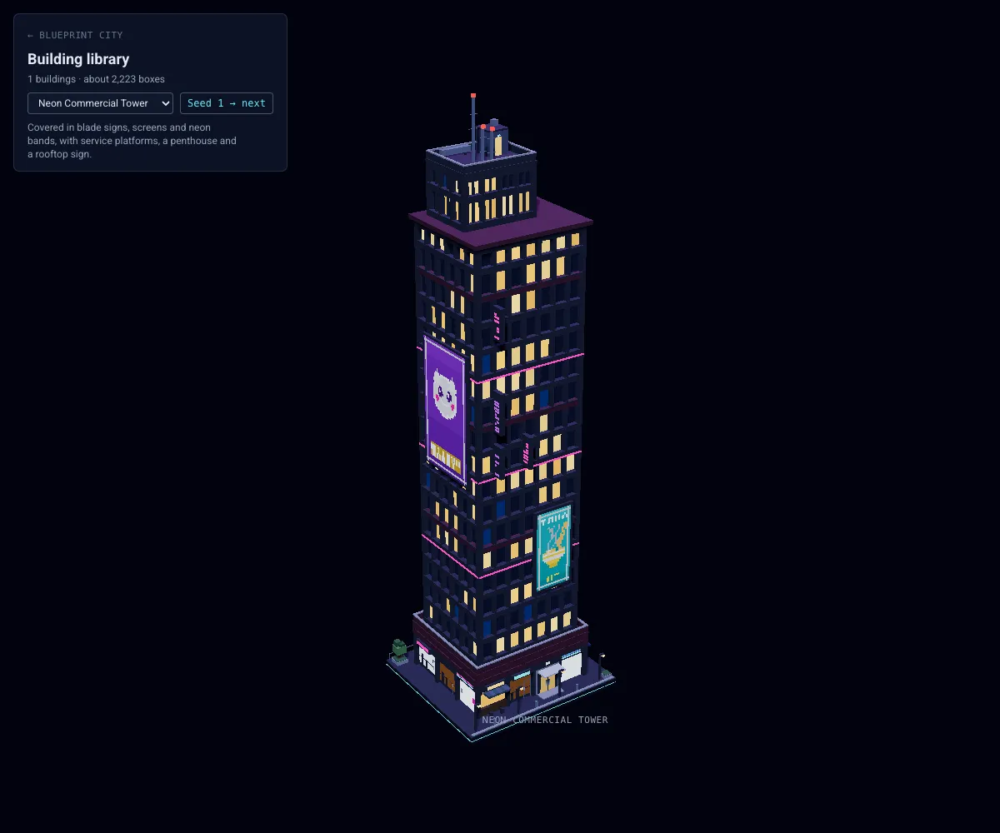 | 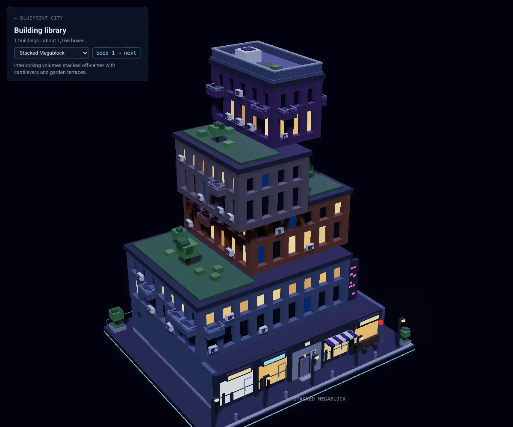 |

| Terraced Residential | Tower and Annex |
|---|---|
| 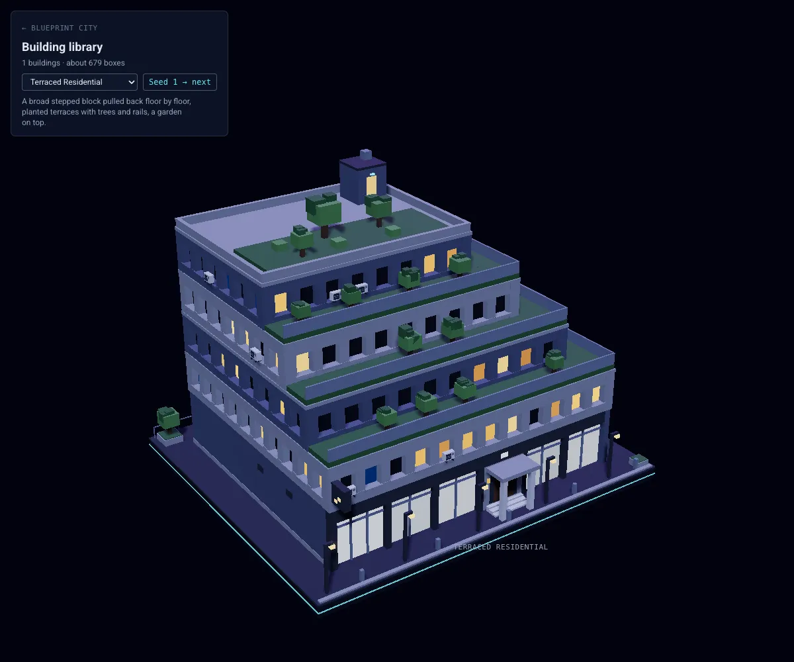 | 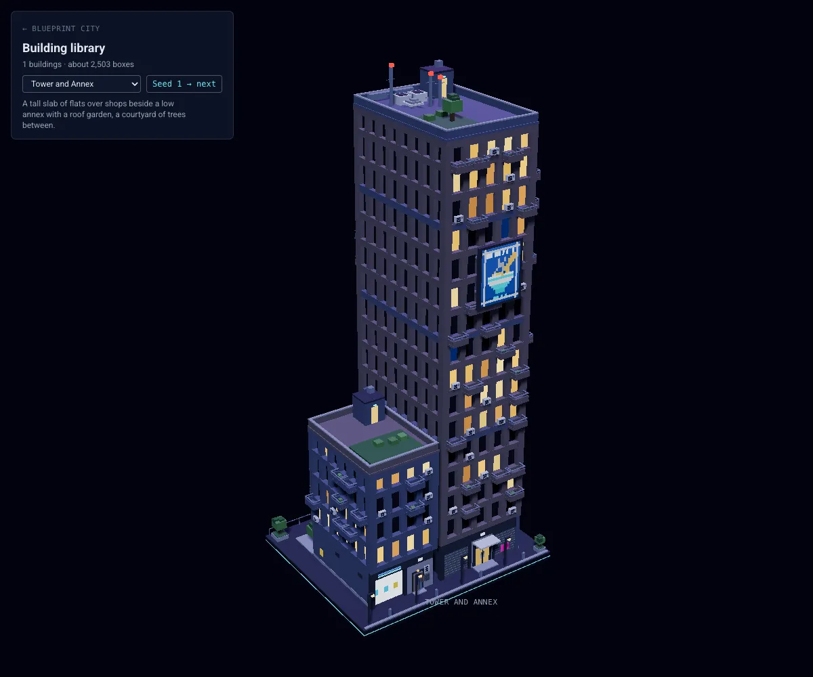 |

Where it ends up: eleven archetypes, every one with no clashes on 8 seeds and under 0.5 m² of
flicker (the Vertical Neighborhood has about 4 m² left, not yet tracked down).

### 2026-10-14: the build timeline

The timeline at the bottom used to print the finished ground layer by layer, so the river and
streets were already cut into it. It now replays the city in the order it is made, over 8 s:
1. **Printing terrain:** the ground before the river and the streets.
2. **Carving the river:** the river's cut sinks layer by layer to the channel floor.
3. **Filling the river:** the water runs down the channel from the source to the mouth.
4. **Building the plaza:** paving spreads from its center out.
5. **Growing streets:** paving spreads along the network by distance from the plaza, the street
   cuts open as it reaches them, and a glowing build front leads it. Streets not yet built look
   like the grass around them.

The finished ground is drawn as always. The ground the river and the streets cut away is drawn
on top of it as two extra meshes (`terrain/buildup.ts`) and cleared as the timeline passes.
Paving order is one value per column, which the ground shader reads, so nothing is rebuilt per
frame.

**The dry river, fixed.** Watching the fill showed the downstream half of the default river had
no water. The river's level only ever falls, and after it passed a low pit it kept falling below
the plinth floor (−1.3 voxels at the mouth). The bed can't go lower than one voxel above the
plinth, so there was no room for water above it, and the river cut a dry trench through the high
ground to the mouth. The level now stops one channel depth (1 m) above the lowest bed. Four of
eight test seeds had dry stretches (the default only 47% wet); all eight are now fully wet. The
channel floor is unchanged; the valley sides beside those stretches are a little gentler.

**Faster settings changes.** A change (slider released) used to block the page for about
1.3 s with no feedback: the whole pipeline (0.8–1.15 s in the browser, districts alone up to
0.5 s), the new build-animation data (0.18 s) and the upload, all before the next frame.
- The timeline bar shows **Generating…** right away (1 ms after release), and the slider stays
  where it was let go, because the work starts two frames later.
- The ground is drawn as soon as its mesh is ready. Districts and lots, which only the overlays
  use, finish a moment later (`generateTerrain(..., { deferDistricts })`, then `finishTerrain`).
- The build animation's data is made only when the timeline plays or is scrubbed. A settings
  change doesn't replay it, so it no longer pays for it.

A Terrace Height change is now done in about 1.07 s end to end, with the new ground on screen
well before that.


### 2026-10-14: buildings on the lots

The building library now stands on the city (`city/placement.ts`, drawn by
`WorldView.setBuildings`). Each lot gets one building:
- **Which:** picked with the seed from the archetypes that suit the lot's district and fit it
  (each has a smallest side it still reads well at, from 6 m for the neon tower to 14 m for the
  twin towers).
- **How big:** the footprint is the whole lot; the height follows the district (core 55–140 m,
  wealthy 14–30 m) and the lot's density, but never more than 8 times the narrower side.
- **Facing:** the entrance turned to the lot's street.
- **On slopes:** the building stands on the lot's lowest ground, its uphill side set into the
  hill, so nothing floats (it had a concrete plinth until 2026-10-27).
- **The Landmark** stands at the center of the plaza (no lot is big enough), at least 25 m above
  everything else.

The default seed places 141 buildings. They are built a few per frame (about 10 ms each frame),
so the page stays responsive. The timeline has a new last phase, **Raising buildings**: the
Landmark first, then outward from the plaza, each growing up out of its lot. **Show buildings**
in the Town section turns them off.

### 2026-10-26: one panel, and the city slides clear of it

A UI review of /world found the panels hid the city. Now:
- **One panel, on the left.** The title card (home, title, seed) that sat on the right is
  the top of the settings panel (`TitleBlock` in `ui/TitleCard.tsx`), so only one side of the view
  is covered and one round button (or E) shows and hides everything.
- **The city slides clear of it.** When the panel is open, the picture shifts right by half the
  panel's width (a view offset in `WorldView.setInsetLeft`; the camera doesn't move), easing as the
  panel opens and closes, so the city sits in the part still in view. At load, the camera is
  framed for that part.
- The scale line under the seed ("232 m across · 1 voxel = 0.25 m") is gone.

Tried and reverted the same day: an accordion panel (one section open at a time), plain-language
slider names with always-visible hints, and the layer switches moved to the top.

### 2026-10-26: rebuild feedback, build stages, one type system, lighter glass (UI review 4, 10, 12, 13)

- **Rebuild feedback.** While a rebuild runs, a spinner turns by the setting just changed, and a
  quiet "Rebuilding the city…" pill shows at the top of the part of the view the panel leaves. (A
  circular-arrow mark by every setting that rebuilds was tried and removed the same day.)
- **Build stages on the timeline.** Under the scrubber, the six stages (terrain, river, water,
  plaza, streets, buildings) as segments sized to their share: done ones filled, the current one
  bright; the status reads "Growing streets · 5/6".
- **One type system.** Titles and section headings in Share Tech; every small uppercase label
  (Home, Seed, the settings) in the shared label style; every value (the seed, numbers, speed,
  status) in the shared mono value style. The seed field and the Home link had their own.
- **Lighter glass.** The panel, its round button, the time bar and the pill use `WORLD_GLASS`: a
  lighter tint that darkens what is behind it (backdrop brightness) instead, so it looks less heavy
  over the bright diorama and its text keeps its contrast (a plain lighter tint made the headings
  unreadable). `SidePanel` takes a `glass` class for this; the weeks keep their dark cards.

### 2026-10-26: Blueprint City's own UI style, 80% size

/world now has its own controls (`ui/kit.tsx`; the weeks keep `components/controls.tsx`):
- **Colors: a blueprint.** Panels in deep navy ink (`#0b1626` at 75%, dimming what is behind)
  with fine pale-blue rules; **cyan** (`#5ad8ff`, the neon) for everything you can touch (slider
  fills and thumbs, switches, the play button, section icons); **warm amber** (`#ffd27a`, the lit
  windows) for every value (the seed, numbers, speed, status, the current build stage), so a value
  never reads as a control.
- **Parameters as rows.** The name in sentence case on the left (it was all caps), the value in an
  amber chip on the right, and under them a thin track filled in cyan up to the value, with a small
  pale tick where the default sits, so a changed setting shows how far it moved. Sections are
  separated by hairlines instead of wide gaps; the switches are smaller.
- **80% size.** The interface (panel, time bar, rebuild note) is drawn with CSS `zoom: 0.8`
  (`UI_SCALE` in `index.tsx`); the view's inset for the open panel scales with it.
- **One track for time and stages.** The time bar's scrubber and its row of stage segments are one
  now: the track itself is the six stages (each as long as its share, small gaps between), filled
  in cyan up to now, the current stage's remaining part a shade lighter; the range input lies on
  top, transparent but for its thumb, and its tooltip names the current stage.

### 2026-10-26: Buildings are built, storey by storey

The timeline's last stage used to 3D-print each building in thin 0.5 m layers under a cyan print
line. It now reads as construction (`buildings/print.ts`):

- **A frame a storey ahead.** The frame rises one storey (3 m) at a time, with an ease-out, then
  waits; the finished facade climbs steadily up behind it, so a building site is always one to
  two storeys of scaffolding over finished floors.
- **Scaffolding look.** Above the facade the walls are drawn as dark-blue netting with steel
  poles every meter, ledgers every half storey and a diagonal brace, in safety yellow; the deck at
  the frame top is bare concrete; a broken row of amber work lights runs along the frame's edge.
- **Windows light floor by floor**, each as soon as its storey is clad (they were all dim until
  the building was done).
- Unbuilt floors still cast no shadow until the building is finished.

### 2026-10-27: No plinths; steady signs

- **No plinths.** Each building on a slope used to stand on the lot's highest ground over a dark
  concrete plinth down to its lowest, which read as an odd platform under every building. It now
  stands on the lot's lowest ground, its uphill side set into the hill, and the plinths are gone.
- **Signs no longer flicker.** A billboard's pixels sit a tenth of a voxel in front of its frame,
  and sign glyphs are as fine; with the near plane fixed at 1 voxel the depth buffer couldn't tell
  them apart from afar, so they striped and broke up. The near plane now follows the camera, just
  short of the diorama's box (`fitNear` in `WorldView`), which gives the depth buffer hundreds of
  times the precision at the usual viewing distance.
- **Lots are graded.** With the building on the lot's lowest ground, the rest of the lot's ground
  stood up inside it (up to 10 m on megablock lots) and flickered against its floor. After the
  lots are laid out, each is now dug level to its lowest ground, with one column of margin around
  it (never streets, sidewalks, the plaza or the river), and the mesh is redone from the graded
  ground (`terrain/grade.ts`, run in the districts stage). `columns` stays the ungraded ground the
  lots were laid out on. Checked on four seeds (256 buildings): no ground inside any footprint
  (before: all but one building).
- **The dig is part of construction.** In the build timeline a lot keeps its old ground until its
  building starts: the first DIG_SHARE (20%) of the building's time sinks the dug-out ground from
  its top down to the graded floor, then the building goes up out of the level pit. The dug-out
  ground is one mesh (`meshDig`, made in `buildUp`) with each vertex's lot in an `aLot`
  attribute; a one-row float texture holds every lot's current ceiling, which `printMaterial`'s
  `lotCaps` clamps it to, so all lots dig on their own clocks in one draw call.
- **Buildings rise 10% slower.** The timeline's phases are now set in seconds at 1×
  (`PHASE_SECONDS` in `terrain/buildup.ts`; each phase's share and the whole length follow from
  them): the buildings take 1.76 s instead of 1.6 s, every other phase keeps its length, and the
  whole build plays in 10.16 s.

### 2026-10-27: City ground

The ground was painted as wild land everywhere (grass, dirt, rock), so the city stood in a
meadow. Once the districts and lots are known, `paintCity` (`terrain/urban.ts`) repaints the
ground inside the city, and the mesh is redone with it:

- **Sidewalks** on the verges between streets and lots (they were grass), a step lighter than the
  roads.
- **Concrete pads** on the lots and the margin their grading digs.
- **Pavement** on the rest of the districts' ground (alleys, yards, back lots), darker, with half
  the tone patches, like worn, patched asphalt; bare rock inside a district becomes concrete.
- **Scrub** on steep ground inside the districts (the planted slopes between terraces), and tended
  **lawn** in the parks.
- **Retaining walls**: where the ground steps under sidewalk, pavement or concrete, the side is
  concrete (`URBAN_GROUND.wallTop/wallBottom`) instead of cliff rock.
- Outside the districts the land stays wild.

Colors are in `palette.ts` (`URBAN_GROUND`). In the build timeline the city's ground comes with
the paving front, like the streets' cuts and fills (`buildUp` counts repainted columns as changed),
and every lot, flat ones too, keeps its old ground until its building starts: the grading's
`dugBy` now marks each lot's own columns, so a flat lot's old ground is part of the dig mesh (drawn
with a polygon offset over its new floor) and goes when the dig begins.

### 2026-10-27: Hard ground everywhere but the parks

- **The whole ground is built.** `paintCity` now repaints the land outside the districts too: flat
  ground becomes **paving slabs** (2 m tiles), bare rock and steep ground **concrete**, the river's
  bank a concrete **quay**; inside the districts flat ground stays asphalt **pavement**. Only the
  parks keep grass (lawn). The scrub surface is gone.
- **Slabs.** Plaza, paving, sidewalks and lot pads (`TILES` in `terrain/surfaces.ts`: 1.5, 2, 1
  and 3 m) are laid as square tiles, alternate tiles a shade darker and lighter (`SLAB`, ±7%,
  whatever Ground tones is).
- **The plaza is dark stone slabs** (`URBAN_GROUND.plaza`) instead of beige; before the city is
  painted (the ground drawn first while the districts finish) it is still the plain plaza color.
- **Retaining walls everywhere** the ground steps, except under lawns and the riverbed
  (`NATURAL_SIDES`), which keep cliff rock.
- **Planting strips on narrow steps.** Ground on a step at most 1 m deep (`NARROW`: a rise on one
  side and a drop on the other, along x or z, within 4 columns), the voxel stairs on hillsides and
  thin terraces, is a dark-green **planter** (`URBAN_GROUND.planter`) behind its concrete walls,
  instead of more concrete steps. About 18–30% of the ground, depending on the seed.
- **Rectangular parks.** A park is no longer a round patch grown from a spot: it is a whole
  rectangle of district cells, long side 1–2 times the short (the seed picks), placed at the same
  best-scoring spots, either way round and shifted up to a quarter of its sides to fit, shrunk to
  90% then 80% of its size where a whole one doesn't fit (a street or the edge would cut it), else
  the spot is skipped. Six seeds tried: 3–6 parks each.
- **Every lot gets its building.** Lots narrower than 6 m are skipped, and the narrowest lots
  are exactly 6 m; measured from their rotated corners they came out a hair under (5.9999…), so
  every 8 × 6 m lot stood empty (11 on `blueprint`), which the concrete pads made plain to see. The
  test now allows 0.01 m (`MIN_LOT`); five seeds tried, no empty lot.

### 2026-10-27: Landscaped parks

Parks are no longer bare lawn: each is laid out and furnished (`city/parks.ts`, planned in the
districts stage; drawn from `city/parkModels.ts` by `WorldView.setParks`).

- **Layouts.** One of three per park (the seed picks): **cross** (two straight paths meeting at a
  round court with a fountain), **loop** (a rounded path inset from the edge, a spur out to each
  side, a pavilion in the middle) or **grand** (both, the fountain where they meet). Paths are 2 m
  wide, painted as pale stone setts (`SURFACE.path`, 1 m tiles, `URBAN_GROUND.path`).
- **Terraces.** Parks lie on hillsides (up to ~12 m of rise across one), so every facility is set
  on a terrace: its footprint and a column around it cut and filled to its median height and paved
  (so it shows retaining walls). The court is levelled whole; other spots that would need more
  than 2 m of cut or fill (1 m for a bench) are passed over for flatter ones. The terraces are part
  of `Parks.ground`, which the finished mesh is built from; the paving front brings them, like the
  rest of the city's paint.
- **Facilities.** The fountain (a lit basin, a two-tier spout and its jet) or a pavilion (deck,
  posts, stepped roof, lantern); four flower beds around it; a playground in most parks (sand pit,
  slide tower, swings, a spring rider); 1–3 picnic tables; benches along the paths in paved
  niches, facing the path, some with a litter bin; lamps between them (amber, warm or cyan per
  park); a vending machine at an entrance.
- **Plants.** Hedges along the edge in some parks (open where paths come in); trees thick along
  the edge and sparse on the open lawn, kept off the paths, each park with a favorite of three
  kinds (round broadleaf, slim conifer, pink blossom with fallen petals); shrubs, some flowering,
  along the paths and between the trees.
- **Built in turn.** Each park is one solid and one glow mesh (the buildings' materials). Every
  vertex carries its prop's base and start (`aGrow`), and the shader grows each prop out of its
  base with a small overshoot: parks start outward from the plaza as the buildings do, and within
  a park the middle first (`PARK_SPREAD`, `PARK_GROW`). They cast shadows once the city is built.

### 2026-10-27: Gentler parks, flower gardens, no clashing props

- **The parks' ground is regraded** (`planParks` returns it as `Parks.ground`, and the finished
  mesh is now built from it; until now the terraces the props were set on were planned but never
  drawn, so props could float or sink). Inside, the ground is smoothed (a 3 m box blur) and its
  rise around the park's mean height scaled to `FLATTEN` (25%): the lawn is nearly level. At the
  edge a short bank brings it to within `WALL` (1.5 m) of the ground around, and a stone-capped
  retaining wall takes the rest. Each path comes in at the street's level and ramps to the park's
  over `ENTRY` (measured along the paths from where they come in, so a path running beside the edge
  stays level), with the lawn either side sloping down to its stairs over `FLANK` instead of
  standing as a wall. Steps of 0.75 m or more get a stone coping. Columns a lot's dig reached are
  left to the lot. Five seeds: the inner lawn's rise fell from 6–11 m to 1.3–3 m, and no step in a
  park is over 1.75 m (it was 4 m). Terraces may cut or fill at most 1 m (0.5 m for the small ones).
- **Flower gardens.** One park per city (two from four parks up) is a garden: only paths, flower
  beds (a pair in the middle, four around them, more along the paths, long side to the path) and
  benches.
- **No prop runs into another, the ground or a building.** Every prop keeps clear of the others:
  tree crowns (radius to their farthest block corner, `crown`) of each other, of every prop that
  reaches above their underside (`ROOM`; hedges and beds as rows of circles), of the ground under
  them and of the park's edge; a blossom's fallen petals and a shrub's spread of every prop; shrubs
  only on level ground; hedges only where their whole depth is level and free; benches centered
  on their niches; bins on pads wider than their lids.
- **No flickering faces.** Plant blocks are snapped to a quarter voxel and each grown by a
  different hair (`plant` in parkModels.ts), so no two faces of a plant share a plane; the bench's
  frame, the lamp's lantern, the fountain's falling water and the flowers in a bed were moved off
  the planes they shared. A check over five seeds (every prop's boxes against every other prop's,
  the ground, the park's edge and nearby buildings, and same-direction coplanar faces of different
  colors within a prop) finds none.

## 2026-10-27: Even park stairs, footings kept covered, iron fences

- **Stairs.** A path no longer ramps from the street to the park over a fixed 9 m. It is held to a
  grade instead (`limitPaths` in city/parks.ts): along the paths, each column stays within half a
  voxel per column of every way in (held at the street's level) and of the court. The result is
  stairs of single 25 cm steps, however long that makes them. Where a way in is too close to the
  court for that grade, the stairs run straight between the two, steeper but even, with no wall at
  either end. The lawn beside the stairs slopes to them once the court is levelled. Terraces paved
  beside a path (flower beds, bench niches, bin pads, the vending machine) are skipped where they
  would leave a step of more than 50 cm to it. Over five seeds the tallest step on a path went from
  2–3 m to 1 m, and steps over 50 cm went from about 400 per city to a handful.
- **Footings.** Regrading could cut the park up to 2 m below a neighboring lot's floor, which bared
  the building's footing so it looked afloat. Within 4 columns of a lot, a park is no longer cut
  below that lot's floor, and it eases down from there over 3 m.
- **Fences.** A low (0.8 m) black iron fence runs around each park's edge: posts about every 2 m,
  two rails, a picket every voxel. It is open where the paths come in and steps with the ground in
  level runs. The clash check (props, ground, park edge, buildings, coplanar faces) still finds
  none over five seeds.

## 2026-10-27: Inhabitants (agents, after Class 08)

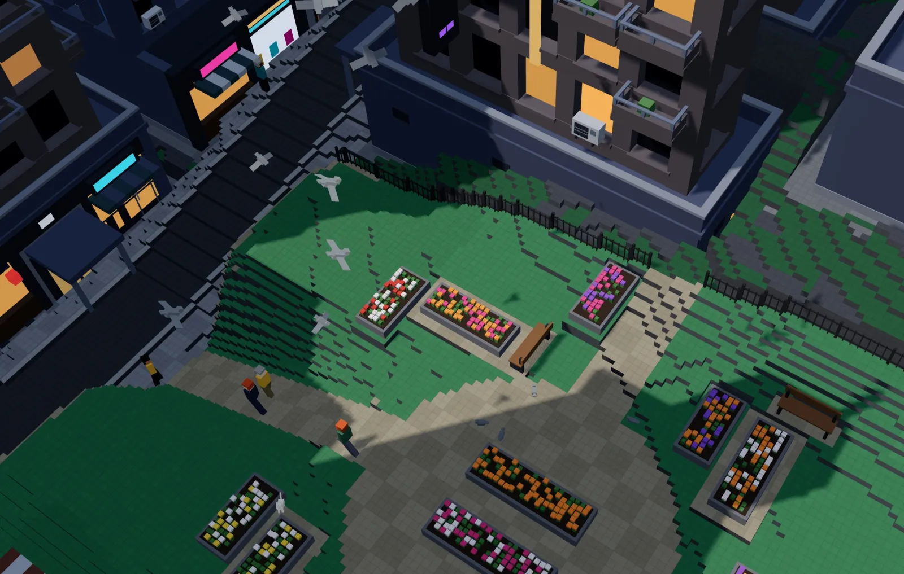

The city is lived in once it is built (`life/`, drawn by render/life.ts; "Show life" in the
Town section, `?hide=life` to start without). 420 people, 150 pigeons and 8 cats, each kind from
one of the agent models, and each reacting to the others.

- **Where they can go** (life/walk.ts). Sidewalks, the plaza and the park paths are paving; roads
  cost more (crossed, not walked down); open ground and the river bank cost more still (crossed
  only where there is no paved way: the parks are ringed by open ground, not sidewalk). Park lawns
  are the animals' only. Park props, fences and the Landmark are blocked out; columns beside
  anything people can't walk on cost a little more, so walkers keep to the middle of a path;
  strips a single column (25 cm) wide are closed; no step is over 2 voxels. Getting anywhere is a
  flow field: one search from every place of a kind (all benches, all vending machines, the
  meeting places round the fountains, pavilions and plaza, all doors, and eight far stroll points)
  gives each column its distance, and walkers go downhill in it. Fields are worked out a slice at
  a time (3 ms a frame), so the page never stalls on them.
- **People: needs and a state machine.** Thirst, rest, company and home grow at each person's own
  rates; when only strolling, the most basic need past its threshold wins (thirst, then rest, then
  company, then home: Maslow's order). They walk to it, then walk to the path in front of a free
  seat and sit down (getting up back onto the path), stand at a vending machine, or stand talking
  in a circle of at most four, facing each other (a full circle sends them on). Going home, they
  walk into a door, and someone new comes out of another.
- **Bodies.** A person is 0.75 voxel round: its body never overlaps a column it couldn't stand on
  (walls, props, fences), and it is eased off any it has come to touch. People keep their distance
  (2.4 voxels), are never closer than 1.6, and bear right of anyone coming the other way. Someone
  who gets no nearer the goal for 2.5 s squeezes past the people in the way for 1.5 s; after three
  of those, they go somewhere else. Seated, the shins hang clear of the seat's front edge.
- **Pigeons: boids.** One flock per roost (the plaza, each park's court). On the ground they peck
  and hop; they walk off from anyone coming within 2.25 m and fly from closer, and the alarm puts
  up the flock around them. In the air: separation, alignment, cohesion, circling the roost at
  9–18 m, kept over the roofs (a coarse grid of the highest roof per 2 m cell); they land again
  once the roost has been quiet for a while.
- **Cats: predator and prey, with perception.** A cat prowls its home range and sees pigeons in a
  120° cone up to 11 m, unless a building or a wall blocks the line. It stalks slowly and low (a
  pigeon notices it only late), sprints from 2.75 m, and sits down to wash when the flock goes up.
  People walking by send it running.
- Three seeds (blueprint, harbor, delta), ten simulated minutes each: per sample, no person's body
  in a wall (0–0.02) and 0.01–0.26 pairs closer than 1.2 voxels, besides the 1–2% squeezing past;
  0.02–0.1% of walkers made no headway over 10 s. 1.3–1.8 ms per step headless.

## 2026-10-27: Buildings stand back from their lot's edge

- **The whole building keeps within its lot, less 2 voxels (0.5 m) all round** (`GAP`, `room` and
  `fitBuilding` in city/placement.ts). Until now the body filled the lot (most lots are only 6 m
  across, and no model was built narrower than 6 m), and what sticks out of the walls reached past
  it: entrances up to 2.6 m, billboards and signs 2.5 m, shop awnings 1.4 m, balconies 1 m, over the
  sidewalks and stairs. Now the body is built GAP smaller than the room all round (so awnings and
  signs have that strip to stick out into, and models may now be as narrow as 4 m), and every box
  of the model is cut at the room's edge (`Kit.clip`; a cut side gets its face, each cut a hair
  apart so no two share a plane). The body is centered on the lot.
- **Sizes that build badly are avoided.** A few archetypes put faces in one plane (flicker) or run
  parts into each other at some sizes; `fitBuilding` then tries the next of a short list of body
  sizes (a little narrower or wider, down to filling the room) and keeps the cleanest. The modular
  block now needs 8 m (narrower, a tall one's modules ran into each other), and a lot no building
  of its district fits gets the slimmest one of any district that does (narrow industrial lots
  used to get a lab tower squeezed below its 12 m).
- Three seeds (blueprint, harbor, delta): no part of any building past its room or over a street
  (it was 109 of 150 on blueprint); part clashes 0 (were 0–108); flickering faces about as before
  (a few 5 m-deep neon towers have 2 m² at a sign's top edge). Building the models takes about
  four times as long (1 s for blueprint), still spread over frames.

## 2026-10-27: One concrete city: Surfaces rewritten for the cyberpunk island

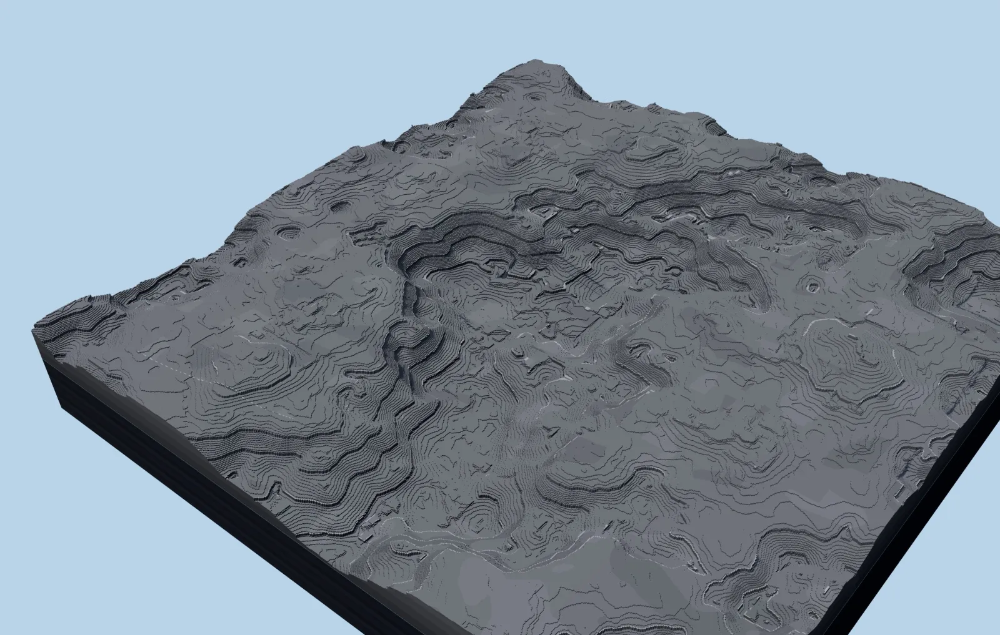

- **The whole island is one pour of concrete** (terrain/surfaces.ts). Surfaces no longer makes
  grass, dirt and rock: everything that isn't river, street or plaza is concrete, with two kinds
  read from the land, with their settings (the panel's Surfaces section):
  - **Grime** (was Ground tones; 0.12): how strongly the concrete is stained in large noise patches.
  - **Ledge drop** (was Rock cliff; 0.75 m): a rim with a neighbor at least this much lower gets a
    pale coping (`ledge`) along the drop.
  - **Stair slope** (was Dirt slope; 30°): hillsides steeper than this are flights of concrete
    steps (`stairs`), each tread a voxel up, alternately lighter and darker.
  - Grass limit is gone: no ground is set apart by its height.
  Every step in the ground is faced with a concrete retaining wall (only lawns and the riverbed
  keep cliff sides), so the terraces read as built.
- **The city's paint** (terrain/urban.ts) now only adds what the city laid on it: the plaza's
  slabs, sidewalks, the quay along the bank, the parks' lawns and paths, and the lots' pads, of the
  same concrete as the ground around them. The patchwork of slab paving, asphalt, concrete and
  planter strips it used to lay over unbuilt ground is gone (`pavement`, `paving` and `planter`
  are no longer painted). The build animation is concrete from its first layer: the ground before
  the streets, what the river and streets cut away, and the streets not yet paved (render/print.ts
  showed them as grass, in green bands along where the streets would go).
- Three seeds: concrete 62–74% of the island, stairs 5–7%, ledges 1–2%; the rest streets,
  sidewalks, plaza, parks and river.

## 2026-10-28: Traffic: cars, vans, taxis and buses, and how people live with them

| Bus stop | Taxi pickup |
|---|---|
| 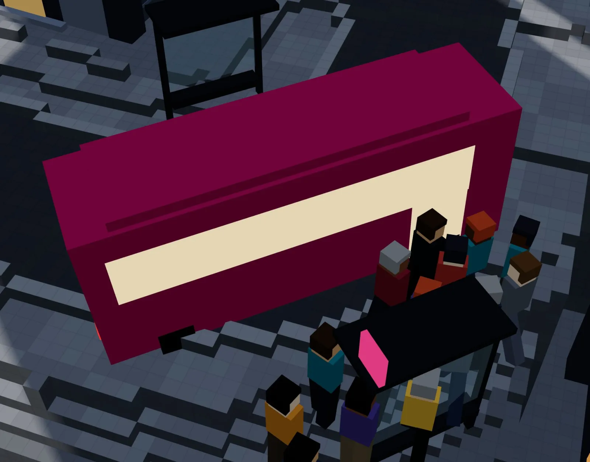 | 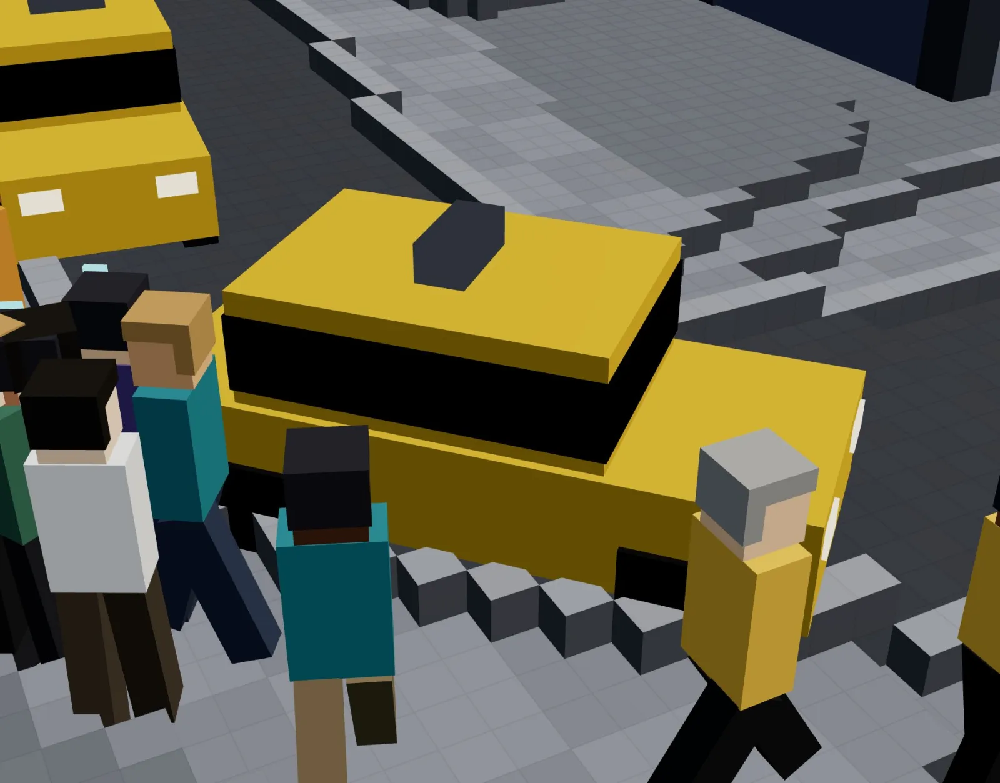 |

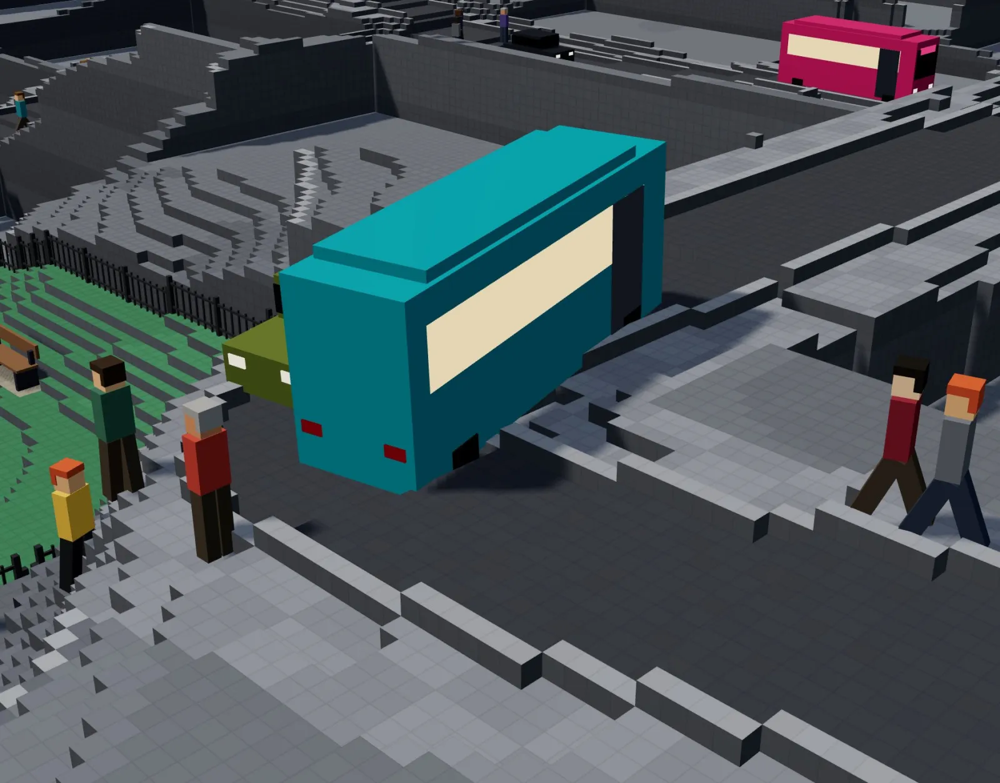

- **The road graph** (life/traffic.ts): every street is two lanes, keeping right, each 0.24 of the
  street's width off its center line and trimmed back from the junctions. At a junction, each lane
  coming in is joined to each lane going out (not back the way it came) by a link, a smooth curve.
  The streets into the plaza (people only) and other dead ends turn traffic round; short dead ends
  (under 10 m) are kept out of. Streets running off the island's edge are where traffic leaves and
  comes back on.
- **The fleet**: kei cars (3.4 × 1.4 m), vans, yellow taxis and community buses (6 × 1.65 m) that
  fit the 3.5 m streets, no more than one per 17.5 m of lane or three per junction (`LIFE` in
  index.tsx: 14 cars, 4 vans, 8 taxis, 2 buses a route). Each follows the one ahead by the
  Intelligent Driver Model, slows for bends, and rides over the top of a stepped street's steps.
  Cars and vans turn at random and now and then leave the island; taxis and buses route by
  shortest path.
- **Junctions**: a vehicle asks for its link 10 m before the stop line. Links that cross, merge or
  start from the same lane conflict (two going straight on in opposite directions don't). Once at
  the line, it is let in in the order they got there, if its link conflicts with no one inside and
  no one waiting before it, and if there is room beyond the junction for it ("don't block the
  box"). It holds the junction until its back is out of the link. A vehicle stuck 45 s (a knot) is
  towed: taken off and brought back elsewhere.
- **People and vehicles**:
  - A vehicle stops for anyone its *body* would pass over in the next few voxels (on a tight turn
    its corners cut over the corner of the sidewalk). Kept waiting 3 s, it creeps on at walking
    pace, minding only people on the road at its bumper, and people make way.
  - Someone about to step off the curb waits (up to 12 s) while a vehicle is coming, then crosses
    30% faster. People walk round vehicles, never into one, and step out of the way of one beside
    them. Walking down a road now costs 10 per column (was 7), so people keep to the sidewalks.
  - Going home, 25% take the bus: they walk to the nearest shelter and wait, facing the road; when
    their bus pulls up, its door lights up and they walk to it and get on. At each stop riders get
    off with a chance of 35%, and walk on from there. Two routes go round six streets far apart,
    one each way, with shelters on both sides of those streets in each route's color.
  - 10% hail a taxi at the curb (holding up a glowing phone). The nearest free taxi (roof light
    lit) comes, pulls up beside them, takes them aboard and drops them somewhere else in the city,
    at least 40 m away. They give up and walk home after 90 s (150 s for a bus).
  - Pigeons go up as a vehicle passes.
- **Drawing** (render/life.ts): instanced, a few draw calls for the fleet. Headlights are always on;
  tail lights flare when braking; buses have lit windows and a destination sign in their route's
  color.
- Three seeds (blueprint, harbor, neon7), four minutes each, simulated headless: 1–4 vehicles towed
  per seed, no one standing inside a vehicle (it was in the hundreds before people stepped aside),
  vehicles overlapping in under 1% of samples (mostly a bus's corner on a bend), and taxis and
  buses picking up and dropping off. Harbor's network is three streets between the same two
  junctions, so it jams most. A step of the whole simulation (people, animals, traffic) takes
  about 2 ms.

## 2026-10-28: Smoother blocks, graded lots, deeper lots

| Ground (buildings hidden) | With buildings |
|---|---|
| 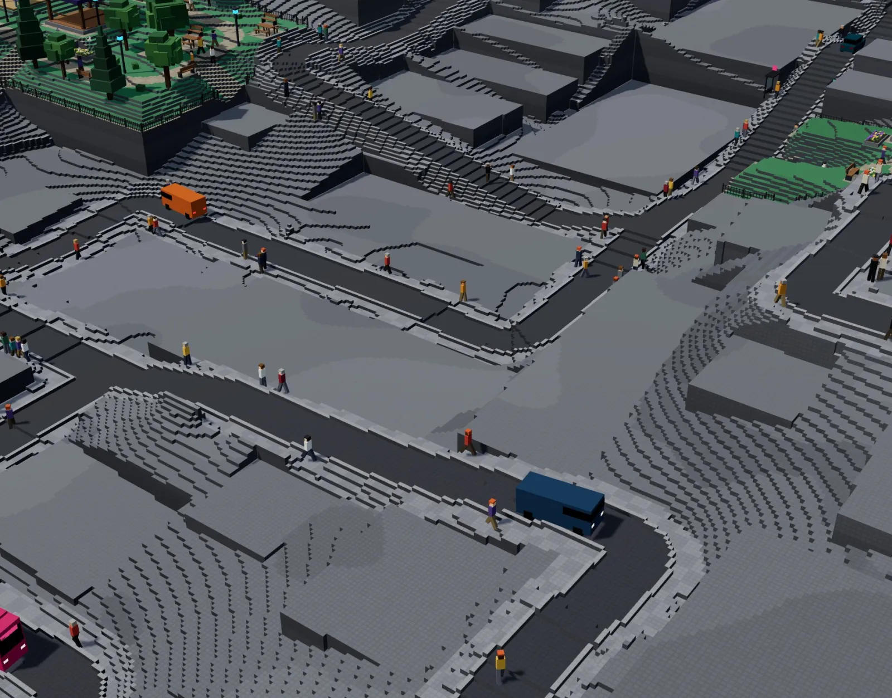 | 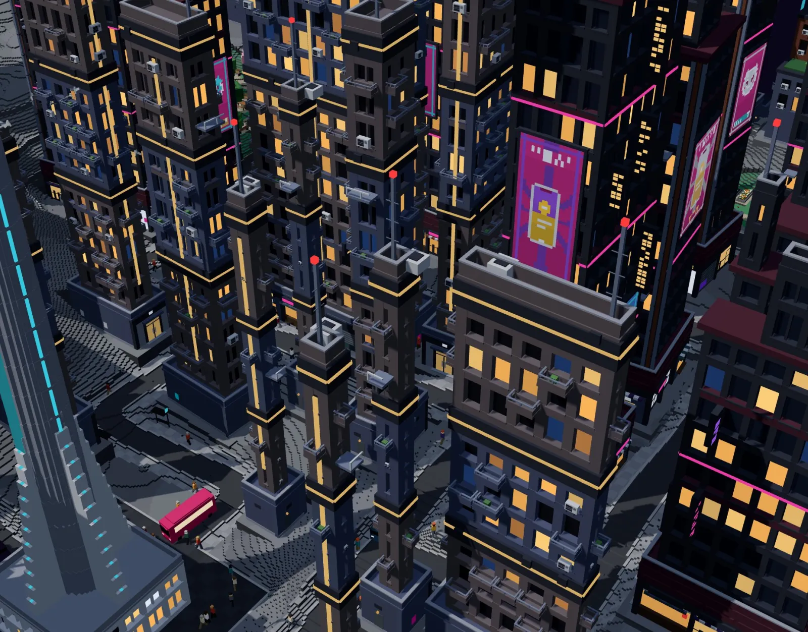 |

- **Blocks smoothed** (terrain/streets.ts, `smoothBlocks`, a new step after the carve): the ground
  between the streets keeps the hill's terraces no longer. It takes the smoothest shape (a membrane,
  Laplace's equation) held at the paving's levels (streets, sidewalks, plaza) and the river's,
  within 12 m of paving, and back to the ground as it was by 30 m (20 m and 40 m since "Filling the
  gaps" below; the hills beyond the city keep
  their terraces). Solved coarse to fine on a pyramid of grids (Gauss-Seidel), about 0.2–0.5 s.
- **Lots cut and filled** (terrain/grade.ts): each lot is graded to its `floor`, the median of its
  ground, as much cut as fill, instead of dug down to its lowest column; the building stands on the
  floor (`base` in city/placement.ts). The build animation's dig shows only what is cut; filled ground
  is there from the start.
- Together, on three seeds (blueprint, harbor, neon7): a lot's cut or fill was 2.5–3 m (median, dug
  to its lowest) with 5.5–6 m at the 90th percentile; now 1–1.5 m and 2.5–3.25 m. The smoothing
  alone (both with the new grading) takes steps of 2 m or more between neighboring city columns
  from 2167 to 1676 on blueprint (−23%) and from 512 to 338 on neon7.
- **Why the library barely showed**: the street tiles are 20 m, so many blocks are two parallel
  streets one tile apart, 13.5 m sidewalk to sidewalk; lots from both streets met halfway at about
  6 m deep, and with the 0.25 m gap round each building the room was 5 m, under every archetype's
  smallest side. So nearly every lot fell back to the slimmest archetype of all,
  neon-commercial-tower (125 of 155 on blueprint), whatever its district. Now:
  - a block shallower than 20 m isn't split: its lots run through it, fronting both streets
    (terrain/districts.ts, `THROUGH_BLOCK`); median lot depth 5.5 → 11 m;
  - lots are the district's width in zone cells or one more (was ± one), and commercial lots two
    cells (was one);
  - a lot nothing of its district fits gets its district's slimmest building if that is within
    1.5 m of fitting (`SQUEEZE`), so small megablock and core lots get residential towers, not shop
    towers.
  Blueprint: neon-commercial-tower 24, residential-skyscraper 77, stacked-megablock 6,
  terraced-residential 4, modular-apartment-block 3, twin-tower-complex 1. The corner lots that pack
  the frontage the street walk leaves are still almost all 6 m squares, and many street lots are cut
  short where the street bends every tile, so the wide archetypes (megatower, lab, twin towers,
  vertical neighborhood) still seldom fit.

## 2026-10-28: No more small plots

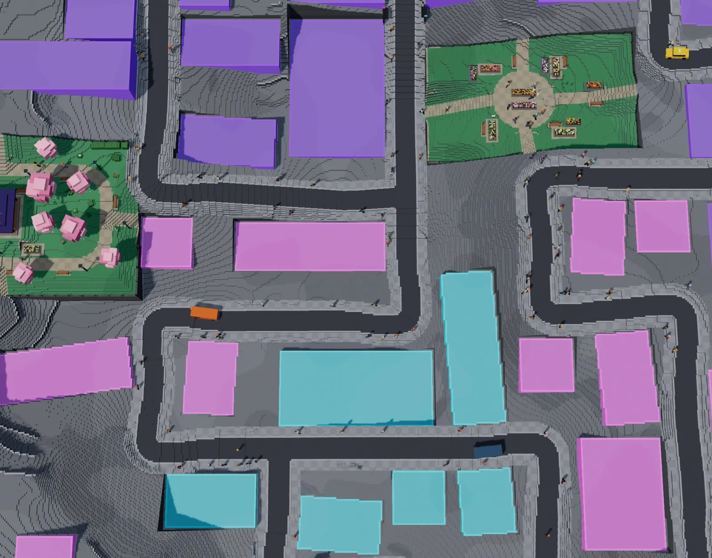

- **Small lots merged or given up** (terrain/districts.ts, step 6, `mergeSmallLots`): a lot under
  10 m either way (`MERGE_BELOW`) is merged with the neighbor beside it on the same frontage, across
  their alley (same district, same facing, as deep as the shallower, at most 24 m wide
  (`MERGE_WIDEST`), ground within the district's step), choosing the neighbor that gives the roomiest
  lot. A lot still under 8 m (`MIN_PLOT`) is given up; its ground is left free concrete. Lots are
  renumbered. About 25 ms.
- **Corner lots** now pack rectangles no smaller than 8 m a side (was 6 m, `MIN_DEPTH`): the
  corner pockets were almost all 6 × 6 m or 16 × 6 m, too shallow to merge with the street lots
  (they face another way).
- Lots: blueprint 115 → 93, harbor 23 → 21, neon7 53 → 39; every lot's narrower side is now at least
  8 m (rooms 7 m). Blueprint's buildings: residential-skyscraper 61, neon-commercial-tower 15,
  terraced-residential 5, stacked-megablock 5, modular-apartment-block 4, twin-tower-complex 2,
  vertical-neighborhood 1.

## 2026-10-28: Filling the gaps

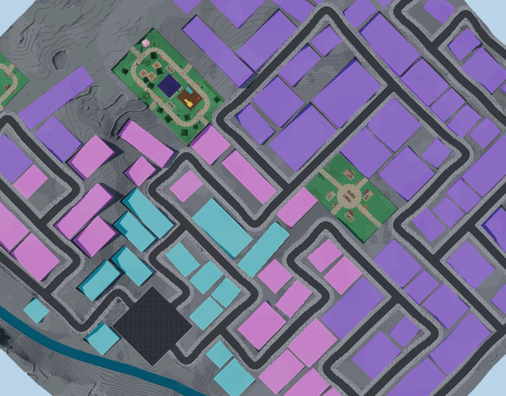

- Empty frontage next to the streets (beside bends, at block ends, on the hill inside a loop) got
  no lot. Three reasons, three changes (terrain/districts.ts, terrain/streets.ts):
  - **The street walk runs twice**: the second walk fills the gaps the first left with lots of any
    whole-meter width from 8 m (`MIN_PLOT`) up to the district's, not only whole 8 m zone cells.
    The first walk's small lots are merged or given up before the corner lots are packed, so
    what they leave is packed too.
  - **Corner lots** are tried in every size from the district's down to 8 m, 2 m apart
    (`CORNER_STEP`; was five sizes), and need only a quarter of their narrower side on the paving
    (was half), within a 1 m forecourt (`FORECOURT`): beside a bend the verge curves away from a
    grid-aligned side.
  - **Smoothing reaches farther**: free within 20 m of paving (was 12 m), the ground's own by 40 m
    (was 30 m), so steep ground near the streets (the hill inside a loop) is gentle enough for lots.
- Lots: blueprint 96 → 107, harbor 21 → 22, neon7 45 → 51. On blueprint, every free 8 × 8 m square
  near a street is now used except where the ground still drops more than 6 m across it (by the
  river and on the hills past the city). Blueprint's buildings: residential-skyscraper 61,
  neon-commercial-tower 15, stacked-megablock 13, modular-apartment-block 7, terraced-residential 5,
  vertical-neighborhood 2, twin-tower-complex 2, tower-and-annex 2; neon7 now has a
  corporate-megatower and a research-lab-tower too.

## 2026-10-29: No more buses stuck at busy corners

A bus turning at a junction full of people could sit there for minutes, edging forward, never
towed. Kept waiting, it crept on at walking pace; the people at the curb, seeing it nearly stopped,
stepped out in front of it; and every time its bumper was clear for a moment it counted as moving
again, so its wait never reached the tow. Four changes (life/traffic.ts):

- **Edging only while people are there.** A vehicle kept waiting is held to walking pace only
  while someone is at its bumper; clear, it drives on. Its wait is reset only once it is really
  under way again (faster than walking pace), so a vehicle kept in a crowd for 45 s is towed.
- **People let it through.** A vehicle that has been kept waiting and is edging on counts as
  coming: people at the curb nearby wait for it instead of stepping out in front of it.
- **Out of its way to the side.** Someone in front of a vehicle steps aside, off its path, or
  back if behind it; they used to be pushed on ahead of it, along its way.
- **Routes avoid turning round.** Turning round at a dead end (into the plaza, where people stand
  talking) costs a route 100 m more, so buses and taxis do it only when there is no other way.

Vehicle-seconds spent crawling (under 5 m in 40 s):
- the first three changes, over five minutes: blueprint 486 → 112 and neon7 1363 → 129 (of
  7,800), harbor 1148 → 646 (of 4,420);
- the route cost on top of them, over ten minutes: blueprint 634 → 309, neon7 1105 → 542 (of
  16,800). Harbor, whose network is three streets between the same two junctions, got worse
  (1004 → 1417 of 9,520): without turning round, it has to go through its one busy junction.

## 2026-10-29: People to the city's scale

People were drawn to life (1.66 m, a 1.5 × 0.9-voxel torso on two thin legs, no arms), but the
streets and vehicles are not: streets are 3.5 m with 1.75 m lanes, cars are 1.4 m-wide kei cars and
buses 1.65 m-wide community buses. Beside them people looked too big, and from any distance like
sticks. They are now drawn to the scale of the streets and vehicles (render/life.ts):

- **About 1.3 m tall**: hips at 2.3 voxels, a 1.3 × 1.9 × 0.8 torso and a 0.95 head, so a head
  reaches a car's roof and the middle of a bus's windows.
- **A little chunky, with a big head**, so they read as people from far off, in the voxels' style.
- **Arms**: they swing against the legs as people walk; sitting, the hands rest on the knees (the
  seated legs are shorter, so the feet still reach the ground from a bench); hailing a taxi, the
  right arm holds the glowing phone up.

Only the drawing changed: people keep the same paths, bodies (0.75-voxel radius) and speeds.

## 2026-10-29: People's state machine, in three layers

A person's state was one field with 13 values (stroll, go, approach, seat, sit, rise, drink, chat,
wait, hail, board, ride, gone). It mixed up three different things: what they want, what they are
doing, and how they are moving. Being stuck, squeezing past people or waiting at the curb were not
states at all, and could only be found by reading the code. Following how games do it, a person is
now three layers (life/agents.ts):

| Layer | After | Values |
|---|---|---|
| **Goal**: why | Reynolds' action selection; The Sims' needs | the need (thirst, rest, social, home; none while strolling) and the field walked down to it |
| **Activity**: what, the one state machine | F.E.A.R.'s "Three States and a Plan" (Goto and Animate) | `walk`, `use`, `ride`, `away` |
| **Motion**: how, this step (reported only) | Reynolds' steering | `walk`, `step`, `wait-to-cross`, `squeeze`, `wander`, `make-way`, `stand` |

- **What is used says the rest**, as The Sims' smart objects do: a seat, a vending machine, a
  circle of talkers, a bus shelter or the curb (hailing a taxi), each with how long it lasts and
  what ends it. Walking has its legs: down the goal's field, or the last steps to the front of a
  seat, onto it and off again, or to a vehicle's door.
- **Every change of activity goes through one place and says why** (`since`, `why`): "tired",
  "every seat taken, wants company", "no bus came: walking home". This is what a debug inspector
  will show.
- **Two fixes along the way**: someone who reached a bus stop with no shelter near, or found no
  taxi to hail, used to vanish on the spot; now they walk home to a door. Someone stuck too often
  walks on to a stroll instead of keeping their need with the goal of a stroll.

Over ten simulated minutes (420 people) the new machine behaves as the old one did:

| Seed | Walking | Seated | Circles | Shelters | Riding | Boarded | Walking but stuck |
|---|---|---|---|---|---|---|---|
| blueprint, before | 375 | 9 | 15 | 9 | 7 | 22 | 6.3 |
| blueprint, after | 375 | 8 | 13 | 8 | 8 | 26 | 6.2 |
| neon7, before | 345 | 12 | 18 | 22 | 12 | 56 | 11.8 |
| neon7, after | 339 | 11 | 17 | 25 | 14 | 53 | 11.6 |

The reasons already show something the old states hid: on blueprint, of about 1,000 times someone went
to rest, only 114 found a free seat (benches are few and far between); most then went to talk
instead.

## 2026-10-29: Vehicles' state machine, in the same layers

A vehicle's state was spread over many fields (`gone`, `dwelling`, `dwell`, `halt`, `fare`,
`still`…), so whether it was standing at a stop, fetching a fare, towed or off the island had to be
worked out from them, and why it was standing still could not be found out at all. It now has the
people's layers (life/traffic.ts):

| Layer | Values |
|---|---|
| **Task**: why, by kind | cars and vans `roam`; a bus keeps to its `route`; a taxi `cruise`s, `fetch`es a fare and `carry`s it |
| **Activity**: what, the one state machine | `drive`, `stand` (at its halt, doors open), `off` (over the island's edge, towed, or waiting for room to come back on) |
| **Limit**: what holds its speed this step (reported only) | `free`, `bend`, `lead` (the vehicle ahead), `people`, `creep` (edging past them), `line` (the stop line, not let in yet), `halt` |

As with people, every change of activity goes through one place and says why: "at its stop", "no
one else waiting", "the fare is aboard", "dropped the fare off", "towed: held up 45 s", "left the
island", "back on the island".

Only the bookkeeping changed. With a fixed clock (the flow fields are worked out in slices of wall
time, so a run otherwise depends on the machine's speed), ten simulated minutes come out the same
before and after on blueprint, neon7 and harbor: tows, boardings, taxi rides, vehicles crawling and
mean speed alike. What holds the vehicles up, as a share of the time they are driving:

| Seed | Free | Bend | Lead | People | Stop line | Creep |
|---|---|---|---|---|---|---|
| blueprint | 73% | 5% | 8% | 9% | 3% | 0% |
| neon7 | 49% | 5% | 25% | 10% | 11% | 0% |
| harbor | 32% | 5% | 37% | 12% | 11% | 3% |

## 2026-10-29: Pigeons and cats, in the same shape

The last two agents now keep their state the way people and vehicles do (life/agents.ts): one
activity, how long they have been in it, and why it began, all set through one `into()` shared
with the people.

| Agent | Activities | Before |
|---|---|---|
| **Pigeon** | `ground` (pecking and hopping about its roost), `fly` (with its flock, round the roost), `land` (coming down to a free spot) | two flags, `flying` and `landing` |
| **Cat** | `prowl`, `rest`, `hunt` (in two stages: `stalk`, then `sprint`), `flee` | five states, the hunt's two stages among them |

The reasons say what set them off: a pigeon goes up because "a person came close", "a cat came
close", "a vehicle went by" or "the flock went up"; a cat rests because it "missed: the pigeon flew
off", "lost sight of it" or is "safe again" after fleeing.

Only the bookkeeping changed: with a fixed clock, ten simulated minutes on blueprint and neon7 come
out the same before and after (pigeons going up and landing, time in the air, the cats' time in
each state and every change between them). Over those ten minutes on blueprint, a cat set off a
pigeon's flock 238 times and people 221; the cats sprinted 79 times and missed every time, as they
are meant to.

## 2026-11-08: City controls, after the Component Gallery

The panel had grown one setting at a time: overlays that fought over the ground's color, a
reset button on every section, explanations in tooltips you had to find, a timeline that said
nothing of what it was building, and no way to get to a place in the city but dragging. Following
the patterns collected on [component.gallery](https://component.gallery/components/) (tabs,
segmented control, badge, tooltip, stepper, toolbar), the controls were reworked in three steps.
The plan, with what each component is for and the six milestones, is
[docs/plans/city-controls-plan.md](../../../docs/plans/city-controls-plan.md); these are the
first three.

### The panel: Build and Layers

| 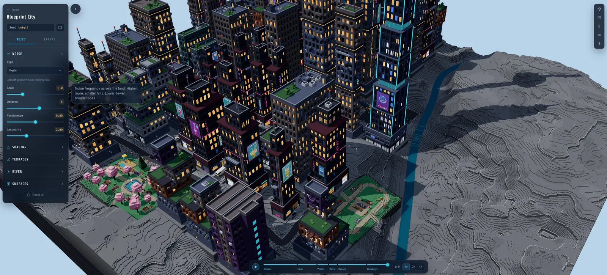 | 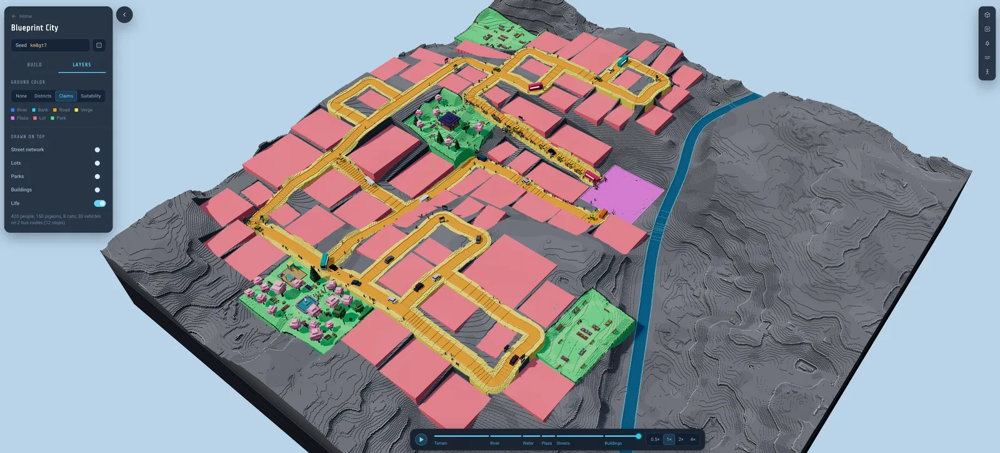 |
|---|---|

- **Two tabs** (ui/TerrainPanel.tsx): **Build**, the settings that change the city (Noise,
  Shaping, Terraces, River, Surfaces), and **Layers**, what is shown over it. The open tab is
  remembered.
- **One ground color at a time.** Districts, claims and suitability all tinted the ground, and
  turning on two mixed them into a color that meant nothing. They are now a segmented control
  (None, Districts, Claims, Suitability) with the chosen one's legend under it; `showClaims` and
  `showDistricts` became one `groundTint` (state.ts, `setGroundTint` in render/WorldView.ts).
  The street network, lots, parks, buildings and life are switches drawn on top, each with a
  count.
- **Explanations on hover, beside the panel.** Each setting's explanation used to sit behind an
  ⓘ. Now hovering the setting's name (or focusing its control from the keyboard) shows it in a
  speech bubble just outside the panel's right edge, level with the name, so it never covers
  the panel or gets clipped by its scrolling (ui/kit.tsx, `useHoverTip`, portaled to the page
  and tied to the control with `aria-describedby`).
- **A badge on each section** says how many of its settings differ from their defaults, so a
  changed setting can be found with the sections closed. One **Reset all** at the end replaces
  the reset button on every section.

### The timeline: named steps, time kept honest


- **The track is the build's six steps** (Terrain, River, Water, Plaza, Streets, Buildings),
  each stretch as long as the step takes, so the thumb moves at one steady pace. (Equal stretches
  were tried first, but then the thumb sped up and slowed down from one step to the next.)
- **Each step is named under its own stretch**: done in cyan, the current one in white, the
  rest dimmed. Clicking a name plays the build from the start of that step. When the bar is too
  narrow for every name to fit its stretch (on a phone), one line names the current step instead
  ("Streets · 5/6").
- **Speed is a segmented control**: 0.5×, 1×, 2×, 4×, applied at once, even mid-play.
- The slider tells screen readers which step it is on ("Streets, step 5 of 6").

### The camera toolbar: five places to fly to

| 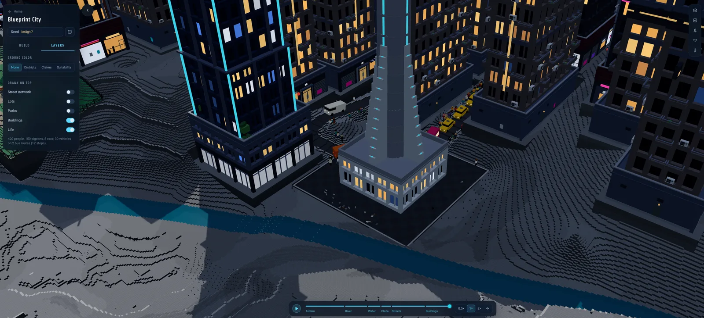 | 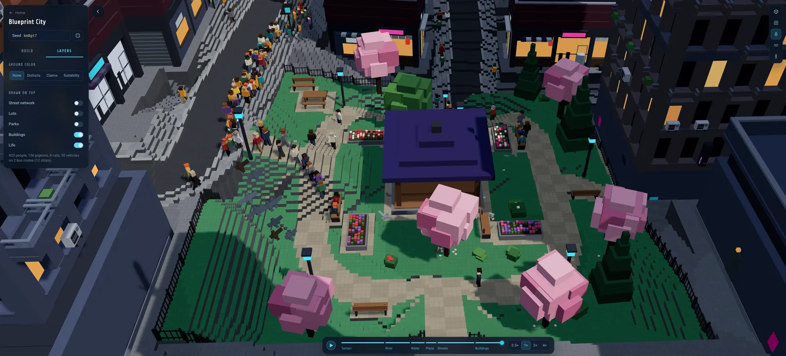 |
|---|---|
| 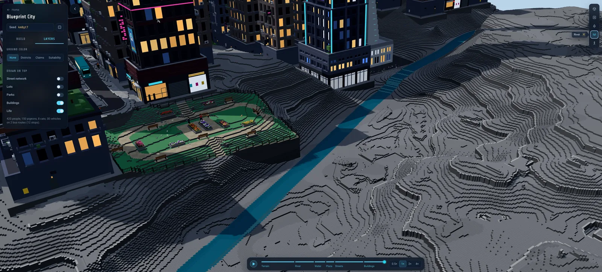 | 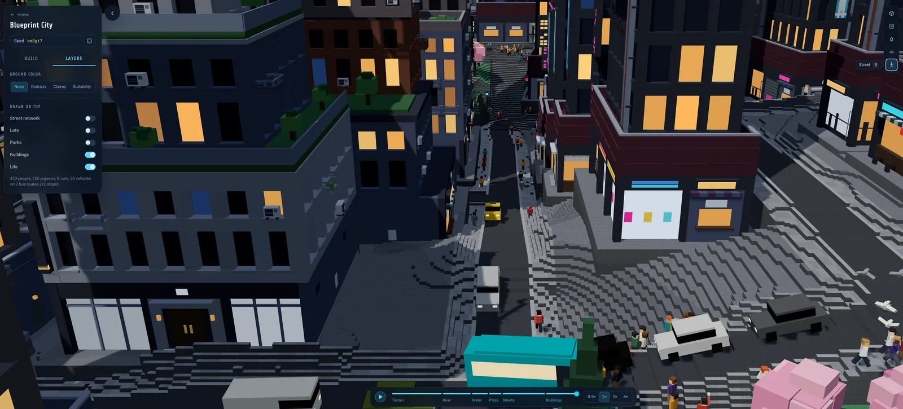 |

A toolbar at the top right (ui/CameraBar.tsx) flies the camera to a place in the city, with keys
`1`–`5`; each button names itself and its key on hover. The flight takes 700 ms, easing in and
out; dragging the view by hand cancels it and clears the lit button. A place the city doesn't
have yet (no streets while the timeline is early) is disabled. Each view is worked out from the
city, so it finds the same kind of place on any seed. The angles were matched by eye to views set
by hand on seed km8gt7:

| Preset | Where it looks from |
|---|---|
| **Overview** `1` | the default view of the whole diorama |
| **Plaza** `2` | 95 m out, 36° down onto the paving and the Landmark's base, from the clearest side turned 45° counterclockwise |
| **Park** `3` | 43° down into the park with the most in it (a full park before a flower garden), 40–60 m out by its size, from the clearest side turned 10° clockwise |
| **River** `4` | a long look up the river at a point a little past halfway down it: 108 m out and 27° up from downstream, turned 25° off the river's line |
| **Street** `5` | 70 m past the end of a street and 27 m up, looking back along it, 21.5° down: the first clear one, main streets and the end away from the plaza first, coming closer if it must |

**The clearest side.** A tower in front of the plaza or the camera inside a building made the
first versions useless on some seeds. The Plaza and Park views now score 24 directions round the
place (render/WorldView.ts, `openSide`): a building standing in the corridor between the whole
place and the camera and rising above the line of sight costs 1, a hill above it 2, and a
building or hill at the camera's own spot rules the side out. Then the view turns by its set
angle; if that side is blocked, the camera first comes closer (85%, 70%, then 55% of the
distance), then tries the sides next to it, nearest first and up to 90° off, and takes the first
clear one. On km8gt7 and blueprint the Park view comes in to 70% and 55% to clear the towers on
its far side.

**What's next** (Milestones 4–6): an inspector (click a building, person or vehicle to see what it
is and why it's doing what it does, and follow it), a keyboard-shortcut sheet and a short
tour.

## 2026-11-09: The inspector: click anything to ask what it's doing

Milestone 4 of the city controls plan (docs/plans/city-controls-plan.md, §4.6). Clicking a
person, pigeon, cat, vehicle or building opens a card beside it (ui/Inspector.tsx) and rings it
on the ground in cyan, pulsing gently so it can be found in a crowd.

- **What it says.** A person: their activity and motion as badges ("Talking", "standing"), the
  state machine's reason in quotes ("joined a circle") and for how long, and four meters for
  thirst, rest, company and home, each full when that need is due, with the one being met lit
  in amber. A bus: its route, what it is doing and what holds it back ("people in the way"),
  the next stop ("2 of 6") and its riders. A building: its type from the library, district,
  size, height and lot.
- **Where it sits.** Beside the selection, moved every frame and kept clear of the ring; it
  flips to the left near the right edge and waits at the top right while its agent is out of
  sight (riding a bus, indoors). The words refresh four times a second. Under 640 px it is a
  drawer at the bottom.
- **Closing.** ×, Escape, or a click on empty ground.
- **Follow** (the card's button, or the toolbar's new sixth button, key `6`). The camera flies to
  the agent and trails it, still free to orbit and zoom. It keeps the view's direction if
  nothing is in the way, else it takes the nearest clear side, scored the same way as the Plaza
  and Park views; the first try sat behind the Landmark. Selecting someone else while following
  flies over to them.

Picking (render/select.ts) tests each agent as a sphere round its middle, padded to 5 px on
screen so a pigeon can be clicked, and each building by its bounds; whatever is nearest in front
of the ground wins.

## 2026-11-11: Shortcuts, a tour, and Space for the timeline

Milestone 5 of the city controls plan (§4.8), the last piece of it.

| Shortcuts | The tour, step 1 |
|---|---|
| 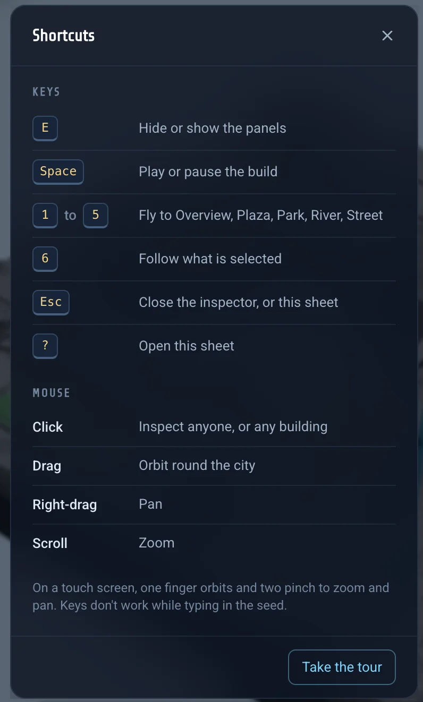 | 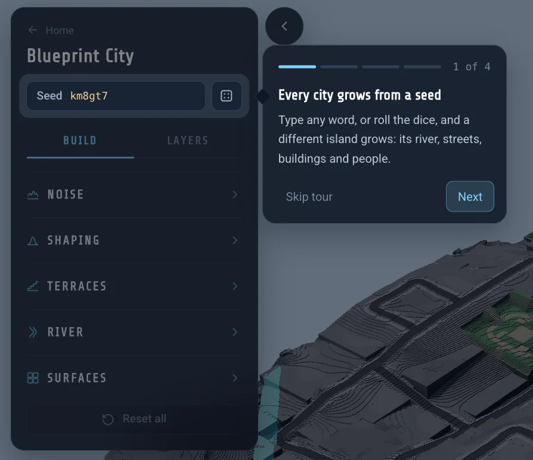 |

- **Shortcuts** (ui/Help.tsx). A **?** button at the bottom of the camera toolbar, or the `?`
  key, opens a sheet listing every key and mouse gesture, with a button to take the tour. It is
  a native modal dialog, so the page behind can't be reached until it closes, and keys pressed
  in it don't reach the page: Escape closes the sheet, not the inspector behind it.
- **Space** plays or pauses the build, from anywhere but a control that Space already presses.
- **The tour** (ui/Tour.tsx). On a first visit, once the city has finished building, four cards
  point in turn at the seed, the Build tab, the Layers tab, and then the city itself ("Click
  anyone in the city"); the last ends when the inspector opens, so the tour hands over to it.
  The page dims round each step's control, leaving it lit like a spotlight (a glowing cyan
  outline came first and didn't fit the panel's quiet glass), and the card sits beside it with
  a progress bar, Back and Next. The first version covered the
  panel's collapse button and, for the Build tab, the Layers tab next to it, so the cards now
  keep below the button and clear of the whole tab row. On a phone the cards sit below their
  controls, and the panel closes again for the last step. It shows once per browser.

## 2026-11-11: Frontage: what each lot faces

Milestone 1 of the city morphology plan (docs/plans/city-morphology-plan.md, §2.1 and §2.3). Lots
now record what they front (terrain/districts.ts, step 7), and a new ground tint shows it. No lot
or building changed: the same seeds cut the same lots.

- **What a lot records.** `street`: an avenue (a main street, or the plaza) or a side street.
  The street walk knows its own street; a corner-pass lot reads the paving straight out from its
  front edge. `frontage`: its front edge's length in meters. `corner` and `through`: whether a side
  edge, or the back edge, also fronts paving (road, verge or plaza within 2 m along at least a
  quarter of the edge). Merged lots front an avenue if either half did.
- **The Frontage tint** (Layers → Ground color). Each lot is filled by its kind, a corner first,
  then a through lot, then by its street: avenue amber, side street sky blue, corner pink,
  through lime. A 1.5 m strip along the front edge is drawn brighter, so you can see which way
  each lot faces. The legend gives each kind's share of the lots.
- **What it shows.** The 20 m street tiles make small blocks, so many lots front two streets:
  on `blueprint`, 107 lots are 4% avenue, 40% side street, 37% corner and 19% through. Avenues
  are few (three, about 7% of the street length there), so avenue lots are too; `harbor` has six,
  and 7 of its 22 lots show as avenue.

## 2026-11-11: The lots' settings

Milestone 2 of the city morphology plan (§2.2 and §4). How the land is cut into lots, until now a
set of constants in terrain/districts.ts, is a new Build section, **Lots** (`params.lots`), read by
the districts stage: a change re-cuts the lots, regrades them, lays out the parks again and
redraws the ground, about 2–5 s in development. Every default is the old constant, so the
default city is the same (107 lots on `blueprint`, as before).

| Setting | Range | Default | What it does |
|---|---|---|---|
| Frontage unit | 6–12 m | 8 m | The zone cell lot widths and depths are counted in (ZONE) |
| Avenue lot width | 0.5–1 | 1 | Avenue lots' width as a share of their district's, in whole cells |
| Lot depth | 0.5–1.5 | 1 | How deep lots may grow, as a share of their district's depth |
| Alley | 0–4 m | 1 m | The gap between lots (ALLEY) |
| Setback | 0–4 m | 0 m | How far lots stand back from the verge |
| Merge lots under | 6–16 m | 10 m | Narrower lots are merged with a neighbor (MERGE_BELOW) |
| Corner lots | on/off | on | Pack what the street walk leaves with corner lots |

- **Setback, not verge.** The plan had a verge width here, but the verge is painted by the
  streets stage, which runs earlier; the lots can only stand back from it. Setback keeps every
  free column within that distance of paving clear of lots, so corner lots keep it too.
- **Narrow avenue lots stay narrow.** At first an avenue width under 1 changed nothing: the
  8 m lots it cut were under the 10 m merge threshold and were merged straight back. An avenue
  lot cut narrow on purpose, at least one cell wide, is now left alone.
- **What changes, on `blueprint`.** Frontage unit 6 m: 111 lots; 12 m: 89. Setback 2 m: 100.
  Alley 3 m: 97. Lot depth 0.5, no alleys, merging under 16 m and no corner lots: 72. Avenue
  lot width 0.5 changes nothing there (its avenue lots are already one cell wide); on `harbor`
  it cuts two 24 m avenue lots to 16 m.

## 2026-11-11: The height map

Milestone 3 of the city morphology plan (§3.1 and §3.3). How tall a building may stand used to
be worked out lot by lot inside `planBuildings`: its district's range, its density, and a random
factor of its own. It now comes from a zoning map, `city/zoning.ts`: one height limit per 2 m
cell, built after the districts, which `planBuildings` reads.

```
limit = scale · (lo + (hi − lo) · density · skyline · variety)    the district's range
        · avenue bonus (on a lot fronting an avenue)
        then at most the edge cap near the river and the parks
```

- **The skyline** is 1 at the plaza and halves every 220 m along the streets (`falloff`). The
  old density fell off linearly to half at the city's reach (about 220 m on every seed tried),
  so the two agree at both ends.
- **Variety** is slow noise in patches about 48 m across, `1 − 0.25 · (1 − noise)`: the same
  0.75–1 range the old per-lot random factor had, but neighbors now rise and fall together.
- **One 3 × 3 smoothing pass** over the cells, so district borders step rather than jump.
- **The open edge** is the one new rule: within 12 m of the river bank or a park the limit is
  30 m, and the cap doubles every 12 m beyond, so the city steps down toward open ground.
- **A building's height** is still the smaller of its limit and 8 × its narrower side, at least 12 m.
  Each plan now records its limit and what held it down (`cap`: the edge, the slender rule, or
  nothing), for the inspector later.

The settings (`ZoningParams`: peak 140 m, falloff 220 m, avenue bonus 1, edge cap 30 m,
variety 0.25) are fixed defaults for now; milestone 5 puts them on the panel.

**Matched to the old skyline.** The old heights were recomputed on the same lots and compared
with the new, first with the edge cap off. Mean height (m), old → new:

| Seed | Lots | Edge cap off | Edge cap on | Lots held down |
|---|---|---|---|---|
| `blueprint` | 107 | 40 → 39 | 40 → 36 | 26 |
| `harbor` | 22 | 67 → 68 | 67 → 54 | 11 |
| `neon` | 59 | 42 → 43 | 42 → 38 | 14 |
| `42` | 85 | 45 → 43 | 45 → 40 | 22 |
| `kowloon` | 48 | 46 → 48 | 46 → 42 | 16 |

With the cap off the histograms keep their shape (the tallest building and the 90th percentile
within a few meters on every seed). With it on, the change is where it should be: `harbor`,
whose core sits on the river, loses its riverfront towers (core mean 77 → 59 m) and now steps up
from the water.

**The Height tint.** Layers → Ground color gains **Height**: a heat map of each lot's limit, from
navy through violet and rose to amber, on a log scale from 12 to 140 m so the mid-rise band most
lots sit in gets most of the color. The land between lots shows the cell map, fainter. The legend
marks the tiers (low under 20 m, mid to 60 m, high above) and says how many lots the edge cap
holds down. With six tints the segmented control no longer fit in one row; it is now a 3 × 2 grid.

## 2026-11-11: Building types by height

Milestone 4 of the city morphology plan (§3.2). A lot's building used to be picked by its
district and footprint alone, and its height set afterward, so a building could be asked for a
height it never builds at. Now the height comes first (the zoning map's limit, under the slender
rule), is sorted into a tier (low-rise under 20 m, mid-rise to 60 m, high-rise above), and the
building is picked to suit both.

**Checking the library at each tier.** The `/buildings` preview takes `?h=`, `?w=` and `?d=`
(meters) and builds the whole library at that size, so it can be looked at one tier at a time
(16, 40 and 90 m on a 15 × 22 m footprint). A script also built every archetype at heights from
12 to 120 m and measured what it actually reaches:

- Three have a floor they never go under: the Corporate Megatower about 36 m, the Stacked
  Megablock 32 m, the Residential Skyscraper 46 m. They record it as `minHeight`, and a lot more
  than 3 m under it doesn't take them.
- The Research Lab Tower follows the height down to 11 m and reads as a low lab block at 16 m, so
  it takes low-rise too: industrial no longer has a low-rise gap. Terraced Residential steps back
  to about 33 m and reads well at 28 m, so it takes mid-rise too: nor does wealthy.
- At 90 m the four residential blocks read as plain slabs; Tower and Annex still reads as a tower.

Each archetype's `tiers`, `minSide` (the old `MIN_SIDE`) and `minHeight` now sit in the registry.

**The pick**, in order: its district's buildings for its tier that fit (else its district's
slimmest for its tier, squeezed by up to 1.5 m); its district's for a lower tier, the height
brought down to that tier's top (never up, which would break the limit); any district's for its
tier; the old slimmest fallback. With `mix` above 0, that share of the lots with another district
within 16 m try that district's buildings first. `mix` is 0 by default; at 0.5 on `blueprint`,
20 of its 36 border lots took a neighbor's building (shop towers among the megablocks,
residential towers in the commercial ring). Each plan records its tier, how it was picked and
whether it was mixed, for the inspector.

**What changed.** The old pick put the Residential Skyscraper on megablock lots zoned 31–35 m,
where it builds 46 m; those lots now take the Modular Apartment Block, which builds to the height
asked. Building counts, old → new:

| Seed | Lots | Residential Skyscraper | Modular Apartment Block | Lots changed | Picked outside their district |
|---|---|---|---|---|---|
| `blueprint` | 107 | 61 → 10 | 7 → 51 | 62 | 3 |
| `harbor` | 22 | 12 → 8 | 0 → 1 | 6 | 2 |
| `neon` | 59 | 24 → 4 | 4 → 22 | 24 | 6 |
| `42` | 85 | 33 → 7 | 9 → 25 | 34 | 3 |
| `kowloon` | 48 | 16 → 6 | 4 → 12 | 16 | 2 |

No lot needed the lower-tier step or the fallback. With the default zoning no lot is low-rise
(the edge cap is 30 m and the districts' floors start at 14–24 m), so the low tier waits for the
Zoning settings in milestone 5.

**Clashes.** On the narrowest megablock lots (7.5 m of room) the Modular Apartment Block is
squeezed under its 8 m and one pipe runs into its own mass, hidden in the wall; at 9.5 m it is
clean. The Research Lab Tower's fins clash with its masses at any footprint but its own default,
whatever the height; it stood on these lots before too.

## 2026-11-12: The zoning settings

Milestone 5 of the city morphology plan (§4). The zoning map's settings, fixed defaults until
now, are a new Build section, **Zoning** (`params.zoning`), after Lots.

| Setting | Range | Default | What it does |
|---|---|---|---|
| Center height | 40–200 m | 140 m | The tallest limit, at the plaza; every district's range scales with it |
| Falloff | 40–400 m | 220 m | The limit halves every this many meters along the streets |
| Avenue bonus | ×1–1.5 | ×1 | How many times higher a lot fronting an avenue may build |
| Waterfront and park cap | 10–80 m | 30 m | The limit within 12 m of the river or a park, doubling every 12 m beyond |
| Variety | 0–1 | 0.25 | How far slow noise pulls heights down, in patches |
| Mixed use | 0–50% | 0% | The share of lots near another district that take its buildings |

No terrain stage reads the group, so a change leaves the ground alone: `generateTerrain` hands
back the same districts and mesh, and only the zoning map and the plans are redone. Center height
dragged from 140 to 55 m on `blueprint` re-planned in 0.27 s (the 2–5 s of a Lots change is the
districts stage); the buildings then refit a few per frame, as after any change.

**Each setting at its ends**, on `blueprint` (107 lots) and `harbor` (22), mean height:

| Setting | `blueprint` | `harbor` | Notes |
|---|---|---|---|
| Defaults | 36 m | 54 m | |
| Center height 40 / 200 m | 15 / 44 m | 25 / 56 m | at 40 m, 92 of 107 lots on `blueprint` are low-rise |
| Falloff 40 / 400 m | 30 / 38 m | 49 / 55 m | district floors and the slender rule damp it |
| Avenue bonus ×1.5 | 36 m | 56 m | few avenue lots, most already slender-capped |
| Cap 10 / 80 m | 26 / 39 m | 31 / 66 m | 63 / 1 lots held down on `blueprint` |
| Variety 0 / 1 | 37 / 33 m | 55 / 51 m | |
| Mixed use 50% | 36 m | 54 m | 20 and 3 lots take a neighbor's building |

**The low tier, at last.** With the default zoning no lot is low-rise, so milestone 4's low-rise
picks first ran here. Two fixes came out of it. At Center height 40 m, 10 narrow low-rise lots on
`blueprint` (7 of `harbor`'s 22) found nothing for their tier and fell to the slimmest fallback,
which could be the Residential Skyscraper: it never builds under 46 m, on a lot zoned 15 m. Now
the any-district step also takes the slimmest within 1.5 m of fitting (a squeezed Modular
Apartment Block), and the fallback only considers archetypes that can build that low. After
both, no lot falls back at Center height 40 m or a 10 m cap, and no lot gets a building whose
floor is above its height. The default city is unchanged by them.

## 2026-11-12: Fewer settings, one Zoning section

The Lots and Zoning sections had thirteen settings between them, and the seven lot settings each
re-cut the lots: about 3 s for the districts stage and 7 s for the whole rebuild in development.
They are now one Build section, **Zoning**, with two settings. The fast one comes first.

| Setting | Range | Default | A change takes |
|---|---|---|---|
| Center height | 40–200 m | 140 m | 0.3 s (140 → 60 m re-planned in 297 ms) |
| Lot size | 6–12 m | 8 m | 3 s for the districts stage, 7.3 s in all |

Center height sets the skyline. Lot size sets the grain, from 107 lots on `blueprint` at 8 m to
89 at 12 m. Their descriptions are now one or two sentences each. The Height legend lists the
tiers as bullets, its "140 m" tick no longer wraps onto its text, and Ground color has no hover
text.

The rest are constants again, at the defaults they always had:
- the alley (1 m);
- merging lots under 10 m;
- corner lots;
- the district depths;
- the skyline's falloff (220 m);
- the variety (0.25).

Gone with their code:
- avenue lot width, the setback and the avenue bonus;
- mixed use, which did nothing at its default of 0%;
- the waterfront and park cap, rule and all: buildings by the river and the parks no longer step
  down.

Without the cap, `blueprint` keeps its 107 lots. The 26 lots it held down build to their
district's limit again, so the mean height goes from 36 to 39 m and the high-rise lots from 3 to 5.

## 2026-11-12: Clicks pick agents only

A click selects a person, a pigeon, a cat or a vehicle, and no longer a building. Buildings still
hide what stands behind them: the click stops at the nearest building or ground along the ray.
The inspector's building card is gone with it. So is the milestone that would have added lines
about frontage, height and type to that card.

Two bugs came out while looking at it:
- **Every click showed person 353.** `move` clamps a point off the grid to the edge cell, so a
  step past the diorama's edge looked like staying put and was allowed. A walker a cell outside
  then read the ground at a negative index and its height became NaN for good (9 people and a cat
  after a few minutes). Every test in `pick` compares false against NaN, so the last such walker
  won every click. Walkers now stay on the grid, the ground lookup clamps, and `pick` skips any
  agent whose position isn't a number.
- **Buildings were picked by boxes at the origin.** Each building's bounds were taken before it
  was moved onto its lot, so only the Landmark, near the origin, could be hit. They are now taken
  once it is placed. These are the boxes that hide agents.

## 2026-11-12: The building grammar, M1

A new page at `/grammar` builds one building from the rules in Class 09 (slide 21), and each
slider rebuilds it live:

```
BUILDING -> BASE SHAFT TOP
BASE     -> pier [S A]+ pier  (mirrored)
SHAFT    -> FLOOR x n
FLOOR    -> pier [A A]+ pier
TOP      -> parapet + roof
```

`buildings/grammar.ts` takes the parameters (frontage, depth, floors, ground floor height, bay
width, window size, lit share, and the upper and ground patterns) and returns the model, the
derivation and the stats. This first cut has the Bar footprint and four bays: window (A), blank
(B), door (C) and shop front (S). The front cuts n = floor((frontage − pier) ÷ bay width) bays and
stretches them to fill it; with Mirror on, the right half reflects the left and an odd middle bay
on the ground floor becomes the door. The back and the sides repeat plainer patterns.

Each wall was first four boxes around every window: 46 floors on 40 × 40 m took 119 ms and 215k
triangles. Each floor's wall is now cut into horizontal strips at the window edges, one box per
solid stretch. That case takes 20 ms and 108k triangles; the default (12 floors on 16 × 20 m)
takes about 2 ms and 14k triangles. Every test case, from 2 floors on 6 × 8 m to the largest,
builds with no clashes and no overlaps.

Two things made the building jolt on every slider move, and both are fixed:
- **The facade reshuffled.** Every lit window, shop front and awning drew from one running
  sequence, so any change that added or removed a draw reshuffled the whole building. Each bay
  now draws from its own generator, keyed by its side, floor and place in the row (`k.rng` is
  left for the rooftop). Changing the window size or the ground floor keeps the same windows lit,
  and adding floors leaves the ones below as they were.
- **The view tilted.** The camera's target jumped toward the new height while the camera stayed
  put, so the view turned. The target and the camera now glide together, a pan plus a pull back
  far enough to fit the whole building, and only when the height changes. Grabbing the view stops
  the glide.

## 2026-11-12: The building grammar, M2: the facade grammar

The two bay patterns and the signs are drawn from the seed (`drawPatterns`, `placeSigns`), and
one slider under **Facade** steers the building:
- **Signs** has no slider. The upper floors' pattern (two to four letters) opens with a window,
  then windows, service bays and blank panels by weight. Each draw then takes a sign
  share from 0 to 30% (`SIGN_CAP`), and that share of the street front's columns, never more than
  30% of them, become sign columns (`placeSigns`). They are set on the expanded row, not in the
  pattern, since a two-letter pattern with one sign would make half the front signs. On a mirrored
  front a column goes with its reflection, so the signs stay symmetric. The printout's N line
  reads, for example, N → 2 of 7 columns · drawn 22%, at most 30%.
- **Balconies** is a stochastic rule, A → window | balcony: each window above the ground floor
  draws its own number and is a balcony if it falls under the share. It began as a letter in the
  pattern, but a letter repeats across the whole front with its pattern, so the slider could only
  add or take away whole sets of columns, and it felt like all or nothing. Drawn window by window
  it moves smoothly: on the default building, 0, 33, 92, 136 and 286 balconies at 0, 10, 35, 50
  and 100%.
- Each window draws its own number, so the slider only changes the windows it reaches.
- The ground floor's pattern (two or three letters) opens with a shop; the rest are shops,
  windows, doors, service doors and blank walls. Four draws in five are mirrored.
- **Randomize** draws new patterns along with the lights and the clutter. The page opens on seed
  15, A B A over S S B, mirrored, with signs on 2 of its 7 columns, which shows windows,
  balconies and signs at once.

A letter-cell editor came first, with Mirror as a switch, but typing patterns was too much to
ask. Drawing them keeps the grammar visible in the printout without asking anyone to write it.
The printout's A line reads, for example, A → punched window | balcony 35%.

Two bays join A, B, C and S, and A gains its balcony:
- **Balcony:** a tall door behind a slab with a sheet-metal front, and by chance laundry on a
  rod, an AC unit on the wall, a planter on the rail, or a neon strip under the slab.
- **N, sign:** a blade sign standing out from the bay's left pier in front of a window, one
  storey a piece and one color all the way up the column, so it reads as one tall sign.
- **V, service:** two pipes down the bay's side, joining floor to floor into one line, beside a
  louvered vent; on the ground floor, a roller shutter with a warning light.

B gets a rust or grime panel now and then, sometimes with a vent. The sides read S, C and N as A;
the back is A, V and B in turns.

**Window types** set how the A bays are glazed: punched (the window's own size), ribbon (across the
piers but for a mullion, so a floor reads as one band) and glass (the ribbon's width, floor to
floor). Every window on a building is the one type: a glass-wall bay, G, was drawn among punched
windows at first, and two window styles on one front looked like two buildings, so it was taken
out of the patterns.

The right panel's **Grammar** printout shows the rules as they read now (BASE → pier [S A]+ pier
mirrored · 4.5 m, and so on) and the street front's rows they expand to.

Three things came up in testing:
- `m()` rounds to a quarter voxel, so some thin parts came out flush with their neighbors or with
  no thickness at all: a glass wall's transom with its mullion, cloths and vent slats that
  vanished. They are sized in voxels now. The shop shutter's
  top slat also sat flush with an awning's underside (an M1 bug); the slats now stop short of it.
- With ribbon and glass windows, a sliver of wall ended up inside each corner column. The walls
  now run between the columns.
- Two blade signs could stand on the same pier: the first bay's blade went on its right pier,
  which is the second bay's left. A blade now always stands on its bay's left pier, and the first
  bay, whose left pier is the corner column, is never a sign.

Three sweeps found no clashes, no overlapping faces and no NaN:
- 756 buildings with every letter and mixed patterns (N, NV, VN and others) typed in.
- 1,656 drawn buildings after the balcony rule: 30 seeds, balconies
  and the sign share at 0, 50% and 100% and the defaults, every window type, and sizes from 6 × 8 m
  and 2 floors to 40 × 40 m and 46 floors.
- 1,440 drawn buildings once the signs were drawn and made blades only: 40 seeds, balconies at 0,
  35% and 100%, every window type, and four sizes up to 40 × 40 m and 46 floors. None had signs on
  more than 30% of its front or on its first column; across 2,000 seeds and fronts of 1 to 26 bays
  the most was 2 of 7.

The default builds in about 3 ms. At 46 floors on 40 × 40 m: about 33 ms with no balconies, 54 ms
at the default 35%, and 86–111 ms with every window a balcony, so dragging a slider on the
largest building is not smooth.

## 2026-11-16: The building grammar, M3: massing

The building is no longer one box. `world/buildings/massing.ts` makes its plan and its stages out of
rectangles, and the facades run along the plan's outline:
- **Shape** (Footprint) picks the plan:
  - Bar.
  - L and U (a light court). These are wings of one depth (about a third of the footprint, 6 to
    12 m) round a court at least 4 m across. A footprint too small for its court
    is built as a bar, and the printout's PLAN line says which was built.
  - The L and the U open their court to the street. Each wing end on the street is a front of its
    own: its own bays, ground floor and signs (the U's FRONT line says "on each of 2 wings").
  - Stepped: each stage steps back from the street front only, so its terraces face the street.
    It rises in 3 stages, the floors shared evenly, each 2 m back from the one below.
- **The outline:** where rectangles meet, their sides are left out, and what faces out is merged
  into edges, each knowing whether its corners turn out or in.
  - An outer corner gets a corner column.
  - At an inner corner the bays keep 1.5 m clear, past the deepest thing a bay hangs out (a
    balcony, 1.15 m), so the two walls' balconies never meet.
  - Floor bands, roof lips, parapets and copings meet at every corner without overlapping: the
    edges facing the street and the back own the corners (`reach`).
- **Stepped's stages:** the other shapes rise in one stage; there are no sliders for stages or
  setbacks.
  - A stage stops stepping back where it would be under 6 m deep. A step under a meter is not
    taken there, so a terrace is never too narrow for its parapet.
  - Each step leaves a terrace: the stage's roof slab with a parapet along the open edges. The
    first floor above a terrace has no balconies, and its floor band sits on the slab.
- **Top:**
  - **Roof:** gear, a garden, a billboard facing the street on two posts with the gear behind
    it, or a helipad. The billboard is one size, 8 m wide and 4 m high, centered near the front;
    a roof under 11 m wide gets gear instead. A roof too small for a pad or a billboard gets gear, and the printout says
    so.
  - Under it, the chosen roof's sliders:
    - **Fill** (gear, garden, billboard; 0.5 by default): how much gear or planting. At 0 only
      the stair hut stands. The other wings' gear follows it too.
      - Gear: about one piece per 30 m² at 1, so 8 on the default roof. The kinds are dealt from a
        shuffled deck, so each comes up once before any comes round again; antennas and dishes go up
        once at most. Every piece keeps 0.75 m clear round it, and they spread over the whole roof.
      - Garden: about one tree or shrub per 9 m² at 0.5, twice that at 1.
    - **Pad size** (helipad, 8 to 16 m, 16 by default), or as large as the roof allows.
  - **Parapet** (0.5 to 2 m, 0.75 by default) on the top and every terrace.
  - The Top group's controls carry no hover notes.
  - Every roof keeps its stair hut in the back corner on the right:
    - The garden plants the whole roof but for a 1 m path along the parapet: one bed in front of
      the hut and one beside it. (`rooftop`'s garden, which `/world` uses, plants only the front
      half.) Benches stand in the path, backs to the parapet, about every 5 m and clear of the
      corners, the hut and where a wing meets the roof. A cap's top tier, with no parapet, has
      none.
    - The helipad sets the hut's strip aside, along the back or the right side, whichever leaves
      the larger pad, and centers the pad in the rest.
  - The grammar lays out its own gear and garden roofs from the library's parts. `garden` in
    `parts.ts` takes the fill as an optional last argument; `/world` leaves it out, and its roofs
    (`rooftop`) are built as before.
  - **Crown:** none, a neon band round the parapet, or a stepped cap: two tiers, the lower ringed
    in neon, with the roof on top of it.

The right panel's Grammar section now reads in plain words rather than as rule notation
(BUILDING → PLAN BASE SHAFT TOP and so on), which was hard to follow. Top down, like the building:
- Shape, with Stepped's tiers and how far each steps back;
- Top: the roof and crown, with a dimmed note when one didn't fit;
- the upper floors' and the ground floor's bays as letter chips;
- the street front's bays, the windows and balconies, and the signs;
- a key to the letters the front uses.

Stats fold Floors into Footprint, and the Variation note shows the seed.

Every front is now mirrored. M2 mirrored four draws in five, so Randomize sometimes gave a lopsided
front that read as a mistake rather than a variation. The back still runs A, V and B in turns.

Things that came up in testing:
- The corner columns reached a quarter voxel past the core and the walls behind them. Their tops
  shared a plane with the core's, which only the roof slab's underside had hidden. They now stop
  at the wall line.
- A stage's band at a stage join shared its underside with the slab below. Over a terrace the
  band now sits on the slab, and so do the service pipes.
- A setback cut short at a stage's limit could leave a terrace half a meter deep, which put the
  next stage's pipes through the parapet. Steps under a meter are not taken now.
- Two library parts (`parts.ts`) had faces sharing a plane, which showed once the grammar's roofs
  used them: the helipad's light strips overlapped at its corners, and a garden shrub was drawn a
  quarter voxel wider than the space it took. Both are fixed; neither changes how they look.

A sweep of 840 buildings found no clashes and no NaN. It covered:
- 30 seeds and every shape;
- seven sizes, from 6 × 8 m on 2 floors to 40 × 40 m on 46;
- the roofs, crowns, balcony shares, window types and roof sliders, taken in turn.

Each stage stood inside the one below, the floors added up, and no front had signs on more than
30% of its columns. A second sweep built every roof with every crown at both ends of Fill,
Parapet and Pad size (4,608 buildings), with no clashes.

No two faces shared a plane in either sweep.

Two fixes outside the grammar came out of this:
- **Trees flickered.** The library's tree (`tree` in `parts.ts`) put three darker cubes on its
  crown at random, and a cube's face could land in, or a hair off, the plane of the crown's or
  another cube's, so the two greens flickered. A full garden roof, with twice the trees, showed it
  plainly. Each cube now takes the nearest small shift that keeps its faces at least a quarter
  voxel off the others, or is left out. The trees in `/world`'s parks and roof gardens get the
  fix too; they draw the same numbers, so they stand where they did.
- **The panel jumped.** Picking a Roof or a Crown scrolled the whole left panel up and left it
  blank below. The Segmented buttons (`ui/kit.tsx`) hide a radio inside each label, absolutely
  placed. With no positioned label, it was placed by the panel and sat past the panel's bottom,
  and focusing it scrolled the panel, which clips but still scrolls. Each label is now
  `relative`, so the radio stays inside its button.

The default still builds in about 3 ms. The largest (46 floors on 40 × 40 m, Stepped)
builds in up to about 170 ms.

## 2026-11-16: The building grammar's Simulation

The grammar now has a second page, **Simulation** (`/grammar/simulation`), after Class 09's City
Morphology Demo. A Building | Simulation switch at the top of the left column moves between the two.
It replaces the City lot panel the plan first had: a height map driving each building on its lot
shows the same idea without generating a whole city first.

`buildings/block.ts` (pure) lays it out:
- **Streets:** a grid on flat ground, with long blocks along x. Each band of blocks has its own
  cross streets, so with Irregularity on they stagger into T junctions.
- **Blocks:** two rows of lots back to back, each row facing its own street.
- **Lots:** cut along each row at the frontage and jittered. The body is the lot less its
  setbacks. A lot whose body is under the grammar's smallest (6 × 8 m) stays open.
- **Height:** a hidden Perlin field, stretched over the lots from Min to Max height, sharpened by
  Contrast, and capped by the city's slender rule. The floors follow from it.
- **Each lot's draws:** its shape (L and U on wide lots, Stepped on tall ones), windows,
  balconies, lights, roof and crown, suited to its height tier.

The view shows the buildings as Masses (each lot's massing as boxes, from `massing.ts`), as
Grammar (every lot's grammar building), or not at all, which shows the lots with the Height map.
Grammar builds from the middle out, within 12 ms per frame. A building whose settings didn't change
is kept and only moved, so New heights rebuilds only the lots whose floors changed.

The setbacks start just past what the grammar's parts reach out from the body: 1.15 m for
balconies on the sides and back, and 1.52 m for awnings in front. The front setback first started at
1.5 m and the awnings crossed it by 2 cm. It now starts at 1.75 m. Across 8 settings and 3 seeds,
2,383 buildings stay inside their lots, and no two lots overlap.

At the defaults (320 m, 194 lots) Grammar builds in about 0.6 s of work, about a second on the
clock, and draws 8.7M vertices. At first that ran at about 39 fps. Three changes to the view brought
it to 60 fps, the display's limit, with the slowest frame going from 33–36 ms to 18 ms:
- **Shadows drawn only when the buildings change.** The light never moves, so the shadow map was
  drawing every vertex a second time each frame for nothing.
- **A plain depth buffer.** A logarithmic one writes each pixel's depth itself, which stops the
  GPU from skipping hidden pixels early. The camera's near plane went from 10 to 20 voxels to keep
  the precision.
- **At most 1.5 device pixels per pixel**, down from 2, with bloom on top.

The Building page keeps its settings: one building gains nothing from them.

Changing a setting in Grammar view still stalled the page while the buildings rebuilt, so the
building moved off the main thread:
- **Workers.** Up to four Web Workers (`grammarWorker.ts`, run by `grammarPool.ts`) build the
  buildings and hand their buffers back without copying. Each worker takes one job at a time, so a
  new layout drops every job not yet started.
- **A few per frame.** Taking every finished building at once stalled a frame for seconds, because
  each must go to the GPU, and the workers sent more in the meantime. Now at most 300k vertices go up
  per frame, and the shadows follow every 0.3 s while buildings arrive.
- **Masses stand in.** Lots still waiting show their masses. While a slider is dragged, the
  buildings hide and every lot shows its mass; the build runs once, when the slider is let go.
- **A vertex cap.** Past about 10M vertices, each new GPU buffer stalled frames for seconds
  (470 lots made 17.6M). Grammar now stops at 10M, from the middle out, and the lots left keep
  their masses, with a note under the stats.

At the defaults a full rebuild (New streets) now takes about 0.4 s at 60 fps, with the slowest frame
23 ms, where it took about a second with frames dropping. New heights takes about the same, since it
rebuilds only the lots whose floors changed. At the largest area the build stays at about 59 fps.

The two pages share their night view (`buildings/stage.ts`) and their panel pieces
(`buildings/panels.tsx`).

With that the grammar plan's last milestone is done:
- The homepage's Technique tab has a **Building grammar** studio card, and the Building morphology
  card a chip for it.
- `docs/techniques/building-morphology.md` has a section on the grammar and Simulation, with five
  new screenshots (`2026-11-16-grammar-*` and `2026-11-16-simulation-*`).
- The production build loads the workers from their own bundle (`grammarWorker-*.js`) and builds
  every lot.

## 2026-11-16: Grammar buildings on the city's lots

The plan: [grammar-city-plan.md](../../../docs/plans/grammar-city-plan.md), M1. Every lot in
`/world` now gets a grammar building. The Landmark Tower stays on the plaza, and the Corporate
Megatower stays wherever the library would put it. `planBuildings` still picks an archetype for
every lot.

**Each lot's building** (`city/placement.ts`, `planGrammar`):
- **The body:** the room (the lot less 0.5 m all round) less 0.5 m on the sides and back. In front
  it keeps as much of 1.5 m as the depth can spare above 6 m. The smallest lots (8 × 8 m) give a
  6 × 6 m body.
- **The floors:** 1 + floor((height − 4.5 m) ÷ 3 m), so the top floor stays within the zoning
  limit and the slender rule.
- **The settings:** the same draw as Simulation's, now shared in `buildings/lotGrammar.ts`, seeded
  by the lot.
- **The place:** the body sits toward the street from the lot's center, by half of what the front
  clearance takes over the back's.

**The clearance rule** (`buildGrammar`'s new `clearance`): most lots are too small to keep a
balcony's 1.13 m of room on every side. So each face measures how far it is from the room's edge:
- a face with less room than a balcony's reach gets no balconies, so the sides read as party walls;
- blade signs shorten to the room, and are left out under 0.85 m;
- awnings shorten to the room, and are left out under 0.5 m;
- anything else reaching past the room is cut at its edge (`Kit.clip`), as in the library.

With no clearance nothing changes. Before and after, the same 400 buildings from `/grammar` and
Simulation hash the same. For the city, the build allows bodies 6 m deep and 66 floors (a 200 m
Center height); the `/grammar` sliders keep 8 m and 46.

**Checked** on four seeds (`blueprint`, `harbor`, `lantern`, `delta`), at Center height 40, 140 and
200 m, and at Lot size 6, 8, 10 and 12 m:
- no vertex reaches past its room, and no balcony stands outside it;
- `findClashes` stays at zero;
- every top floor is within its limit and the slender rule.

Two settings leave a little flicker (0.13 m² on `blueprint` at Lot size 10, 0.03 m² on `harbor`),
under the library's own 0.5 m² allowance.

The same seed and camera, before and after:

| The building library (before) | The building grammar (after) |
|---|---|
| 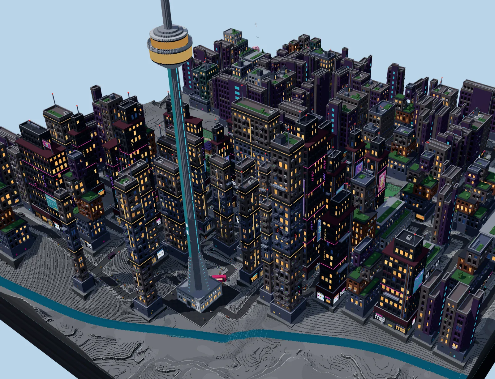 | 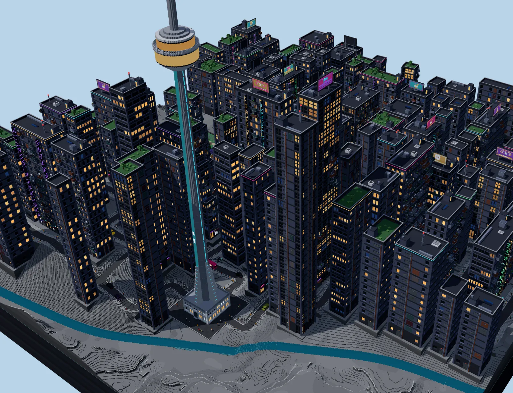 |
| 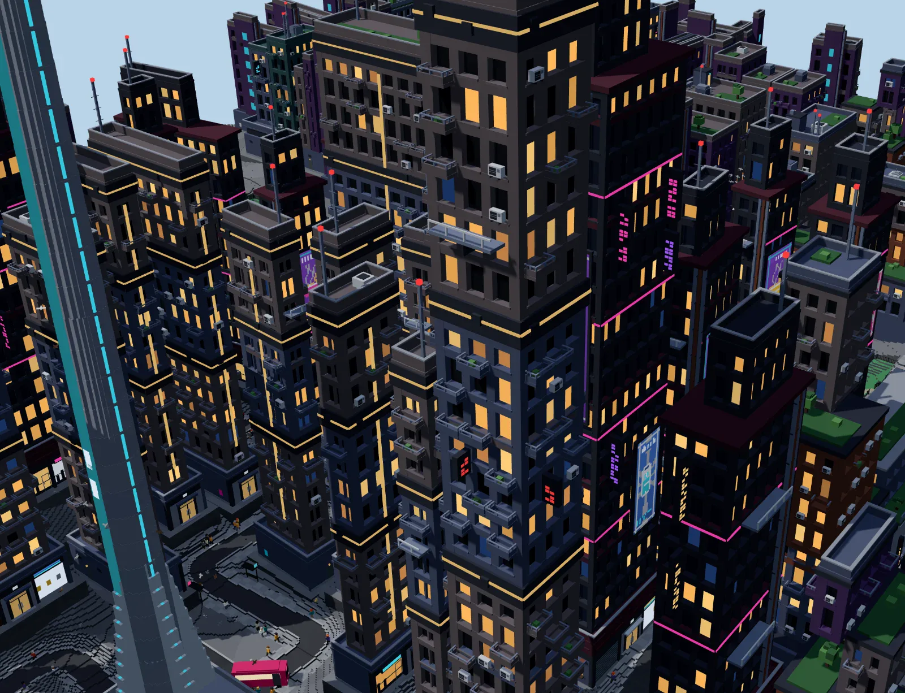 | 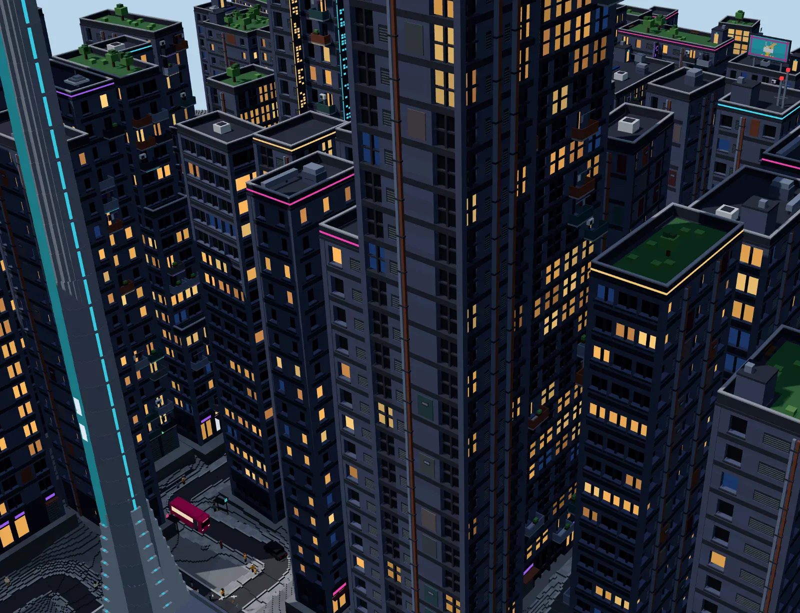 |

**Speed:**
- **Building:** `blueprint` builds all 107 lots in 125 ms, where the library's `fitBuilding` took
  about 1.1 s (it tries up to ten body sizes per lot). So `setBuildings` keeps its 10 ms-per-frame
  loop and needs no workers.
- **Vertices:** 2.77M, against the library's 1.83M.
- **Drawing:** one frame costs the same either way, by the time from a frame's start to the GPU
  finishing it: a median of 8.1 ms and a 90th percentile of about 10 ms on `blueprint`. The
  browser pane was hidden, so its own frame rate was throttled and not measured.

## 2026-11-16: Zones drive the grammar

The plan's M2 ([grammar-city-plan.md](../../../docs/plans/grammar-city-plan.md) §1.5): each
district now weights its lots' draws, so the assignment's "building types by zones" shows in the
city itself.

`drawCityGrammar` (`buildings/lotGrammar.ts`) takes Simulation's size-and-tier draw, then the
district's weights from a stream of their own:

| District | What it weights |
|---|---|
| Core | Glass windows, few balconies, helipads (on roofs big enough), bands and caps, signs mostly on avenues |
| Commercial | Shops on every ground bay, a 5–6 m ground floor, signs on 30–50% of the front, billboards, neon bands |
| Megablock | Balconies 0.3–0.55 where the clearance allows, more lit windows, gear and gardens, no crown |
| Industrial | Service bays up the walls and opening the ground floor, few shops, ribbon windows, few lights, full gear |
| Wealthy | Wide bays, no signs, a ground floor of windows and doors, Stepped more often, gardens and caps |

**The frontage:**
- **Avenues:** an avenue lot gets shops and a 5–6 m ground floor whatever its district. A taller
  ground floor takes its height from the top floors, so the top floor stays within the limit.
- **Corners:** a corner lot's side on its cross street is a second street front, with the front's
  ground floor and signs. It also gets up to 1.5 m of clearance, as the front does. The terrain now
  records which side that is (`Lot.cornerSide`).

The grammar takes these as an optional `GrammarStyle`: the bay weights, the ground floor's first
slot, the sign range and cap, and the corner side. With none it builds as before. The same 400
buildings from `/grammar` and Simulation still hash the same.

**Commercial's sign cap.** At first commercial lots averaged 0.3 signs each. The grammar caps signs
at 30% of a front's columns, and the city's three- and four-bay fronts round that down to none.
Commercial now has its own cap of 50%, which gives one sign per building on average.

**Checked** on six seeds at Center height 140 and 200 m, and on three of them at every Lot size and
40 m:
- no vertex past its room, and no clashes;
- every top floor within its limit;
- flicker at most 0.19 m², under the library's 0.5 m²;
- the corner side faces paving on 124 of 125 corner lots at Center height 140. The one left
  (`blueprint` lot 50) is a true corner: its cross street runs only along the back half of its
  side, past where the check looked.

Across the six seeds at 140 m:

| District | Buildings | Glass windows | Signs each | Ground bays that are shops | Balconies each | Lit windows | Crowned |
|---|---|---|---|---|---|---|---|
| Core | 67 | 54% | 0.2 | 77% | 3.3 | 49% | 81% |
| Commercial | 96 | 0% | 1.0 | 87% | 5.4 | 50% | 63% |
| Megablock | 188 | 0% | 0.1 | 75% | 13.9 | 54% | 0% |
| Industrial | 10 | 0% | 0 | 10% | 0.5 | 24% | 10% |

Wealthy lots don't appear on any of 20 seeds tried, so its weights are untested in the city.

Most lots are 8 m wide, so many roofs are too small for a billboard (11 m) or a helipad. Those
fall back to gear: 18 of 96 commercial roofs carry a billboard, and 3 of 67 core roofs a helipad.

| `blueprint` with zones (same camera as above) | The Districts ground color |
|---|---|
| 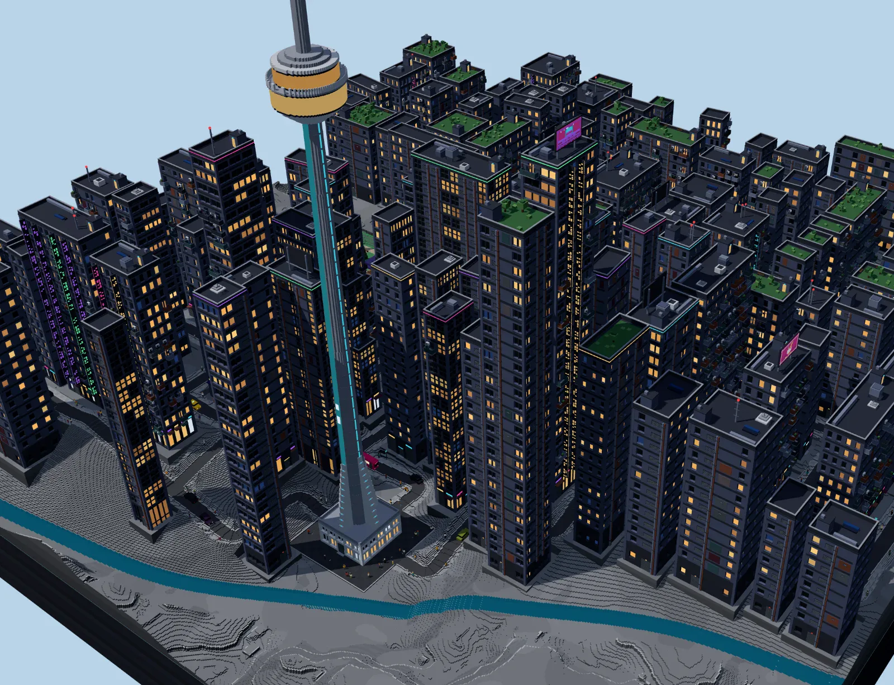 | 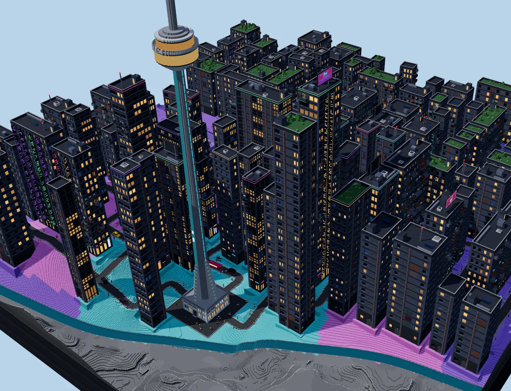 |

## 2026-11-16: Denser lots and party walls

The city's buildings stood apart: each kept 0.5 m of its lot clear on every side, and lots kept a
1 m alley on every side too. So a street front read as a row of towers with slots between them,
and footprints covered under two thirds of each lot. Three changes close the gaps:

- **Party walls between lots** (`terrain/districts.ts`): lots side by side now share an edge
  (`SIDE_ALLEY` is 0). The 1 m alley stays only behind lots, where back meets back.
- **Deeper lots:** a lot deepens up to `LOT_DEEPEST` (40 m) rather than its district's depth, still
  stopping halfway to the street behind the block. Then a new backfill step (6b) lets every lot
  but a through lot grow on into free land behind it, while the ground stays within its step and
  no paving or other lot lies within an alley behind it. So a block whose far side got no lots
  (a slope, a bend) fills from the side that did.
- **Party walls in the building** (`city/placement.ts`): a grammar building's room is now its whole
  lot. Its sides stand `PARTY_WALL` (0.25 m) in from the lot's side edges, a hairline that keeps
  neighbors apart where lots fan out on a curve. Its back is on the lot's back edge. The front
  keeps up to 1.5 m for awnings, signs and balconies, and so does a corner lot's cross-street
  side. The library's buildings keep their 0.5 m all round.

On `blueprint` (Center height 140 m, Lot size 8 m):

| | Before | After |
|---|---|---|
| Lot area | 17,317 m² | 19,089 m² |
| Footprints | 10,969 m² | 15,420 m² |
| Footprints / lot area | 63% | 81% |
| Footprints / district land | 28% | 40% |

`harbor` and `alpha` come out at 84% and 82% of lot area. Most free land left within 10 m of a
street is the thin strip between a verge and its lots' fronts. Most of `harbor`'s is more than
40 m from any street, which needs streets, not lots.

**Checked** on four seeds, every Lot size and Center height 40, 140 and 200 m:
- no vertex past its room, no clashes, no flicker, every top floor within its limit;
- no two buildings' bodies overlap. On `delta` at the 6 m Lot size, two rooms reach up to 0.63 m²
  into a neighbor's body where lots fan inward on a curve, so a pipe or AC unit there would sit
  inside the next wall;
- `/grammar` and Simulation still hash the same.

`blueprint` makes 3.1M vertices (2.8M before) and builds in about 150 ms. A frame's render takes
1.8 ms.

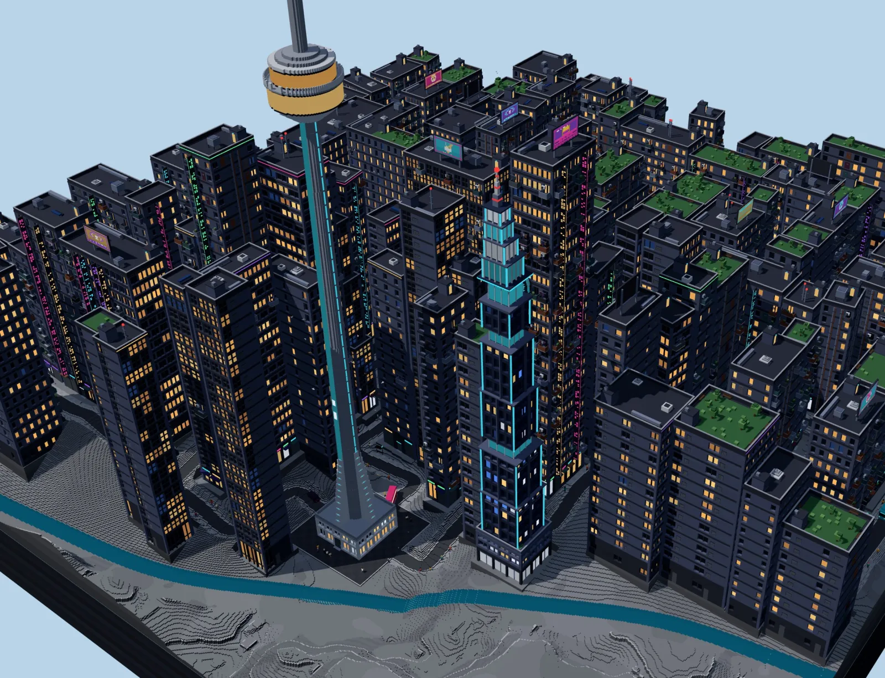

## 2026-11-16: Buildings at the people's scale

People are drawn to the scale of the streets, not to life (`render/life.ts`): a person is about
1.3 m, standing in for one of about 1.75 m. The buildings were drawn at full size, so a 3 m storey
stood more than two people tall, a window as tall as a person and a door half again taller.

`scale.ts` now has `FIGURE_SCALE` (0.75), the people's scale, and the city's buildings are drawn
at it:
- **How:** each lot's building is built at full size and the finished model is scaled by 0.75
  (`scaleModel` in `city/placement.ts`): every vertex, its sizes and its parts' boxes. So every
  rule and part keeps its exact proportions. Scaling each size on its own instead rounded them to
  the quarter-voxel grid and made parts run into each other.
- **Fit:** the grammar is given the lot, its room and the zoning height at full size (each over
  0.75), so the scaled model fills the same footprint and stops under the same height limit. A
  storey is now drawn 2.25 m, about 1.75 people tall, as a 3 m storey is to a real person. The
  same height holds a third more floors.
- **Which buildings:** the grammar buildings and the Corporate Megatower. The library builds to
  200 m at most, so a Megatower over 150 m comes out 150 m. The Landmark stays at full size, the
  city's monument.
- `/grammar` and Simulation have no people and are unchanged: their 400 buildings still hash the
  same.

**Checked** on four seeds, Lot size 6, 8 and 12 m, and Center height 40, 140 and 200 m:
- no vertex past its room, no clashes, no balcony out, and every top floor within its limit;
- flicker at most 0.63 m² in a whole city;
- no two buildings' bodies overlap.

`blueprint` at 140 m makes 5.8M vertices (3.1M before): more floors, and more bays across each
front. A frame's render still takes about 1 ms.

| Before (full size) | After (the people's scale), the same camera |
|---|---|
| 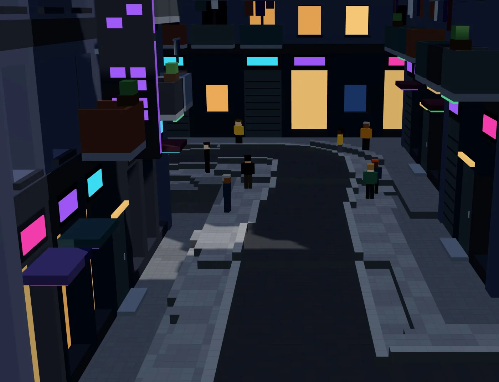 | 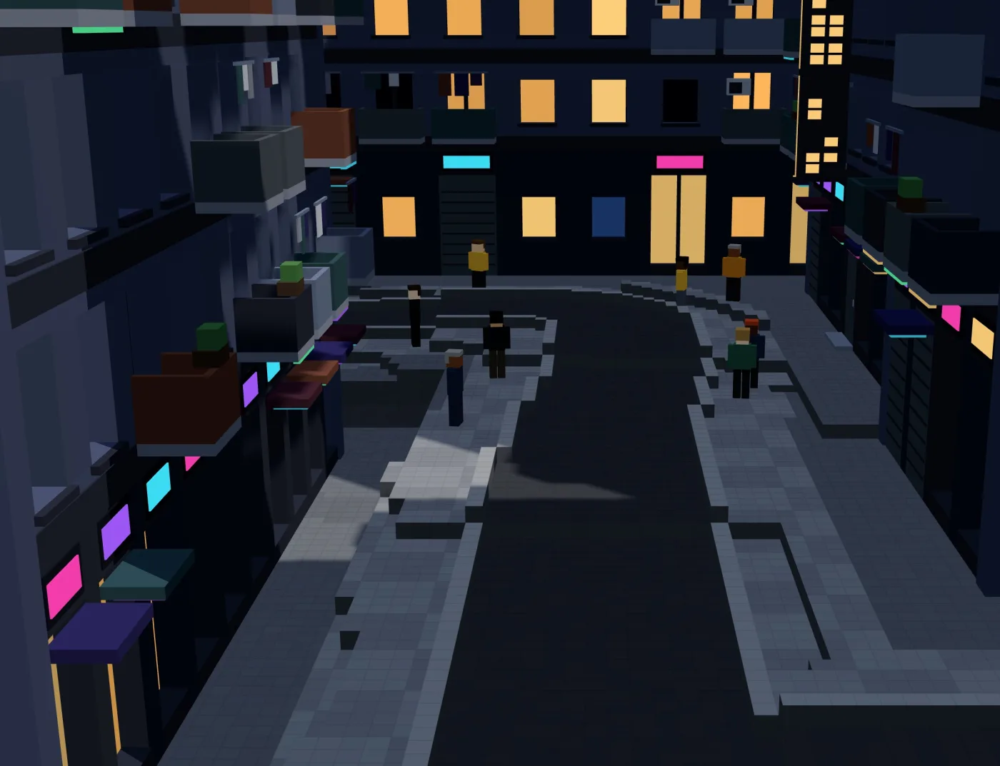 |

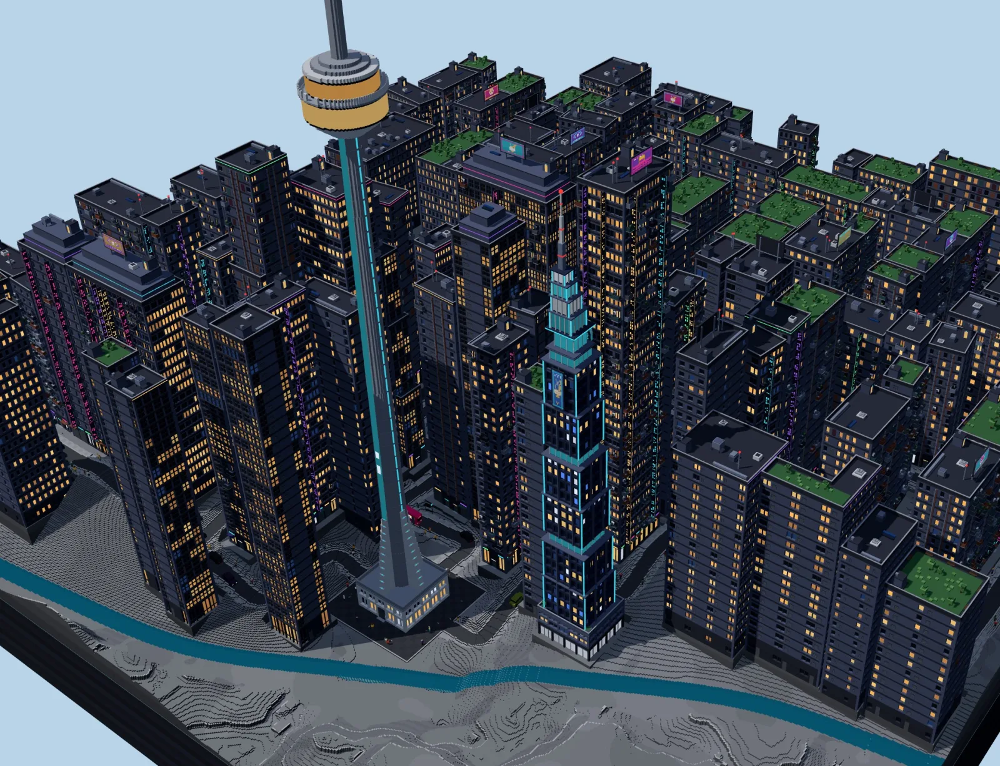

## 2026-11-17: The Landmark and shop fronts at the people's scale

Two places still read too big beside the people:
- **The Landmark's base:** it was left at full size, so its door stood more than two people tall
  and its windows taller than a person. It is now built at full size and drawn at FIGURE_SCALE
  too, from its footprint, room and height each over 0.75. It still stands 170 m on an 18 m
  footprint, the tallest in the city. For this the library now takes heights up to 270 m (200 m
  over 0.75), so the Corporate Megatower is no longer held to 150 m.
- **Commercial ground floors:** commercial and avenue lots drew a 5–6 m ground floor, so their
  shop windows stood about two and a half people tall. They now draw 4.75–5.25 m at full size,
  so the shop windows stand about two people tall.

Checked on four seeds at Center height 40, 140 and 200 m: the grammar rules still all hold, the
Landmark and the Megatower have the same part clashes as at full size (none and 2), and
`/grammar` and Simulation still hash the same.

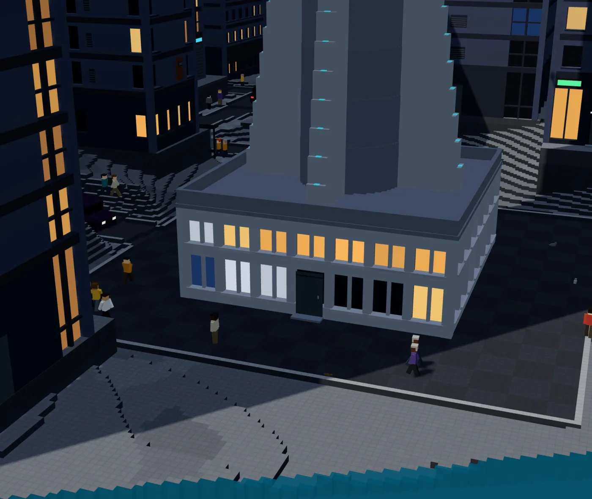

## 2026-11-17: The city as a simulation: homes, jobs and waste

Class 09's second assignment asks whether the city runs as a simulation: inhabitants, resource
flows, and agents performing tasks across the roads and buildings. Blueprint City had the
inhabitants but no schedule and no resources. Now it runs as a steady loop, with no clock: every
rule is a state, a rate per second or a stay of so many seconds, so at any moment the city is
somewhere in every part of its loop (`docs/plans/city-simulation-plan.md`).

**Homes and jobs** (`life/city.ts`, `life/agents.ts`):
- Every grammar building has a role from its district: megablock and wealthy lots are homes; core,
  commercial and industrial lots are jobs. Each person has a home and a job; the job is picked by
  its places, the home near it.
- Each person goes round a cycle of their own: at home (60–150 s), the commute (on foot, by bus or
  by taxi), working (a shift of 75–150 s, half of them with a break), then out (the needs machine,
  as before) and home. Everyone starts at a random point of it, so there is no rush hour.
- Indoors now means inside a known building: a person comes out of the same door they went in.
- The inspector shows a person's home, job and step of the cycle, and how long until the next.

**Waste** (`life/waste.ts`, pure, its books kept once a second; bins and piles few on purpose):
- **Bins:** one to each group of about six neighboring doors, on the curb nearest them: 18 on
  `blueprint`. A bin fills by who is inside its buildings (shops half as fast again), from empty
  to full in about ten minutes.
- **Garbage trucks**, a new vehicle (`life/traffic.ts`): two or three, each with its side of the
  city. A truck waits in the depot, off the road, until a bin on its side is past half; then it
  empties the fullest bins one by one, hauls the load to the incinerator, unloads, and goes out
  again or back into the depot. The inspector shows its task and its load ("0.7 of 4 bins").
- **The incinerator** is the tallest industrial building; `blueprint` has no industry, so it is
  the building farthest from the plaza. A concrete chimney with two red bands rises from it
  (`buildings/chimney.ts`).
- **A missed bin**, full for 90 s, spills a pile of bags beside it (at most six in the city). The
  nearest flock of pigeons takes the pile for its roost, and goes home once a truck clears it.

**Seeing it:**
- **Ground color → Waste** tints every building by the bin it shares with its neighbors, green
  (empty) through yellow to red (full); a tint uniform per building (`buildings/print.ts`).
- **The selected agent's path ahead** (`life/ahead.ts`, `render/select.ts`): click any person,
  pigeon, cat or vehicle and a thin blue line runs from it along where it means to go, with a ring
  breathing slowly at its goal; where the goal is out of reach, the line fades out instead. Each
  agent works its path out from what it will actually do:
  - a person: down the field they are walking (their group's, then their building's own for the
    last steps), or straight to a seat or a vehicle's door; 30 m ahead;
  - a vehicle: along its segment and the segments it has planned (a taxi's or a truck's whole
    route, a car's next three turns, picked at random as before), stopping at its halt; 60 m
    ahead;
  - a cat: at its pigeon while it hunts, else straight on till its next turn or a wall;
  - a pigeon: to the spot it hops or lands on, or to its roost (or the pile it has taken for one)
    while it flies.
  The line is a flat strip a little off the ground (0.45 voxels wide for a person, 0.9 for a
  vehicle): a one-pixel line read too dark on the paving. A walker's path steps from column to
  column in its field, so it is rounded off before it is drawn. Nothing is kept between frames: the
  path is worked out for the one selected agent each frame. (It first drew a trail of dots where
  the agent had been, every vehicle's 120 m long, then dots ahead, which slid along with the agent
  and looked like loose voxels; the line ahead reads best, and a vehicle's is half that length.)

**Checked** on `blueprint`:
- over fifteen minutes with the trucks running, no bin spilled; the trucks burned about nine
  bins' worth;
- with the trucks taken away, the first pile spilled after about four minutes and six by the end,
  with flocks on four of them; with the trucks back, the piles were cleared in about six minutes;
- a step of the whole simulation: median 0.8 ms, at most 1.4 ms.

| The Waste ground color | A bus and the line of its way to the next stop |
|---|---|
| 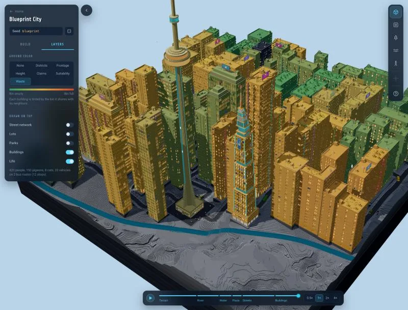 | 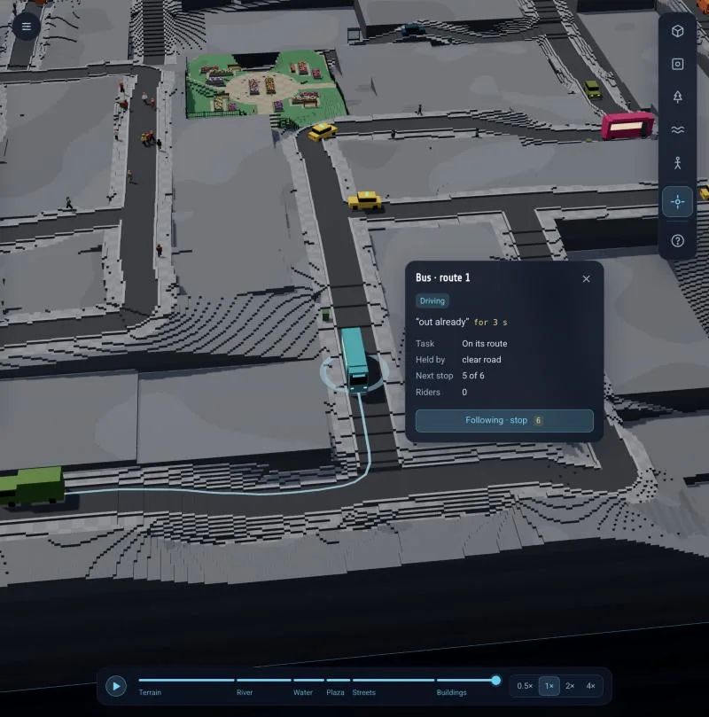 |

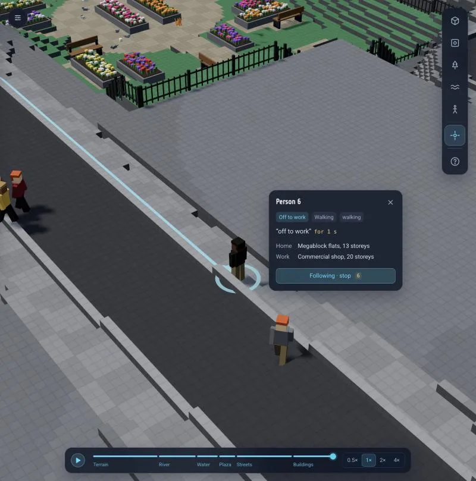

## 2026-11-18: The card closes when its agent goes out of sight

A selected agent that went out of sight (indoors, onto a bus or into a taxi, off the island, a
garbage truck into its depot) kept its card open, waiting at the top right with nothing to point
at. Now the selection lets go as soon as its agent can't be seen (`render/WorldView.ts`, each
frame, by `locate` in `render/select.ts`): the card closes, the ring and the path ahead go, and
the camera stops following. Hiding Life does the same. Checked on `blueprint`: a person selected
a few steps from their door, the card closed the moment they went in.

The card's words for agents out of sight are gone with it (`ui/Inspector.tsx`): "Riding the bus",
"Riding a taxi", "At home", "At work", "Off the island", "In the depot", and the next step from
home or work. A garbage truck's task on its way back reads "Back to the depot" (it said "At the
depot", which it only ever is out of sight).

E (hide the panels) no longer hides the card too (`index.tsx`): with the panels, the toolbar and
the timeline out of the way, the card stays with its agent. × or Escape still closes it.

## 2026-11-18: Street lamps

Town plan step 6 (`docs/plans/street-furniture-plan.md`), kept few on purpose. Each street is
walked with a slot every 24 m (`city/streetProps.ts`), each on the other side from the one
before, so on either side a lamp stands every 48 m. A slot stays empty off the verge, near a
junction or the plaza, near a lot's front middle (its door) or a park's way in, and where the
street steps. The plaza gets a lamp at each corner.

A lamp (`city/parkModels.ts`) is a post 4.2 m tall with an arm out over the road and a lantern,
glowing by district: amber in the homes, cyan in the core and the shops, warm white in industry.
The lamps are drawn as the parks' props are, in one solid and one glow mesh, and grow out of the
ground with them, outward from the plaza. People walk round them (`life/walk.ts`), and the bus
shelters, the bins and the taxis' fares keep clear of them (`life/traffic.ts`).

| Seed | Streets | Lamps | Planning |
|---|---|---|---|
| `blueprint` | 1.86 km | 37 | 5.8 ms |
| `8ahsrz` | 1.06 km | 27 | 4.8 ms |
| `neon7` | 0.86 km | 14 | 4.9 ms |
| `rust42` | 0.20 km | 6 | 3.9 ms |

On all four: no lamp off the verge or the plaza, none within 6 columns of a building's door or a
bus stop, or 3 columns of a bin, and no door's column blocked.


## 2026-11-18: Taxis come for the people who hail them

People leaving work stood at the curb with no taxi coming, and empty taxis drove past them. On
`blueprint`, timed over 120 s of the simulation, 3 of 27 people who hailed got a ride. The
causes, and what changed (`life/traffic.ts`, `life/agents.ts`, `index.tsx`):

- **Too few taxis for the hailing.** A taxi took about 85–150 s a trip (fetching 25–55 s,
  carrying 70–110 s), so 8 taxis made about 3–5 trips a minute against about 13 hails. Now there
  are 10 taxis, and someone takes a taxi only while more taxis are free (cruising, empty) than
  fares no taxi is coming for and people already on their way to the curb; otherwise they go by
  bus or on foot.
- **Giving up on a taxi on its way.** People gave up after 25 s even with a taxi coming, and the
  taxi turned back. Now, with one on its way, they wait up to 90 s longer for it.
- **Empty taxis passing.** A taxi only went to the fare it was sent to. Now a free taxi about to
  pass someone hailing (up to 22.5 m ahead on its lane, if it can brake in time) stops for them,
  and the taxi that was sent is free again. A taxi already on its way to someone else keeps going
  to them.
- **The nearest taxi by the road.** The taxi sent was the nearest in a straight line, often
  across a block and round a loop of one-way lanes; now it is the one with the shortest drive.
- **Curbs no taxi drives past.** A street cut off from the rest (part of the road graph of its
  own) had curbs to hail at but no taxi on it. Taxis now stay on the main part, and people walk
  only to the curbs beside it.

After the change, over 300 s with 14 taxis: on `blueprint` 18 of 23 hails got a ride (the rest
gave up waiting for a free taxi), on `neon7` 18 of 24, and an empty, free taxi drove past someone
hailing on its lane no more. 14 taxis crowded the streets, so the fleet went down to 10: on
`blueprint`, 9 rides in 300 s and 1 hail given up, as fewer take a taxi while none is free.

## 2026-11-18: The buses take their riders

No one rode the buses. On `blueprint`, over 300 s of the simulation, 14 people set off for a
bus and none got on: each waited 30 s at the shelter and walked on. Three causes, and what
changed (`life/traffic.ts`, `life/agents.ts`, `index.tsx`):

- **Buses drove past stops.** A bus halted at its route's stops in a fixed order, but the way
  from one stop to the next often runs along another stop's lane, and the bus drove past the
  people waiting there. Now a bus halts at the first of its route's stops it comes to from where
  it is (`toNextStop`).
- **Too long between buses.** A route's lap is about 8,700 voxels (2.2 km, round the lanes'
  one-way loops), some 10 min at a bus's pace, so with 2 buses a route a bus came every 5 min,
  and people waited 30 s. Now there are 4 buses a route.
- **Waiting by the clock, not for the bus.** Now someone at a shelter keeps waiting while a bus
  of the route is within 1,600 voxels of driving (about 2 min, `busDue`), up to 2 min longer than
  the 30 s; if none is that near when they get there, they walk on at once.

After the change, over 300 s: 58 people got on a bus on `neon7` (61 set off for one) and 20 on
`blueprint`, with up to 11 riders on a bus. Few take the bus on `blueprint` because few trips
there are long: most people live near their work.

Then more people take the bus: on a trip longer than 50 m, 60% look for one (35% before), and a
bus counts as going their way if the walks to its stop and from the one it takes them to add up
to less than 75% of the straight way (60% before; `BUS_SAVES`). Over 300 s, 36 people got on a
bus on `blueprint` (20 before) and 124 on `neon7` (58 before), where some buses run nearly full
(16 of 18 seats).


## 2026-11-18: The benches and vending machines get used

The parks' benches stood mostly empty and no one bought a drink. On `blueprint`, over 300 s of
the simulation, 34 people sat down and 0 used a vending machine. Three causes, and what changed
(`city/parks.ts`, `life/agents.ts`):

- **No vending machines.** A machine's pad was 1.2 m square round a column 2 columns from the
  path, so it always reached onto the path and was never placed. Now its pad is shaped like a
  bench's niche (the column, one either way toward and from the path, and the machine's width
  across), and every park gets one (only the parks that weren't gardens, 70% of them, before):
  near where a path comes in from the street if it can, else anywhere along a path clear of the
  benches, lamps and beds.
- **The time out ran out on the way.** A break is 30 s, and the nearest bench is often farther
  than that. Now the walk there doesn't count against the time out for its first 60 s
  (`OUT_WALK`).
- **One full bench sent people away.** The way to a seat leads to the nearest bench, and with
  both its seats taken people gave up. Now they walk on along the paths to the nearest bench with
  a free seat within 12 m (`SEAT_WALK`), on a small field round that bench made when first
  needed.

After the change, over 300 s: 74 people sat down on `blueprint` and 92 bought a drink; on `neon7`,
69 sat down (53 before the last change) and 77 bought a drink, and people giving up because
every seat was taken fell from 71 to 29.

## 2026-11-18: Fewer pigeons

There were too many pigeons: 150, shared among the flocks (one at the plaza and one at each park's
court), some 25 a flock on `blueprint`. Now there are 60 (`LIFE` in `index.tsx`), about 10 a
flock.

## 2026-11-18: The voxel look on everything

Only the ground read as voxels: its shader draws a line round every cube and tints each a
little, and nothing else had it. Now the buildings, the park props, the people, the animals and
the vehicles have it too (`render/voxelLook.ts`; M1 of `docs/plans/voxel-look-plan.md`). Their
shapes are unchanged.

- Each vertex carries where it lies on its own box's cubes (`aVoxel`), so a building turned to
  its lot or a walking person's swinging arm still shows cubes square to its own edges. A box is
  a whole number of cubes along each axis: voxels for a box a voxel or more every way, fine
  voxels (a quarter voxel, `FINE` in `buildings/kit.ts`) for smaller parts and for everything
  alive.
- The lines fade out where a cube covers fewer than about 4 pixels, as on the ground. The lights
  (lit windows, neon, signs, headlights) stay clean.
- Look › Grid sets the strength of both, the ground's and this.

## 2026-11-18: The plaza is a roundabout

Traffic jammed where the avenues meet the plaza: each ended there, and every vehicle turned
round at the plaza's edge, slowly, in the way of the next. Now, where two or more streets meet
the plaza, it is a roundabout (`life/traffic.ts`):

- **The ring.** A one-way lane round the Landmark, the Landmark on its left (keeping right),
  midway between it and the plaza's edge, round each corner on a curve about the Landmark's
  corner. The middle of each side is a junction, where the streets come on and off it.
- **As at any roundabout.** Those on the ring go first. One coming on from a street needs room
  for one more behind it, so the ring never fills (full, everyone on it would wait for everyone
  else). One whose way off has no room goes round again instead of standing on the ring.
- **Not for the big.** A bus (6 m) or a garbage truck (5 m) can't turn in the 3 m between the
  Landmark and the plaza's edge without cutting its corner: they turn round where a street meets
  the plaza, as before, and route without the ring.
- **Not for a street too short.** One whose lanes would be shorter than two vans between the
  plaza and its next junction keeps turning round at the plaza: two junctions that close each
  hold the other up. With fewer than two streets left to join it, there is no ring.
- **People meet elsewhere.** The plaza's chat circles stood on the ring; with a ring they are
  gone, and people meet at the parks' fountains and pavilions.

Over 900 s of the simulation, the share of the time vehicles within 22 m of the plaza stood
still:

| Seed | Before | After | Towed before → after |
|---|---|---|---|
| `blueprint` | 51% | 9% | 1 → 0 |
| `8ahsrz` | 66% | 40% | 12 → 11 |
| `neon7` | 29% | 29% (no ring: one street joins) | — |

No vehicle's body came inside the Landmark's footprint.

## 2026-11-18: The buildings on the grid

The buildings had the voxel look, but their boxes fell anywhere: a wall 20.3 voxels wide, a
frame standing 0.12 voxel proud of it. Now every box is on the grid (`buildings/kit.ts`), as the
ground is, so the lines drawn on them run on from box to box:

- **Masses on whole voxels.** Footprints, wings, storeys, ground floors and parapets are rounded to
  whole voxels (`whole()` in `buildings/grammar.ts`, `massing.ts` and `block.ts`).
- **Every box on fine voxels.** `Kit.box` and `Kit.light` move each face of a box to the nearest
  fine voxel (a quarter voxel); a box thinner than one is one thick. `PROUD`, the step a part
  stands out from a wall, is now one fine voxel (was 0.12 voxel).
- **One grid per building.** The cubes are counted from the building's own origin, not from each
  box's corner (`GeometryBuilder.grid`), so neighboring boxes' cubes line up.
- **No flicker from it.** Snapped to the grid, many details landed in the plane of the wall,
  frame or pane drawn before them: the flicker check (`findOverlaps`) went from 20 m² to 3,300 m²
  over the eleven archetypes × 8 seeds. So each face drawn is checked against the faces already in
  its plane, looking the same way, and where it overlaps one it is drawn a layer (0.02 voxel, about
  4 mm) in front of the frontmost it overlaps, at most five layers: the later part, the detail,
  shows. Now 70 m², nearly all of it slivers a layer wide along the sides of parts that moved out.

Building a building now takes about 6 ms instead of 2 (the layer check); the parts never run into
each other (`findClashes` stays at zero).

## 2026-11-18: Animals and vehicles as voxel models

The pigeons, cats, vehicles, bins, bag piles and bus shelters were a few smooth boxes each, of any
size. Now each is a small voxel model on the fine voxels (`render/voxelModel.ts`), as in a voxel
editor: boxes of cubes filled in, each cube with a color and a kind (paint, glass, a lit window).
At load, each kind is meshed once: only the faces no other cube covers, merged into as few
rectangles as the colors allow, with the cubes for the voxel look.

- **Pigeons** (3 × 8 fine voxels): wing bars, a green neck, pink feet, eyes and a beak. The wings
  are still their own part, to flap.
- **Cats** (3 × 11): a striped back, ears, eyes and a nose, the tail up behind.
- **Vehicles**: each in one model, the wheels (with a hub), bumpers and skirts shaded into the
  paint, and the glass. The bus's lit windows (with pillars between), door and destination sign
  come from the same model, so they sit in its sides instead of over them. The lights and the taxi
  sign stand a fine voxel out. The paint is matte now, as the ground is.
- **Bins** with a band, a lid, wheels and a handle; **bag piles** of three tied bags; **bus
  shelters** with posts, a canopy, a bench, the glass back and the sign.

A model's colors are multiplied by each one's own (a car's paint, a pigeon's gray), so they still
vary as before. The people stay as they are.

## 2026-11-18: Trees on whole voxels

The park props and street lamps were drawn with the building kit, so since the buildings went on
the grid they have been on fine voxels too. The plants were the odd ones out: each block snapped
to a quarter voxel and grown by its own hair, so they read as fine, smooth-ish blocks.

- **Each plant one set of cubes.** Tree crowns, lobes, trunks, conifer tiers and shrubs fill in
  whole voxels, at least one each way, in one `VoxelGrid` per plant (`voxelGrid.ts`, the core of
  the life models' `VoxelModel`), and only its outside is drawn, merged into rectangles. Drawn as
  overlapping boxes, the blocks' faces met in one plane: pushed a layer apart (M2) they showed as
  patches of another shade, and the hedges as a seam. Now there is nothing inside to show.
- **Hedges of whole voxels**: 4 deep, in blocks 3–6 long and 3–4 high, each with a lighter top
  layer.
- **Leaves read as cubes.** Leaves vary their shade per cube three times as much as anything else
  (`LEAFY`), carried as the fourth value of `aVoxel` to the voxel look's shader.
- **No speckle on whole voxels.** The shader picked each cube's shade from `floor()` of its cube
  coordinates; across a face lying exactly on a whole voxel, that coordinate wobbles round the
  whole number from pixel to pixel, so the shade flipped between the cubes on either side. It is
  rounded instead.

The flicker check is zero on every plant (8 seeds each); a tree is 50–140 quads.

## 2026-11-18: Checking the voxel look

The last step of the voxel look plan (`docs/plans/voxel-look-plan.md`): the street, a park and the
whole city on `blueprint` and `neon7`, and the frame against the city before the plan (6cf213d),
same camera, in the browser pane:

| View | Frame (median) | Draw calls | Triangles |
|---|---|---|---|
| Whole city, before | 21.6 ms | 465 | 6.40 M |
| Whole city, after | 19.7 ms | 389 | 6.40 M |
| Street, before | 16.7 ms | 308 | 4.34 M |
| Street, after | 16.6 ms | 252 | 4.35 M |

Everything on the grid costs nothing per frame: the cubes are drawn by the shader, not built as
geometry, and the voxel models merge their faces into rectangles. The lines fade out before a cube
gets smaller than a few pixels, so the whole city reads as flat color and nothing shimmers as the
camera moves.

## 2026-11-19: An interface pass

Week 9's feedback asked for navigation help and a clearer way to see the steps, so the interface got
a pass (no change to the city):

- **Size:** the overlay is drawn at 90% (`UI_SCALE`, was 80%), and small targets got bigger hit
  areas without changing how they look: the timeline's track and play button, its step names and
  the toggles.
- **Contrast:** the note color went from `#6f86a0` to `#8ba1b8` and the step names from 10 to 11 px;
  the hover bubbles blur and darken what is behind them. `DESIGN.md` records both.
- **Tour:** two new steps, the timeline (Space, click a step, drag to scrub) and the camera bar
  (keys 1 to 5); the card flips above a control when there is no room below it, and the last step
  says to fly to Street first.

## 2026-11-20: Hover reading on the ground (debug view, D1)

First step of `docs/plans/debug-view-plan.md`. Point at the ground and a card at the mouse reads
what the active ground color shows there:

| Ground color | The card reads |
|---|---|
| None, Waste | Height, slope (rise over run, and degrees), what owns the column |
| Claims | What owns the column, height, slope |
| Districts | The district, and the lot's number and area |
| Frontage | The lot's kind (avenue, side street, corner, through) and its front length |
| Height | The limit in meters and its tier |
| Suitability | The score for the city center (0 to 1) and whether it can be built on |

The card is `ui/Lens.tsx`; `WorldView.setHoverHandler` reports the column under the mouse, at most
once a frame. It goes away over an agent, a building or the sky, and while a button is down (so
dragging the camera never shows it). The ground height is the graded one, as drawn.

The debug view is off until asked for: key **D**, or the magnifier button on the camera toolbar
(lit while on). While it is off no card shows and nothing is read under the mouse. The shortcuts
sheet lists the key.

Opening it:

- **The world goes gray, spreading out from the plaza,** over about 0.6 s, with a faint, thin cyan line
  at the front of the wave; the camera does not move. Shared uniforms (`render/gray.ts`: `uGray`,
  how far the wave has got, and `uGrayCenter` and `uGrayReach`, the plaza's place on the screen and
  the distance to the farthest corner, set each frame by `WorldView.aimGray`) take the color out of
  the ground, the buildings, the people, the vehicles, the park props and the water, and make them
  a little darker, before the lenses' tints are applied; the sky eases to a darker gray. Lights
  (windows, signs) stay colored. With the Waste ground color the buildings are the lens, so nothing
  goes gray. Nothing is rebuilt.
- **It stays marked.** A cyan frame round the view and a badge at the top (`DebugMarks` in
  `ui/Lens.tsx`: a pulsing dot, "Debug view", and the key to leave) fade in as the sweep ends.
- **The left panel swaps.** Normally it shows only the Build settings, with no tab bar (the Layers tab and the "Build" tab heading are gone). In the debug
  view it shows the layers (ground color, drawn on top) in its place, with no heading, fading in, and opens if it was
  closed. D again brings Build back.

## 2026-11-20: The Agents lens (debug view, D2 and D3)

Next steps of `docs/plans/debug-view-plan.md`:

- **Agents,** a ground color of its own, colors the people, pigeons, cats and vehicles by what each
  is doing now, in five broad states (`life/states.ts`): Moving, Using or resting, Waiting, On a
  task, Alarmed. They are the only color left in the gray city (`GRAY.uKeepAgents`), and the legend
  is under the ground color in the panel.
- **Hover someone** and the card at the mouse says who they are, what they are doing and why (the
  Inspector's text, refreshed four times a second); a click still opens the Inspector.
- **The ground colors apply only in the debug view,** so out of it the city shows as it is.
- **The tour** has a step for the debug view; the shortcuts sheet lists D.
- **Cost:** none. At Street view, debug off and debug on with the Agents lens and the cursor moving
  the whole time are both 16.7 ms median (the display's rate), p95 about 25 ms.
